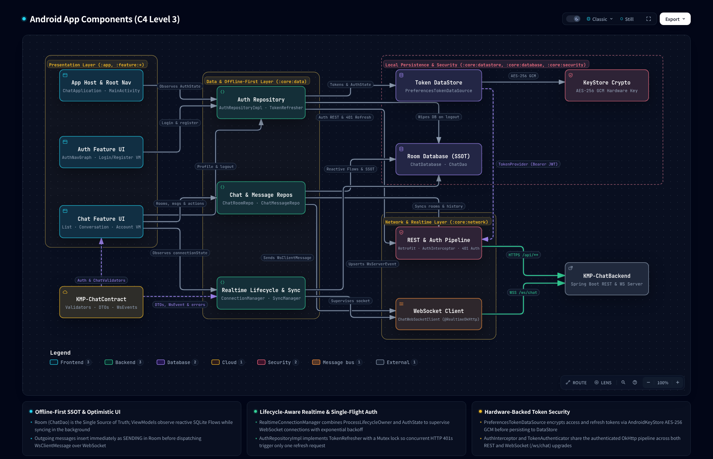

# Android-ChatApp Blueprint

## System Overview

Native Android client for the end-to-end chat project — built with Jetpack Compose, offline-first Room persistence, lifecycle-supervised OkHttp WebSockets, hardware-backed AndroidKeyStore token encryption, and compile-time contract sharing via `KMP-ChatContract`.

> **Architecture & Constitution**
> - Read the [Chat Project Constitution](../KMP-ChatContract/docs/CONSTITUTION.md) ([GitHub](https://github.com/neronguyen/KMP-ChatContract/blob/main/docs/CONSTITUTION.md)) and [Ecosystem Workflow](../KMP-ChatContract/docs/WORKFLOW.md) ([GitHub](https://github.com/neronguyen/KMP-ChatContract/blob/main/docs/WORKFLOW.md)) for the architectural principles and AI agent workflow rules governing this repository.
> - **Medium Series**: [Part 1 — End-to-End Type Safety: Sharing Pure Kotlin Contracts Between Android and Spring Boot](https://medium.com/@neronguyen/end-to-end-type-safety-sharing-pure-kotlin-contracts-between-android-and-spring-boot-part-1-8c45e3ab6720)

### Related Repositories

| Repository | Role | C4 Architecture Level | Tech Stack |
|:---|:---|:---|:---|
| **[KMP-ChatContract](https://github.com/neronguyen/KMP-ChatContract)** | Compile-time wire schema, error contracts, and shared validators | **Level 1** (System Context) & **Level 2** (Containers) | Pure Kotlin 2.4, `kotlinx.serialization`, `kotlinx-datetime` |
| **[KMP-ChatBackend](https://github.com/neronguyen/KMP-ChatBackend)** | Modular monolith REST & WebSocket server | **Level 3** (Backend Components) | Kotlin, Spring Boot 4, PostgreSQL, Redis (Redisson), RabbitMQ |
| **[Android-ChatApp](https://github.com/neronguyen/Android-ChatApp)** *(this repo)* | Native Android client with offline-first persistence and real-time sync | **Level 3** (Android Components) | Jetpack Compose, Navigation 3, Retrofit, OkHttp, Room, DataStore, Hilt, Arrow |

### Full-Stack End-to-End Demos

Recorded live against an API 37 AVD, local Spring Boot backend (`dev,e2e`), PostgreSQL, Redis,
RabbitMQ, and Mailpit (`adb reverse`):

#### 1. Direct Chat & Reconnect Catch-Up (`direct-chat`)

Recorded via `./scripts/e2e/record.sh --journey direct-chat` (`DirectChatE2ETest`): registration →
Mailpit 6-digit OTP verification → RabbitMQ peer discovery → bidirectional WebSocket messaging
(`SENDING` → `SENT` & inbound reply) → offline reconnect catch-up sync.

https://github.com/user-attachments/assets/6304cb6a-1222-4139-a0da-bc3c6934b073

#### 2. OTP Rejection & Recovery (`otp-recovery`)

Recorded via `./scripts/e2e/record.sh --journey otp-recovery` (`OtpRecoveryE2ETest`): registration →
Mailpit 6-digit OTP challenge → invalid OTP rejection via Redis (`retry_button` & error state) →
valid OTP recovery to login confirmation banner.

https://github.com/user-attachments/assets/341bd145-806b-4cf3-bfe1-92ad5a200105

### Android Component Architecture (C4 Level 3)

> **Interactive Architecture Viewers**:
> - **Level 3 — Android App Components (Local HTML)**: [`docs/architecture/interactive/c4-android-components.html`](docs/architecture/interactive/c4-android-components.html)
> - **Level 1 & Level 2 — System Context & Containers**: [`KMP-ChatContract/docs/architecture/`](https://github.com/neronguyen/KMP-ChatContract/tree/main/docs/architecture)

<picture>
  <source media="(prefers-color-scheme: dark)" srcset="docs/architecture/assets/AndroidComponents.png">
  <source media="(prefers-color-scheme: light)" srcset="docs/architecture/assets/AndroidComponents.light.png">
  
</picture>

## Subdirectories & System Boundaries

- [app](./app/README.md) - Application bootstrap, `MainActivity`, Hilt `Configuration.Provider`, and Navigation 3 root switcher.
- [sync:work](./sync/work/README.md) - Edge Android WorkManager consumer (`ChatSyncWorker`,
  `WorkManagerSyncSchedulerImpl`).
- [feature](./feature/README.md) - Root blueprint for presentation UI features.
  - [feature:auth](./feature/auth/README.md) - Login and registration UI flows (Jetpack Compose).
  - [feature:chat](./feature/chat/README.md) - Conversation, chat list, new chat, and account settings UI flows.
- [core](./core/README.md) - Root blueprint for data, domain, persistence, network, security, and UI foundations.
  - [core:data](./core/data/README.md) - Repositories, real-time sync coordinator, and WebSocket lifecycle manager.
  - [core:network](./core/network/README.md) - Retrofit HTTP clients, OkHttp authenticator, and WebSocket client.
  - [core:database](./core/database/README.md) - Room database (`ChatDatabase`, `ChatDao`), SQLite entities and relations.
  - [core:datastore](./core/datastore/README.md) - Encrypted Preferences DataStore for tokens and `AuthState`.
  - [core:security](./core/security/README.md) - Android KeyStore AES-256-GCM encryption manager.
  - [core:model](./core/model/README.md) - Pure Kotlin domain models and sealed error hierarchies.
  - [core:testing](./core/testing/README.md) - Test-only shared fakes and deterministic domain fixtures (`testImplementation` only).
  - [core:ui](./core/ui/README.md) - Shared design system, theme, and common Compose components.
  - [core:common](./core/common/README.md) - Coroutine dispatchers and application-scoped task management.
- [docs](./docs/README.md) - Unified C4 architecture, sequence/lifecycle/dataflow specifications,
  and EGM technical design registry.

## Global Invariants

- **Presentation Layer Isolation**: Presentation modules (`:feature:auth`, `:feature:chat`, `:core:ui`) interact exclusively with repository interfaces and pure domain models (`:core:model`), using shared validators (`:validation:*`) for form validation. They never depend on `:core:network`, `:core:database`, or wire DTOs.
- **Contract SSOT & Pure Serialization**: All network requests and WebSocket frames use `kotlinx.serialization.json.Json` with `KMP-ChatContract` models. Never introduce Gson, Moshi, or Jackson.
- **Offline-First SSOT**: Room SQLite (`ChatDatabase`) is the Single Source of Truth for conversation data. ViewModels observe reactive SQLite `Flow`s.
- **Optimistic Messaging**: Outgoing messages insert into Room with `SENDING` status before dispatching `WsClientMessage.NewMessage` over WebSocket, transitioning to `SENT` on server broadcast or `FAILED` on disconnect.
- **Lifecycle-Supervised Realtime Engine**: Reconnection uses exponential backoff with jitter (`RealtimeConnectionManagerImpl`), supervised by app foreground state and `AuthState`.

## Global Side Effects

- **Room SQLite Database**: Private on-device database storing rooms, messages, participants, and cross-references.
- **Preferences DataStore**: Private encrypted file storing authentication session tokens.
- **Android KeyStore**: Hardware-backed cryptographic keys for token encryption.
- **OkHttp WebSocket & HTTP**: Network connections to `/ws/chat` and backend REST APIs.
- **Android WorkManager**: Configured runtime for deferred background tasks and workers.

## System Verification (5-Layer Testing Pyramid)

Organized after
the [Android Scalable Testing Strategy](https://developer.android.com/training/testing/fundamentals/strategies):

1. **Unit**: Pure logic, data-to-domain mappers, and coroutine utilities (`*MapperTest`,
   `SingleFlightTest`, `ExponentialBackoffTest`).
2. **Component**: Headless Robolectric UI semantics (`*ScreenTest`), AGP Compose Preview screenshot
   regression suites (`*ScreenshotTest`), Room DAO (`ChatDaoTest`), and encrypted DataStore
   (`PreferencesTokenDataSourceTest`).
3. **Feature**: ViewModels (`*ViewModelTest`), repositories & real-time sync (`ChatSyncManagerTest`,
   `ChatRealtimeSyncManagerTest`), and MockWebServer wire tests (`RetrofitNetworkWireTest`,
   `ChatWebSocketClientTest`).
4. **Application (Static)**: Architectural boundary rules (`ArchitectureKonsistTest`), module
   dependency checks (`DataArchitectureTest`), and `lintDebug`.
5. **End-to-End (E2E)**: Full-stack AVD journeys (`DirectChatE2ETest`, `OtpRecoveryE2ETest`) against
   live Spring Boot + PostgreSQL, Redis, RabbitMQ, and Mailpit.

```bash
# Layers 1–4 — Selective inner-loop JVM feedback on affected modules
./scripts/verify.sh

# Layers 1–4 — Full pre-merge clean gate (Unit, Robolectric UI, Compose Screenshots, Konsist & Lint)
./scripts/verify.sh clean

# Layer 5 — Full-stack AVD + Spring Boot + Docker Compose E2E
./scripts/e2e/verify.sh --journey all
./scripts/e2e/record.sh --journey direct-chat
./scripts/e2e/service.sh status
```
