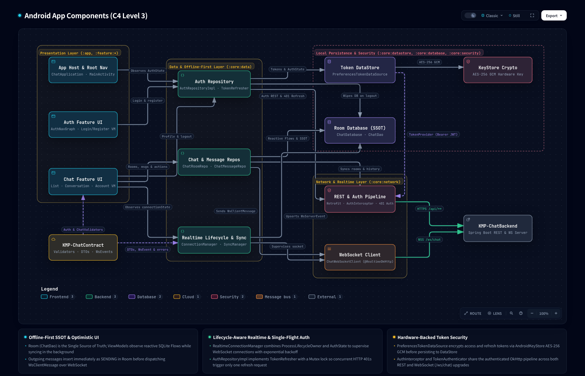

# Android-ChatApp Blueprint

## System Overview

Native Android client for the end-to-end chat project — built with Jetpack Compose, offline-first Room persistence, lifecycle-supervised OkHttp WebSockets, hardware-backed AndroidKeyStore token encryption, and compile-time contract sharing via `KMP-ChatContract`.

> **Architecture & Philosophy**
> - Read the [Chat Project Philosophy](../KMP-ChatContract/docs/PHILOSOPHY.md) ([GitHub](https://github.com/neronguyen/KMP-ChatContract/blob/main/docs/PHILOSOPHY.md)) for the architectural principles and AI agent governance rules governing this repository.
> - **Medium Series**: [Part 1 — End-to-End Type Safety: Sharing Pure Kotlin Contracts Between Android and Spring Boot](https://medium.com/@neronguyen/end-to-end-type-safety-sharing-pure-kotlin-contracts-between-android-and-spring-boot-part-1-8c45e3ab6720)

### Related Repositories

| Repository | Role | C4 Architecture Level | Tech Stack |
|:---|:---|:---|:---|
| **[KMP-ChatContract](https://github.com/neronguyen/KMP-ChatContract)** | Compile-time wire schema, error contracts, and shared validators | **Level 1** (System Context) & **Level 2** (Containers) | Pure Kotlin 2.4, `kotlinx.serialization`, `kotlinx-datetime` |
| **[KMP-ChatBackend](https://github.com/neronguyen/KMP-NeroChatBackend)** | Modular monolith REST & WebSocket server | **Level 3** (Backend Components) | Kotlin, Spring Boot 4, PostgreSQL, Redis (Redisson), RabbitMQ |
| **[Android-ChatApp](https://github.com/neronguyen/Android-NeroChatApp)** *(this repo)* | Native Android client with offline-first persistence and real-time sync | **Level 3** (Android Components) | Jetpack Compose, Navigation 3, Retrofit, OkHttp, Room, DataStore, Hilt, Arrow |

### Android Component Architecture (C4 Level 3)

> **Interactive Architecture Viewers**:
> - **Level 3 — Android App Components (Local HTML)**: [`docs/architecture/interactive/c4-android-components.html`](docs/architecture/interactive/c4-android-components.html)
> - **Level 1 & Level 2 — System Context & Containers**: [`KMP-ChatContract/docs/architecture/`](https://github.com/neronguyen/KMP-ChatContract/tree/main/docs/architecture)

<picture>
  <source media="(prefers-color-scheme: dark)" srcset="docs/architecture/assets/AndroidComponents.png">
  <source media="(prefers-color-scheme: light)" srcset="docs/architecture/assets/AndroidComponents.light.png">
  
</picture>

## Subdirectories & System Boundaries

- [app](./app/README.md) - Application bootstrap, `MainActivity`, splash screen, and Navigation 3 root switcher.
- [feature](./feature/README.md) - Root blueprint for presentation UI features.
  - [feature:auth](./feature/auth/README.md) - Login and registration UI flows (Jetpack Compose).
  - [feature:chat](./feature/chat/README.md) - Conversation, chat list, new chat, and account settings UI flows.
- [core](./core/README.md) - Root blueprint for data, domain, persistence, network, security, and UI foundations.
  - [core:data](./core/data/README.md) - Repositories, real-time sync coordinator, and WorkManager sync engine.
  - [core:network](./core/network/README.md) - Retrofit HTTP clients, OkHttp authenticator, and WebSocket client.
  - [core:database](./core/database/README.md) - Room database (`ChatDatabase`, `ChatDao`), SQLite entities and relations.
  - [core:datastore](./core/datastore/README.md) - Encrypted Preferences DataStore for tokens and `AuthState`.
  - [core:security](./core/security/README.md) - Android KeyStore AES-256-GCM encryption manager.
  - [core:model](./core/model/README.md) - Pure Kotlin domain models and sealed error hierarchies.
  - [core:ui](./core/ui/README.md) - Shared design system, theme, and common Compose components.
  - [core:common](./core/common/README.md) - Coroutine dispatchers and application-scoped task management.
- [docs/architecture/flows](./docs/architecture/flows/README.md) - Android-specific flow specifications and status registry.
- [docs/designs](./docs/designs/SITEMAP.md) - Design document index.

## Global Invariants

- **Presentation Layer Isolation**: Presentation modules (`:feature:auth`, `:feature:chat`, `:core:ui`) interact exclusively with repository interfaces and pure domain models (`:core:model`), using shared validators (`:validation:*`) for form validation. They never depend on `:core:network`, `:core:database`, or wire DTOs.
- **Contract SSOT & Pure Serialization**: All network requests and WebSocket frames use `kotlinx.serialization.json.Json` with `KMP-ChatContract` models. Never introduce Gson, Moshi, or Jackson.
- **Offline-First SSOT**: Room SQLite (`ChatDatabase`) is the Single Source of Truth for conversation data. ViewModels observe reactive SQLite `Flow`s.
- **Optimistic Messaging**: Outgoing messages insert into Room with `SENDING` status before dispatching `WsClientMessage.NewMessage` over WebSocket, transitioning to `SENT` on server broadcast or `FAILED` on disconnect.
- **Lifecycle-Supervised Realtime Engine**: Reconnection uses exponential backoff with jitter (`RealtimeConnectionManagerImpl`), supervised by app foreground state and `AuthState`.

## Global Side Effects

- **Room SQLite Database**: Private on-device database storing rooms, messages, participants, and cross-references.
- **Preferences DataStore**: Private encrypted file storing authentication session tokens.
- **Android KeyStore**: Hardware-backed cryptographic keys for token encryption.
- **OkHttp WebSocket & HTTP**: Network connections to `/ws/chat` and backend REST APIs.
- **WorkManager**: Background jobs (`ChatSyncWorker`) for periodic catch-up sync.

## System Verification

```bash
# Fast cached unit tests (Tier 1 - Inner loop)
./scripts/verify.sh fast

# Full clean verification gate (Tier 2 - Pre-commit)
./scripts/verify.sh clean

# Direct Gradle commands
./gradlew testDebugUnitTest
./gradlew assembleDebug
```
