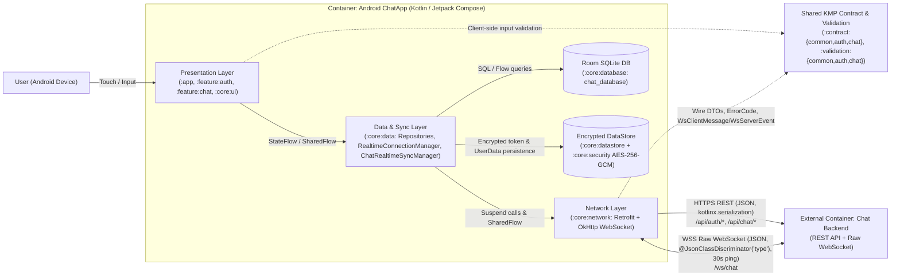

# Baseline Audit — Android (`Android-ChatApp`)

- **Date**: `2026-11-02`
- **ROLE**: `android`
- **Repository**: `/home/nero/Projects/Android-ChatApp` (`rootProject.name = "ChatApp"` at `settings.gradle.kts:83`)
- **Git Commit Hash**: `157ee4d024042622453639c2f2ef20b076c9f9d0`
- **Git Branch**: `main`
- **Working Tree Clean**: `yes` (`git status --porcelain` returned empty output, exit code `0`)

---

## 1. Module Map & Boundaries

### 1.1 Module Inventory & Declared Dependencies

The repository declares **11 Gradle subprojects** in `settings.gradle.kts:85-96`.

| Module | Gradle Plugin(s) | Internal Project Dependencies (`implementation`) | External Contract / Validation Dependencies | Key Third-Party Libraries | Evidence |
|---|---|---|---|---|---|
| `:app` | `android.application`, `kotlin.compose`, `kotlin.serialization`, `ksp`, `hilt` | `:feature:auth`, `:feature:chat`, `:core:model`, `:core:data`, `:core:network`, `:core:security`, `:core:datastore`, `:core:ui` | *(Transitive via `:core:network` `api(...)`)* | Compose BOM (`2026.03.00`), Navigation 3 (`1.0.1`), Hilt (`2.59.2`), Splashscreen (`1.2.0`), Robolectric (`4.16.1`, `testImplementation`) | `app/build.gradle.kts:1-84` |
| `:feature:auth` | `android.library`, `kotlin.compose`, `kotlin.serialization`, `ksp`, `hilt` | `:core:model`, `:core:data`, `:core:ui` | `implementation(libs.validation.auth)` (`io.github.neronguyenvn.nerochat.validation:auth`) | Compose Material3, Navigation 3 (`runtime`, `ui`), Lifecycle ViewModel Compose, Hilt Navigation Compose | `feature/auth/build.gradle.kts:1-50` |
| `:feature:chat` | `android.library`, `kotlin.compose`, `kotlin.serialization`, `ksp`, `hilt` | `:core:model`, `:core:data`, `:core:ui` | `implementation(libs.validation.chat)` (`io.github.neronguyenvn.nerochat.validation:chat`) | Compose Material3, Navigation 3 (`runtime`, `ui`), Lifecycle ViewModel Compose, Hilt Navigation Compose, `kotlinx-datetime` (`0.7.1`) | `feature/chat/build.gradle.kts:1-50` |
| `:core:data` | `android.library`, `ksp`, `hilt` | `:core:model`, `:core:common`, `:core:network`, `:core:datastore`, `:core:database` | *(Transitive via `:core:network` `api(...)`)* | `androidx.lifecycle.process`, `kotlinx-coroutines-android`, `kotlinx-datetime`, Turbine (`1.2.1`, test) | `core/data/build.gradle.kts:1-46` |
| `:core:network` | `android.library`, `kotlin.serialization`, `ksp`, `hilt` | `:core:common` | `api(libs.contract.common)`, `api(libs.contract.auth)`, `api(libs.contract.chat)` | Retrofit (`3.0.0`), `converter-kotlinx-serialization`, OkHttp (`5.3.2`), `logging-interceptor`, `kotlinx-serialization-json` (`1.10.0`), `kotlinx-datetime` | `core/network/build.gradle.kts:1-64` |
| `:core:database` | `android.library`, `ksp`, `hilt` | `:core:model` | None | Room (`2.8.4`: `runtime`, `ktx`, `compiler`), `kotlinx-datetime` | `core/database/build.gradle.kts:1-40` |
| `:core:datastore` | `android.library`, `kotlin.serialization`, `ksp`, `hilt` | `:core:model`, `:core:common`, `:core:security` | None | `androidx.datastore:datastore-preferences` (`1.2.1`), `kotlinx-serialization-json`, Hilt | `core/datastore/build.gradle.kts:1-42` |
| `:core:security` | `android.library`, `ksp`, `hilt` | None | None | Android KeyStore (`java.security.KeyStore`, `javax.crypto.Cipher`), Hilt | `core/security/build.gradle.kts:1-36` |
| `:core:ui` | `android.library`, `kotlin.compose` | `:core:model` | None | Compose BOM (`2026.03.00`), Material3, Google Fonts, `kotlinx-datetime` | `core/ui/build.gradle.kts:1-45` |
| `:core:model` | `kotlin.jvm`, `kotlin.serialization` | None | None | `kotlinx-serialization-json` (`1.10.0`), `kotlinx-datetime` (`0.7.1`) | `core/model/build.gradle.kts:1-18` |
| `:core:common` | `kotlin.jvm`, `ksp` | None | None | `kotlinx-coroutines-core` (`1.10.2`), `hilt-core` (`2.59.2`) | `core/common/build.gradle.kts:1-19` |

### 1.2 Intended Dependency Direction

Per `README.md:33-53` and `docs/architecture/specifications/android-components.archify.json:27-350`:
```text
:app
 ├──> :feature:auth ──> :core:ui, :core:data, :core:model, :validation:auth
 ├──> :feature:chat ──> :core:ui, :core:data, :core:model, :validation:chat
 └──> :core:data ─────> :core:network (──> :contract:{common,auth,chat})
                  ├───> :core:database ──> :core:model
                  ├───> :core:datastore ──> :core:security, :core:model, :core:common
                  └───> :core:model, :core:common
```
- **Presentation (`:feature:auth`, `:feature:chat`, `:core:ui`)** should depend only on domain models/interfaces (`:core:model`, `:core:data` repository interfaces) and shared client-side input validators (`:validation:*`), never on `:core:network`, `:core:database`, `:core:datastore`, or wire DTOs (`:contract:*`).
- **Data (`:core:data`)** should orchestrate `:core:network`, `:core:database`, and `:core:datastore`, mapping wire DTOs and database entities into pure domain models (`:core:model`).

### 1.3 How the Contract Repo Is Consumed

- **Artifact Coordinates & Version Pin** (`gradle/libs.versions.toml:13,52-58`):
  - `contract = "0.3.1"` (`gradle/libs.versions.toml:13`)
  - `io.github.neronguyenvn.nerochat.contract:common:0.3.1`
  - `io.github.neronguyenvn.nerochat.contract:auth:0.3.1`
  - `io.github.neronguyenvn.nerochat.contract:chat:0.3.1`
  - `io.github.neronguyenvn.nerochat.validation:common:0.3.1` *(declared in `libs.versions.toml:56`, brought in transitively by `validation:auth` and `validation:chat`)*
  - `io.github.neronguyenvn.nerochat.validation:auth:0.3.1`
  - `io.github.neronguyenvn.nerochat.validation:chat:0.3.1`
- **Resolution Mechanism** (`settings.gradle.kts:26-72`):
  1. **Composite Build (Active Default Locally)**: `settings.gradle.kts:49-72` checks `val useLocalContract = providers.gradleProperty("useLocalContract").orNull != "false"` and `val localContractDir = file("../KMP-ChatContract")`. When `../KMP-ChatContract` exists on disk (which is true in this workspace), Gradle executes `includeBuild(localContractDir)` and substitutes all 6 `io.github.neronguyenvn.nerochat.{contract,validation}:*` coordinates with `project(":contract:*")` and `project(":validation:*")`.
  2. **Maven Local**: `mavenLocal()` is registered at `settings.gradle.kts:30`.
  3. **GitHub Packages**: `https://maven.pkg.github.com/neronguyen/KMP-ChatContract` is registered at `settings.gradle.kts:31-40` with credentials read from `local.properties` (`gpr.user`/`gpr.key`) or environment variables (`GITHUB_ACTOR`/`GITHUB_TOKEN`).
- **Pinning Caveat**: While `gradle/libs.versions.toml:13` pins `contract = "0.3.1"`, the active composite build (`settings.gradle.kts:50-71`) unconditionally overrides version `0.3.1` with whatever working tree is checked out in `../KMP-ChatContract` unless `-PuseLocalContract=false` is passed.

### 1.4 Proved Boundary Violations

1. **`:core:network` leaks `:contract:*` wire types via `api(...)` across module boundaries**
   - **Evidence**: `core/network/build.gradle.kts:54-56` declares `api(libs.contract.common)`, `api(libs.contract.auth)`, and `api(libs.contract.chat)`. Because `:app` depends on `implementation(project(":core:network"))` (`app/build.gradle.kts:61`) and `:core:data` depends on `implementation(project(":core:network"))` (`core/data/build.gradle.kts:34`), all wire DTOs (`UserDto`, `ChatRoomDto`, `WsClientMessage`, `WsServerEvent`, `ApiErrorDto`) are transitively exported to `:core:data` and `:app` instead of `:core:data` declaring explicit `implementation(libs.contract.*)` dependencies.
2. **`:core:data` exposes `public` mapper extension functions referencing `:core:database` entities, `:core:network` socket state, and `:contract:chat` wire DTOs**
   - **Evidence**: In `core/data/src/main/kotlin/io/github/neronguyen/chat/core/data/mapper/ChatMapper.kt:28-147`, all 8 mapper functions (`fun ChatParticipantDto.toDomain()`, `fun ChatParticipantDto.toEntity()`, `fun ChatParticipantEntity.toDomain()`, `fun ChatMessageDto.toDomain()`, `fun ChatMessageDto.toEntity()`, `fun ChatMessageEntity.toDomain()`, `fun ChatRoomDto.toDomain()`, `fun ChatRoomDto.toEntity()`, `fun ChatRoomWithDetails.toDomain()`, `fun SocketConnectionState.toDomain()`) have `public` visibility (omitting the `internal` modifier used in `AuthMapper.kt:7,16`, `AuthErrorMapper.kt:8`, `ChatErrorMapper.kt:8`, and `DataErrorMapper.kt:9`). This leaks `:core:database`, `:core:network`, and `:contract:chat` types into `:core:data`'s public API surface consumed by `:feature:auth`, `:feature:chat`, and `:app`.
3. **`:core:model` (pure domain layer) uses `kotlinx.serialization` `@Serializable` and is directly coupled into `:core:database` Room entities**
   - **Evidence**: `core/model/build.gradle.kts:2,15` applies `libs.plugins.kotlin.serialization` and `libs.kotlinx.serialization.json`. `core/model/src/main/kotlin/io/github/neronguyen/chat/core/model/ChatRoomType.kt:5-6` annotates the domain enum `ChatRoomType` with `@Serializable`. Furthermore, `:core:database` (`core/database/build.gradle.kts:32`) depends on `:core:model` and embeds domain enums `ChatRoomType` and `MessageDeliveryStatus` directly as Room `@Entity` columns in `core/database/src/main/kotlin/io/github/neronguyen/chat/core/database/entity/ChatRoomEntity.kt:14` and `core/database/src/main/kotlin/io/github/neronguyen/chat/core/database/entity/ChatMessageEntity.kt:29`.
4. **`:app` depends directly on infrastructure modules (`:core:network`, `:core:security`, `:core:datastore`)**
   - **Evidence**: `app/build.gradle.kts:61-63` declares `implementation(project(":core:network"))`, `implementation(project(":core:security"))`, and `implementation(project(":core:datastore"))`. `:app` source files (`app/src/main/kotlin/io/github/neronguyen/chat/ChatApplication.kt:1-22`, `app/src/main/kotlin/io/github/neronguyen/chat/MainActivity.kt:1-66`) only import `:core:data`, `:core:model`, `:core:ui`, `:feature:auth`, and `:feature:chat`; the infrastructure modules are attached to `:app` solely for Hilt component aggregation.

---

## 2. Existing Tooling

### 2.1 Build, Test, Lint, and Codegen Configuration

- **Gradle Wrapper**: Gradle `9.3.1` (`gradle/wrapper/gradle-wrapper.properties:3`).
- **Build Configuration** (`gradle.properties:1-25`, root `build.gradle.kts:1-21`):
  - `org.gradle.caching=true` (`gradle.properties:16`)
  - `org.gradle.configuration-cache=true` (`gradle.properties:17`)
  - `kotlin.jvm.target.validation.mode=warning` (`gradle.properties:23`)
  - Compiler flag `-XXLanguage:+ContextParameters` injected across all Kotlin tasks (`build.gradle.kts:14-20`).
  - JVM toolchain / compile target: Java `21` across Android modules (`app/build.gradle.kts:35-38`, `core/network/build.gradle.kts:32-35`, etc.) and JVM `11` on pure Kotlin modules (`core/model/build.gradle.kts:11`, `core/common/build.gradle.kts:11`).
- **Linters / Static Analysis / Formatting**:
  - **Android Lint**: Built-in AGP lint tasks (`lint`, `lintDebug`, `lintRelease`, `lintFix`). No custom `lint.xml` or baseline files exist in the repo.
  - **ktlint / detekt / spotless / Konsist**: **None configured** (verified via `gradle/libs.versions.toml:1-105` and root `build.gradle.kts:1-21`).
- **Codegen**:
  - **KSP (`2.3.4`)**: Used for Hilt (`hilt-compiler` in `:app`, `:feature:auth`, `:feature:chat`, `:core:common`, `:core:data`, `:core:network`, `:core:database`, `:core:datastore`, `:core:security`) and Room (`androidx.room:room-compiler` in `:core:database/build.gradle.kts:39`).
- **CI / Custom Scripts**:
  - **CI Config**: **None** (`.github/workflows` does not exist; verified via `find . -maxdepth 3 -name '.*'`).
  - **Custom Shell/Python Scripts**: **None** (only standard `./gradlew` and `./gradlew.bat` exist in root).

### 2.2 Gradle Tasks & Tooling Status

| Command | Status | Execution Time | Notes & Evidence |
|---|---|---|---|
| `./gradlew tasks` | **VERIFIED-GREEN** | `20s` (cold daemon) | Exit `0`. Lists all root tasks (`Build`, `Help`, `Install`, `Verification`). Requires access to `/home/nero/.gradle` and `/home/nero/Android/Sdk` outside sandbox. |
| `./gradlew testDebugUnitTest` | **VERIFIED-GREEN** | `53s` (cold compile) | Exit `0`. Compiles and runs all 20 unit test classes across `:core:network`, `:core:data`, `:feature:auth`, `:feature:chat` (`:app`, `:core:database`, `:core:datastore`, `:core:security`, `:core:ui` have `NO-SOURCE`). |
| `./gradlew :core:network:testDebugUnitTest :core:data:testDebugUnitTest :feature:auth:testDebugUnitTest :feature:chat:testDebugUnitTest --rerun-tasks` | **VERIFIED-GREEN** | `43s` | Exit `0`. Forces re-execution of all 154 upstream + unit test tasks. |
| `./gradlew :core:network:testDebugUnitTest --tests "*"` | **VERIFIED-GREEN** | `3s` (warm) | Exit `0`. Re-runs unit tests in a single module with configuration cache and up-to-date compilation (`1 executed, 37 up-to-date`). |
| `./gradlew assembleDebug` | **VERIFIED-GREEN** | `27s` | Exit `0`. Produces debug APK at `app/build/outputs/apk/debug/app-debug.apk`. |
| `./gradlew lintDebug` | **VERIFIED-GREEN** | `1m 46s` | Exit `0`. Runs Android Lint across all modules and writes HTML reports (e.g., `app/build/reports/lint-results-debug.html`, `feature/chat/build/reports/lint-results-debug.html`). |
| `./gradlew check` | **UNTESTED** | — | Runs `lint` + `test` across all variants (including release lint/unit tests); redundant with `testDebugUnitTest` + `lintDebug` already verified. |
| `./gradlew connectedDebugAndroidTest` | **UNTESTED** | — | Blocked: `0` connected devices/emulators (`/home/nero/Android/Sdk/platform-tools/adb devices -l` returned empty list) and `0` `src/androidTest` files exist in the repository. |
| `./gradlew installDebug` | **UNTESTED** | — | Blocked: `0` connected devices/emulators (`adb devices -l` returned empty list). |

---

## 3. Contract SSOT

### 3b. Duplicate Check Against `INPUT_CONTRACT_INVENTORY`

#### Wire Consumption Verification
1. **Serialization Parser**: The repository uses **exclusively `kotlinx.serialization.json.Json`** (`core/network/src/main/kotlin/io/github/neronguyen/chat/core/network/di/NetworkModule.kt:122-124`, `core/network/src/main/kotlin/io/github/neronguyen/chat/core/network/websocket/ChatWebSocketClient.kt:40-43`, `core/datastore/src/main/kotlin/io/github/neronguyen/chat/core/datastore/PreferencesTokenDataSource.kt:48`). Neither Gson, Moshi, nor Jackson is present in `gradle/libs.versions.toml`.
2. **Flat `ErrorCode` & `ApiErrorDto` Handling**:
   - `core/network/src/main/kotlin/io/github/neronguyen/chat/core/network/util/NetworkExtensions.kt:99-106` (`parseErrorBody`) decodes HTTP error bodies directly as `json.decodeFromString<ApiErrorDto>(errorBodyString)`.
   - `NetworkExtensions.kt:23-39` (`safeCall`) resolves domain errors via `contract.fromCode(error)` (where `error` is `apiErrorDto.error: ErrorCode`) and falls back to `CommonServerError.fromCode(error)` (`NetworkExtensions.kt:34,70`). It never expects a nested error object.
3. **WebSocket Frame Discriminator**:
   - `ChatWebSocketClient.kt:40-43` configures `classDiscriminator = WsServerEvent.CLASS_DISCRIMINATOR` (`"type"`) and `ignoreUnknownKeys = true`, encoding outgoing frames via `json.encodeToString<WsClientMessage>(WsClientMessage.NewMessage(...))` (`ChatWebSocketClient.kt:99-104`) and decoding incoming frames via `json.decodeFromString<WsServerEvent>(text)` (`ChatWebSocketClient.kt:140`).
4. **Shared Validators (`:validation:*`)**:
   - `:feature:auth` uses `RegisterRequest(...).validate()` (`RegisterViewModel.kt:85`) and `LoginRequest(...).validate()` (`LoginViewModel.kt:85`), plus `PasswordValidator.MIN_PASSWORD_LENGTH` (`RegisterScreen.kt:212`).
   - `:feature:chat` uses `ChatValidator.validateSearchEmail(email)` (`NewChatViewModel.kt:132`, `ConversationViewModel.kt:267`), `CreateDirectChatRoomRequest(...).validate(currentUserId)` (`NewChatViewModel.kt:238`), `CreateGroupChatRoomRequest(...).validate(currentUserId)` (`NewChatViewModel.kt:296`), and `AddChatParticipantRequest(...).validate()` (`ConversationViewModel.kt:319`).

#### Contract Wire Items Unused or Bypassed on Android
- **Unused Auth Wire DTOs & Error Contracts**:
  - `EmailRequest`, `ResetPasswordRequest`, `ChangePasswordRequest` (`:contract:auth`) and `AuthServerError.VerifyEmail`, `AuthServerError.ResetPassword`, `AuthServerError.ChangePassword` have **no network endpoints, repository methods, or screens** in `Android-ChatApp` (`RetrofitAuthNetwork.kt:16-31` only declares `register`, `login`, `refreshToken`, `logout`).
  - Curiously, `feature/auth/src/main/kotlin/io/github/neronguyen/chat/feature/auth/presentation/util/AuthValidationError.kt:15-19` maps `AuthValidationError.EmptyResetToken`, `EmptyOldPassword`, `EmptyNewPassword`, and `InvalidNewPassword` to UI string resources, even though no screen invokes them.
- **Bypassed WebSocket Error Codes (`ChatServerError.WebSocket`)**:
  - When `WsServerEvent.Error(error: ErrorCode, message: String, roomId: String?, messageId: String?)` arrives, `core/data/src/main/kotlin/io/github/neronguyen/chat/core/data/sync/ChatRealtimeSyncManager.kt:41-45` **completely ignores `event.error` (`ErrorCode`) and `event.message`**, checking only `if (event.messageId != null) { chatDao.updateMessageStatus(event.messageId!!, MessageDeliveryStatus.FAILED) }`. None of the 5 `ChatServerError.WebSocket` codes (`ChatRoomNotFound`, `DuplicateMessageId`, `InvalidJson`, `InvalidPayload`, `MessageSendFailed`) are parsed via `ChatServerError.WebSocket.fromCode(event.error)` or mapped in `ChatErrorMapper.kt`.
- **`ApiErrorDto` Metadata Loss on Domain Errors**:
  - When `safeCall` matches an endpoint-specific `ServerError` (`NetworkResult.Failure.Error(domainError, apiErrorDto)` at `NetworkExtensions.kt:27`), `DataErrorMapper.kt:18` maps it via `onError(result.error)` and **discards `result.apiErrorDto.fieldErrors` and `result.apiErrorDto.message`**. `fieldErrors` is only preserved when `CommonServerError.ValidationFailed` is returned (`DataError.Unexpected.RequestRejected(fieldErrors)` at `DataErrorMapper.kt:26-27`), and even then `DataError.asUiText()` (`core/ui/src/main/kotlin/io/github/neronguyen/chat/core/ui/util/DataErrorExt.kt:21-22`) ignores the `fieldErrors` map and displays a generic string (`R.string.error_request_rejected`).

#### Table of Duplicate / Near-Duplicate Models & Client Error Wrappers

| File (`path:line`) | Class / Symbol | Duplicate / Mirror Of (Contract Inventory) | Severity | Explanation |
|---|---|---|---|---|
| `core/datastore/src/main/kotlin/io/github/neronguyen/chat/core/datastore/model/UserData.kt:6-12` | `@Serializable internal data class UserData(val userId: String, val email: String, val displayName: String, val isEmailVerified: Boolean)` | `UserDto(id: String, email: String, displayName: String, isEmailVerified: Boolean)` (`:contract:auth`) | **Low** | `@Serializable` JSON model persisted in DataStore (`PreferencesTokenDataSource.kt:129-135`). Identical fields to `UserDto` except `id` is renamed to `userId`. |
| `core/model/src/main/kotlin/io/github/neronguyen/chat/core/model/ChatRoomType.kt:5-10` | `@Serializable enum class ChatRoomType { DIRECT, GROUP, UNKNOWN }` | `enum class ChatRoomType { DIRECT, GROUP }` (`:contract:chat`) | **Medium** | Client domain enum adds `UNKNOWN` fallback, but is annotated with `@Serializable` (`kotlinx.serialization`) and used directly in Room `ChatRoomEntity.kt:14`, creating ambiguity with the wire `@Serializable enum class ChatRoomType`. |
| `core/model/src/main/kotlin/io/github/neronguyen/chat/core/model/User.kt:3-8` | `data class User(val id: String, val email: String, val displayName: String, val isEmailVerified: Boolean)` | `UserDto` (`:contract:auth`) | **Low (Intentional)** | Pure domain model in `:core:model`; mapped 1:1 from `UserDto` in `AuthMapper.kt:7-14`. |
| `core/model/src/main/kotlin/io/github/neronguyen/chat/core/model/ChatParticipant.kt:3-8` | `data class ChatParticipant(val userId: String, val email: String, val displayName: String, val profilePictureUrl: String?)` | `ChatParticipantDto` (`:contract:chat`) | **Low (Intentional)** | Pure domain model in `:core:model`; mapped 1:1 from `ChatParticipantDto` in `ChatMapper.kt:28-35`. |
| `core/model/src/main/kotlin/io/github/neronguyen/chat/core/model/ChatRoom.kt:5-13` | `data class ChatRoom(val id: String, val type: ChatRoomType, val name: String?, val creator: ChatParticipant, val participants: List<ChatParticipant>, val lastMessage: ChatMessage?, val lastActivityAt: Instant?)` | `ChatRoomDto` (`:contract:chat`) | **Low (Intentional)** | Client domain model (`lastActivityAt` is nullable `Instant?` vs non-null `Instant` in `ChatRoomDto`). |
| `core/model/src/main/kotlin/io/github/neronguyen/chat/core/model/ChatMessage.kt:5-12` | `data class ChatMessage(val id: String, val roomId: String, val senderId: String, val content: String, val timestamp: Instant, val deliveryStatus: MessageDeliveryStatus)` | `ChatMessageDto` (`:contract:chat`) | **Low (Intentional)** | Client domain model (renames `createdAt` to `timestamp` and adds local `deliveryStatus: MessageDeliveryStatus`). |
| `core/model/src/main/kotlin/io/github/neronguyen/chat/core/model/error/AuthError.kt:3-13` | `sealed interface AuthError` (`Login.InvalidCredentials`, `Login.EmailNotVerified`, `Register.UserAlreadyExists`) | `AuthServerError` (`:contract:auth`) | **Low** | Client domain error mirror mapped in `AuthErrorMapper.kt:8-38`. Omits `RefreshToken`, `Logout`, `VerifyEmail`, `ResetPassword`, `ChangePassword`. |
| `core/model/src/main/kotlin/io/github/neronguyen/chat/core/model/error/ChatError.kt:3-27` | `sealed interface ChatError` (`GetParticipant`, `GetRoom`, `GetMessages`, `CreateRoom`, `AddParticipants`, `LeaveRoom`, `DeleteMessage`) | `ChatServerError` (`:contract:chat`) | **Medium** | Client domain error mirror mapped in `ChatErrorMapper.kt:8-62`. Omits `ChatServerError.WebSocket` completely; WebSocket error codes are dropped in `ChatRealtimeSyncManager.kt:41-45`. |
| `core/model/src/main/kotlin/io/github/neronguyen/chat/core/model/error/DataError.kt:3-52` | `sealed interface DataError` (`Network`, `Unexpected`, `Local`, `Domain<E>`) | `CommonServerError` & `ApiErrorDto` (`:contract:common`) | **Low** | Client error wrapper mapped in `DataErrorMapper.kt:9-60`. Maps `CommonServerError.BadRequest` -> `ClientBug`, `ValidationFailed` -> `RequestRejected(fieldErrors)`, `Unauthorized` -> `Unauthorized`, `RateLimitExceeded` -> `RateLimited(retryAfterSeconds)`, `InternalServerError` -> `ServerFault`. |

---

## 4. Test Inventory

### 4.1 Summary by Module

- **Unit test files (`src/test/kotlin`)**: **20 files** (**152 `@Test` methods** total). All pass (`./gradlew testDebugUnitTest` exit `0`).
- **Instrumented test files (`src/androidTest`)**: **0 files** across all 11 modules.
- **Robolectric / Headless Compose UI tests**: **0 files** (even though `robolectric = "4.16.1"`, `androidx-compose-ui-test-junit4`, and `app/src/test/resources/robolectric.properties` are configured in `:app/build.gradle.kts:40-42,79-82`).
- **Screenshot tests**: **0 files**.
- **Modules with ZERO tests**: `:app`, `:core:database`, `:core:datastore`, `:core:security`, `:core:ui`, `:core:model`, `:core:common`.

### 4.2 Detailed Test Table

| Module | Test File (`path`) | `#` Tests | Type | What It Exercises | What It Mocks / Fakes | Still Passes If Wire Format Changes? |
|---|---|---|---|---|---|---|
| `:core:network` | `core/network/src/test/kotlin/io/github/neronguyen/chat/core/network/interceptor/AuthInterceptorTest.kt` | 3 | Unit (JVM) | `AuthInterceptor.intercept`: public path bypass (`/api/auth/login`), Bearer header injection, `NoAuthTokenException` when token is null | Java `Proxy.newProxyInstance` for `Interceptor.Chain`; anonymous `TokenProvider` | **YES** (uses hardcoded URL `"https://example.com/api/chat/rooms"`, no wire serialization) |
| `:core:network` | `core/network/src/test/kotlin/io/github/neronguyen/chat/core/network/authenticator/TokenAuthenticatorTest.kt` | 4 | Unit (JVM) | `TokenAuthenticator.authenticate`: max retry (`>= 3`), missing token, already refreshed by concurrent thread, refresh failure | Anonymous `TokenProvider` and `TokenRefresher`, synthetic OkHttp `Response` | **YES** (never invokes HTTP or JSON serialization) |
| `:core:network` | `core/network/src/test/kotlin/io/github/neronguyen/chat/core/network/util/NetworkExtensionsTest.kt` | 17 | Unit (JVM) | `safeCall` & `safeCallCommon`: 2xx success, empty body, `AuthServerError.Login`, `CommonServerError.*`, unknown error code, malformed JSON, `NoAuthTokenException`, `SocketTimeoutException`, `UnknownHostException`, `IOException`, `CancellationException` | Synthetic `retrofit2.Response` bodies built mostly via `json.encodeToString(ApiErrorDto(...))` (1 raw JSON string at line 232) | **PARTIAL** (16/17 tests encode `ApiErrorDto` with the same `Json` instance they decode with; only `NetworkExtensionsTest.kt:230-253` tests a raw JSON literal `{"error": "AuthServerError.SomeNewFutureError", "message": "A new error occurred"}`) |
| `:core:data` | `core/data/src/test/kotlin/io/github/neronguyen/chat/core/data/mapper/AuthErrorMapperTest.kt` | 7 | Unit (JVM) | `AuthServerError.*` -> `AuthError.*` mapping | In-memory Kotlin objects | **YES** |
| `:core:data` | `core/data/src/test/kotlin/io/github/neronguyen/chat/core/data/mapper/ChatErrorMapperTest.kt` | 8 | Unit (JVM) | `ChatServerError.*` -> `ChatError.*` mapping | In-memory Kotlin objects | **YES** |
| `:core/data` | `core/data/src/test/kotlin/io/github/neronguyen/chat/core/data/mapper/ChatMapperTest.kt` | 8 | Unit (JVM) | `ChatParticipantDto`, `ChatMessageDto`, `ChatRoomDto`, `ChatRoomWithDetails`, `SocketConnectionState` mapping to domain/entities | In-memory Kotlin objects | **YES** |
| `:core:data` | `core/data/src/test/kotlin/io/github/neronguyen/chat/core/data/mapper/DataErrorMapperTest.kt` | 9 | Unit (JVM) | `NetworkResult.Failure` -> `DataError` mapping | In-memory Kotlin objects | **YES** |
| `:core:data` | `core/data/src/test/kotlin/io/github/neronguyen/chat/core/data/sync/ChatRealtimeSyncManagerTest.kt` | 6 | Unit (JVM) | `ChatRealtimeSyncManager`: handling `WsServerEvent.NewMessage`, `MessageDeleted`, `ParticipantJoined`, `ParticipantLeft`, `Error`, and `Disconnected`/`Failed` marking `SENDING` as `FAILED` | Hand-written `FakeChatRealtimeDataSource` and `FakeChatDao` (`lines 154-226`) | **YES** (emits Kotlin `WsServerEvent` objects directly; no JSON or SQLite) |
| `:core:data` | `core/data/src/test/kotlin/io/github/neronguyen/chat/core/data/sync/RealtimeConnectionManagerTest.kt` | 5 | Unit (JVM) | `RealtimeConnectionManagerImpl`: connect on `Authenticated` + foreground, disconnect on `Unauthenticated`, 30s background grace period, cancel disconnect on foreground return | Hand-written `FakeAuthRepository` and `FakeChatRealtimeDataSource` (`lines 125-153`) | **YES** (and never tests `Failed` -> exponential backoff retry!) |
| `:core:data` | `core/data/src/test/kotlin/io/github/neronguyen/chat/core/data/repository/AuthRepositoryImplTest.kt` | 10 | Unit (JVM) | `AuthRepositoryImpl`: `getAuthState`, `getCurrentUser`, `refresh` (mutex deduplication, success, `InvalidToken`/`UserNotFound`/`Unauthorized` clearing local data, transient network error keeping tokens), `logout` | Hand-written `FakeAuthNetworkDataSource`, `FakeTokenDataSource`, `FakeChatDao` (`lines 259-340`) | **YES** (note: `login` and `register` have 0 tests in `AuthRepositoryImplTest`) |
| `:core:data` | `core/data/src/test/kotlin/io/github/neronguyen/chat/core/data/repository/ChatMessageRepositoryImplTest.kt` | 11 | Unit (JVM) | `ChatMessageRepositoryImpl`: `syncRecentMessages` (with `SENDING`/`FAILED` preservation and `DELETED` pruning), `loadOlderMessages`, `sendMessage`, `retryMessage`, `deleteMessage` | Hand-written `FakeChatMessageDao`, `FakeChatNetworkDataSource`, `FakeChatRealtimeDataSource`, `FakeTokenDataSource` (`lines 42-227`) | **YES** (and `FakeChatMessageDao` at `lines 82-114` copy-pastes the production `syncRecentMessagesTransaction` algorithm in-memory rather than testing `ChatDao`!) |
| `:core:data` | `core/data/src/test/kotlin/io/github/neronguyen/chat/core/data/repository/ChatRoomRepositoryImplTest.kt` | 5 | Unit (JVM) | `ChatRoomRepositoryImpl`: `findChatParticipantByEmail`, `createDirectChatRoom`, `createGroupChatRoom`, `leaveChatRoom` | Hand-written `FakeChatNetworkDataSource`, `FakeChatRoomDao` (`lines 125-210`) | **YES** (note: `syncChats`, `syncChatRoom`, `addParticipantsToGroup` have 0 tests here) |
| `:feature:auth` | `feature/auth/src/test/kotlin/io/github/neronguyen/chat/feature/auth/presentation/login/LoginViewModelTest.kt` | 8 | Unit (JVM) | `LoginViewModel`: email/password validation, valid login, `InvalidCredentials`, `EmailNotVerified`, network error, field error clearing | Hand-written `FakeAuthRepository` (`lines 166-195`) | **YES** |
| `:feature:auth` | `feature/auth/src/test/kotlin/io/github/neronguyen/chat/feature/auth/presentation/register/RegisterViewModelTest.kt` | 9 | Unit (JVM) | `RegisterViewModel`: email/displayName/password validation, valid register, `UserAlreadyExists`, network error | Hand-written `FakeAuthRepository` (`lines 192-218`) | **YES** |
| `:feature:chat` | `feature/chat/src/test/kotlin/io/github/neronguyen/chat/feature/chat/presentation/account/AccountViewModelTest.kt` | 6 | Unit (JVM) | `AccountViewModel`: observing user + connection state, sign-out confirmation dialog, `performSignOut` | Hand-written `FakeAuthRepository`, `FakeRealtimeConnectionManager` (`lines 146-181`) | **YES** |
| `:feature:chat` | `feature/chat/src/test/kotlin/io/github/neronguyen/chat/feature/chat/presentation/chatlist/ChatListViewModelTest.kt` | 4 | Unit (JVM) | `ChatListViewModel`: room sorting + preview mapping, search query filtering (`filterRooms`), `syncChats` error snackbar | Hand-written `FakeChatRoomRepository`, `FakeAuthRepository`, `FakeRealtimeConnectionManager` (`lines 136-187`) | **YES** |
| `:feature:chat` | `feature/chat/src/test/kotlin/io/github/neronguyen/chat/feature/chat/presentation/chatlist/mapper/ChatRoomUiMapperTest.kt` | 5 | Unit (JVM) | `ChatRoom.toUi`: direct/group title, avatar initials, `ChatMessagePreviewUi` variants | In-memory Kotlin objects | **YES** |
| `:feature:chat` | `feature/chat/src/test/kotlin/io/github/neronguyen/chat/feature/chat/presentation/conversation/ConversationViewModelTest.kt` | 12 | Unit (JVM) | `ConversationViewModel`: room/messages observation, `sendMessage`, `retryMessage`, `deleteMessage`, `loadOlderMessages` pagination & guard, `leaveRoom`, add-participant search & confirm | Hand-written `FakeChatRoomRepository`, `FakeChatMessageRepository`, `FakeAuthRepository`, `FakeRealtimeConnectionManager` (`lines 323-444`) | **YES** |
| `:feature:chat` | `feature/chat/src/test/kotlin/io/github/neronguyen/chat/feature/chat/presentation/conversation/mapper/ConversationUiMapperTest.kt` | 8 | Unit (JVM) | `toConversationListItems`: chronological grouping, 5-minute `GROUPING_THRESHOLD`, `GroupPosition`, `DateHeader` insertion | In-memory Kotlin objects | **YES** |
| `:feature:chat` | `feature/chat/src/test/kotlin/io/github/neronguyen/chat/feature/chat/presentation/newchat/NewChatViewModelTest.kt` | 7 | Unit (JVM) | `NewChatViewModel`: mode switching, email search validation (`EmptySearchEmail`, `InvalidSearchEmail`), direct/group participant selection, `submitDirectChat`, `submitGroupChat` | Hand-written `FakeChatRoomRepository`, `FakeAuthRepository` (`lines 184-243`) | **YES** |

---

## 5. Flow Inventory

| Flow | Status in Repo | Entry Points (ViewModel -> Repository -> Network / Local) | Test Coverage by Layer | Gaps / Untested Layers |
|---|---|---|---|---|
| **1. Register** | Implemented | `RegisterViewModel.register` (`RegisterViewModel.kt:80`) -> `AuthRepositoryImpl.register` (`AuthRepositoryImpl.kt:52`) -> `RetrofitAuthNetwork.register` (`POST api/auth/register`, `RetrofitAuthNetwork.kt:42`) | VM: `RegisterViewModelTest` | **Untested in `AuthRepositoryImplTest`** and **untested in `RetrofitAuthNetwork`** (no HTTP test). Navigating after register goes to `AuthRoute.Login` (`AuthNavigation.kt:39`). |
| **2. Email Verification / Resend Verification** | **NOT IMPLEMENTED** | None (`AuthServerError.VerifyEmail` and `EmailRequest` are unused; `LoginViewModel` only displays a static banner when `Login.EmailNotVerified` is returned at `LoginScreen.kt:129-145`) | **NO TEST AT ALL** | Entire flow missing on Android. |
| **3. Login** | Implemented | `LoginViewModel.login` (`LoginViewModel.kt:80`) -> `AuthRepositoryImpl.login` (`AuthRepositoryImpl.kt:64`) -> `RetrofitAuthNetwork.login` (`POST api/auth/login`, `RetrofitAuthNetwork.kt:49`) -> `PreferencesTokenDataSource.saveAuthData` (`PreferencesTokenDataSource.kt:71`) | VM: `LoginViewModelTest` | **Untested in `AuthRepositoryImplTest`**, **untested in `RetrofitAuthNetwork`**, **untested in `PreferencesTokenDataSource`**. |
| **4. Forgot / Reset / Change Password** | **NOT IMPLEMENTED** | None (`EmailRequest`, `ResetPasswordRequest`, `ChangePasswordRequest` have no network/repo/UI code; `LoginScreen.kt:190` has `onClick = { /* TODO: Navigate to forgot password */ }`) | **NO TEST AT ALL** | Entire flow missing on Android. |
| **5. Single-Flight Token Refresh** | Implemented | `TokenAuthenticator.authenticate` (`TokenAuthenticator.kt:21`) -> `AuthRepositoryImpl.refresh` (`AuthRepositoryImpl.kt:83`, guarded by `refreshMutex`) -> `RetrofitAuthNetwork.refreshToken` (`POST api/auth/refresh-token`, `RetrofitAuthNetwork.kt:56`) | Authenticator: `TokenAuthenticatorTest`; Repo: `AuthRepositoryImplTest` | **Untested against real OkHttp 401 response pipeline** (`MockWebServer`) and **untested in `RetrofitAuthNetwork`**. |
| **6. Logout & Account Inspection** | Implemented | `AccountViewModel.performSignOut` (`AccountViewModel.kt:70`) -> `AuthRepositoryImpl.logout` (`AuthRepositoryImpl.kt:116`) -> `RetrofitAuthNetwork.logout` (`POST api/auth/logout`), `tokenDataSource.clearAuthData()`, `chatDao.clearAllChatData()` | VM: `AccountViewModelTest`; Repo: `AuthRepositoryImplTest` | **Untested in `RetrofitAuthNetwork`**, **`PreferencesTokenDataSource`**, and **`ChatDao`**. |
| **7. Room List & Local Search** | Implemented | `ChatListViewModel.observeChats` / `syncChats` (`ChatListViewModel.kt:74,97`) -> `ChatRoomRepositoryImpl.getChats` / `syncChats` (`ChatRoomRepositoryImpl.kt:28,39`) -> `RetrofitChatNetwork.getChatRoomsForUser` (`GET api/chat/rooms`, `RetrofitChatNetwork.kt:81`) -> `ChatDao.insertFullChats` (`ChatDao.kt:158`) | VM: `ChatListViewModelTest` | **`ChatRoomRepositoryImpl.syncChats` and `getChats` have NO tests in `ChatRoomRepositoryImplTest`**; `ChatDao.insertFullChats` (which prunes stale rooms/participants) has **NO Room/SQLite test**. |
| **8. Participant Lookup by Email** | Implemented | `NewChatViewModel.searchByEmail` (`NewChatViewModel.kt:127`) & `ConversationViewModel.searchParticipantByEmail` (`ConversationViewModel.kt:264`) -> `ChatRoomRepositoryImpl.findChatParticipantByEmail` (`ChatRoomRepositoryImpl.kt:59`) -> `RetrofitChatNetwork.findChatParticipantByEmail` (`GET api/chat/participants?email=...`, `RetrofitChatNetwork.kt:74`) | VM: `NewChatViewModelTest`, `ConversationViewModelTest`; Repo: `ChatRoomRepositoryImplTest` | **Untested in `RetrofitChatNetwork`**. |
| **9. Create Direct / Group Room** | Implemented | `NewChatViewModel.submitDirectChat` / `submitGroupChat` (`NewChatViewModel.kt:232,289`) -> `ChatRoomRepositoryImpl.createDirectChatRoom` / `createGroupChatRoom` (`ChatRoomRepositoryImpl.kt:67,85`) -> `RetrofitChatNetwork` (`POST api/chat/rooms/direct`, `POST api/chat/rooms/group`) -> `ChatDao.insertFullChat` (`ChatDao.kt:142`) | VM: `NewChatViewModelTest`; Repo: `ChatRoomRepositoryImplTest` | **Untested in `RetrofitChatNetwork`** and **`ChatDao.insertFullChat`**. |
| **10. Add Participants to Group Room** | Implemented | `ConversationViewModel.confirmAddParticipant` (`ConversationViewModel.kt:314`) -> `ChatRoomRepositoryImpl.addParticipantsToGroup` (`ChatRoomRepositoryImpl.kt:105`) -> `RetrofitChatNetwork.addParticipantsToChatRoom` (`POST api/chat/rooms/{roomId}/add`, `RetrofitChatNetwork.kt:109`) + `WsServerEvent.ParticipantJoined` (`ChatRealtimeSyncManager.kt:28`) | VM: `ConversationViewModelTest`; Sync: `ChatRealtimeSyncManagerTest` | **`ChatRoomRepositoryImpl.addParticipantsToGroup` has NO test in `ChatRoomRepositoryImplTest`**; `ChatDao.insertParticipantsToRoom` has **NO Room test**. |
| **11. Leave Room** | Implemented | `ConversationViewModel.leaveRoom` (`ConversationViewModel.kt:226`) -> `ChatRoomRepositoryImpl.leaveChatRoom` (`ChatRoomRepositoryImpl.kt:125`) -> `RetrofitChatNetwork.leaveChatRoom` (`DELETE api/chat/rooms/{roomId}/leave`, `RetrofitChatNetwork.kt:120`) -> `ChatDao.deleteRoomById` + `WsServerEvent.ParticipantLeft` (`ChatRealtimeSyncManager.kt:32`) | VM: `ConversationViewModelTest`; Repo: `ChatRoomRepositoryImplTest`; Sync: `ChatRealtimeSyncManagerTest` | **Untested in `RetrofitChatNetwork`** and **`ChatDao`**. |
| **12. Send / Retry / Receive Message (Optimistic UI + WS)** | Implemented | `ConversationViewModel.sendMessage` / `retryMessage` (`ConversationViewModel.kt:173,190`) -> `ChatMessageRepositoryImpl.sendMessage` / `retryMessage` (`ChatMessageRepositoryImpl.kt:79,113`) -> `ChatDao.upsertMessage` (`SENDING`) -> `ChatWebSocketClient.sendMessage` (`WsClientMessage.NewMessage`, `ChatWebSocketClient.kt:85`) -> `ChatRealtimeSyncManager` (`WsServerEvent.NewMessage`, `ChatRealtimeSyncManager.kt:24`) -> `ChatDao.upsertIncomingOrAckedMessage` (`SENT`) | VM: `ConversationViewModelTest`; Repo: `ChatMessageRepositoryImplTest`; Sync: `ChatRealtimeSyncManagerTest` | **`ChatWebSocketClient` has NO test at all**; **`ChatDao.upsertIncomingOrAckedMessage` has NO Room test**. |
| **13. Delete Message** | Implemented | `ConversationViewModel.deleteMessage` (`ConversationViewModel.kt:202`) -> `ChatMessageRepositoryImpl.deleteMessage` (`ChatMessageRepositoryImpl.kt:126`) -> `RetrofitChatNetwork.deleteMessage` (`DELETE api/chat/messages/{messageId}`, `RetrofitChatNetwork.kt:138`) -> `ChatDao.markMessageAsDeleted` (`ChatDao.kt:112`) + `WsServerEvent.MessageDeleted` (`ChatRealtimeSyncManager.kt:25`) | VM: `ConversationViewModelTest`; Repo: `ChatMessageRepositoryImplTest`; Sync: `ChatRealtimeSyncManagerTest` | **Untested in `RetrofitChatNetwork`** and **`ChatDao.markMessageAsDeleted`**. |
| **14. Cursor Pagination & Message Sync** | Implemented | `ConversationViewModel.syncRoomAndRecentMessages` / `loadOlderMessages` (`ConversationViewModel.kt:129,214`) -> `ChatMessageRepositoryImpl.syncRecentMessages` / `loadOlderMessages` (`ChatMessageRepositoryImpl.kt:50,62`) -> `RetrofitChatNetwork.getMessagesForChatRoom` (`GET api/chat/rooms/{roomId}/messages?before=&limit=`, `RetrofitChatNetwork.kt:127`) -> `ChatDao.syncRecentMessagesTransaction` (`ChatDao.kt:190`) | VM: `ConversationViewModelTest`; Repo: `ChatMessageRepositoryImplTest` (faked DAO) | **`ChatDao.syncRecentMessagesTransaction` is NEVER tested against Room/SQLite** (`FakeChatMessageDao` copy-pastes the Kotlin logic in-memory). |
| **15. WebSocket Lifecycle & Reconnect Backoff** | Implemented | `ChatApplication.onCreate` (`ChatApplication.kt:19-20`) -> `RealtimeConnectionManagerImpl.initialize` (`RealtimeConnectionManagerImpl.kt:45`) -> `ChatWebSocketClient.connect` / `disconnect` (`ChatWebSocketClient.kt:50,107`) | Manager: `RealtimeConnectionManagerTest` | **Exponential backoff (`calculateBackoffDelay`) on `SocketConnectionState.Failed` is NEVER tested** in `RealtimeConnectionManagerTest`; **`ChatWebSocketClient` has NO test at all**. |
| **16. Offline Caching & Encrypted Token Persistence** | Implemented | Room `ChatDatabase` (`ChatDatabase.kt:20`) + `ChatDao` (`ChatDao.kt:23`); DataStore `PreferencesTokenDataSource` (`PreferencesTokenDataSource.kt:35`) + `AndroidKeyStoreCryptoManager` (`AndroidKeyStoreCryptoManager.kt:17`) | **NO TEST AT ALL** | **Zero tests exist in `:core:database`, `:core:datastore`, or `:core:security`**. |

---

## 6. UI Inventory (Android)

### 6.1 Navigation Graph & Routes

Navigation uses **AndroidX Navigation 3** (`androidx.navigation3.runtime.NavBackStack`, `androidx.navigation3.ui.NavDisplay`).
- **Root Switcher** (`app/src/main/kotlin/io/github/neronguyen/chat/MainActivity.kt:33-63`):
  - Collects `authRepository.getAuthState()` (`StateFlow<AuthState?>`, `initialValue = null`).
  - Keep-alive splash screen condition (`MainActivity.kt:30`): `splashScreen.setKeepOnScreenCondition { !isAuthReady }` until first non-null `AuthState` emission.
  - `null` -> empty `Box(Modifier.fillMaxSize())`
  - `AuthState.Unauthenticated` -> `AuthNavGraph()` (`feature/auth/src/main/kotlin/io/github/neronguyen/chat/feature/auth/navigation/AuthNavigation.kt:18-56`)
  - `AuthState.Authenticated` -> `ChatNavGraph()` (`feature/chat/src/main/kotlin/io/github/neronguyen/chat/feature/chat/navigation/ChatNavigation.kt:20-77`)

| Graph | Route (`@Serializable` `NavKey`) | Route File (`path:line`) | Stateful Wrapper (`*Route`) | Stateless Composable (`*Screen`) | `@Preview` Functions? |
|---|---|---|---|---|---|
| `AuthNavGraph` | `AuthRoute.Login` | `feature/auth/.../navigation/AuthRoute.kt:9-10` | `LoginRoute` (`LoginScreen.kt:62`) | `LoginScreen` (`LoginScreen.kt:85`, `internal`) | **NO (`0` `@Preview`s)** |
| `AuthNavGraph` | `AuthRoute.Register` | `feature/auth/.../navigation/AuthRoute.kt:12-13` | `RegisterRoute` (`RegisterScreen.kt:64`) | `RegisterScreen` (`RegisterScreen.kt:87`, `internal`) | **NO (`0` `@Preview`s)** |
| `ChatNavGraph` | `ChatRoute.ChatList` | `feature/chat/.../navigation/ChatRoute.kt:9-10` | `ChatListRoute` (`ChatListScreen.kt:112`) | `ChatListScreen` (`ChatListScreen.kt:132`, `internal`) | **YES**: `ChatListScreenPreview` (`ChatListScreen.kt:721-799`) |
| `ChatNavGraph` | `ChatRoute.Conversation(val roomId: String)` | `feature/chat/.../navigation/ChatRoute.kt:12-13` | `ConversationRoute` (`ConversationScreen.kt:142`) | `ConversationScreen` (`ConversationScreen.kt:182`, `internal`) | **YES**: `ConversationScreenDirectPreview` (`ConversationScreen.kt:1226-1275`) |
| `ChatNavGraph` | `ChatRoute.NewChat` | `feature/chat/.../navigation/ChatRoute.kt:15-16` | `NewChatRoute` (`NewChatScreen.kt:116`) | `NewChatScreen` (`NewChatScreen.kt:141`) | **YES**: `NewChatDirectPreview` (`NewChatScreen.kt:1083-1112`), `NewChatGroupPreview` (`NewChatScreen.kt:1114-1144`) |
| `ChatNavGraph` | `ChatRoute.Account` | `feature/chat/.../navigation/ChatRoute.kt:18-19` | `AccountRoute` (`AccountScreen.kt:93`) | `AccountScreen` (`AccountScreen.kt:102`) | **YES**: `AccountScreenPreview_VerifiedConnected` (`AccountScreen.kt:563-579`), `AccountScreenPreview_UnverifiedOffline` (`AccountScreen.kt:581-597`) |

### 6.2 Deep Links
- **None**. `app/src/main/AndroidManifest.xml:19-29` registers only `android.intent.action.MAIN` + `android.intent.category.LAUNCHER` on `.MainActivity`. No `<data android:scheme=...>` intent filters or Navigation deep links exist anywhere in the codebase.

### 6.3 Existing `testTag`s & Semantics Modifiers
- **`testTag` count**: **0 (`zero`)** across the entire repository (verified by reading all Compose files in `:app`, `:core:ui`, `:feature:auth`, `:feature:chat`).
- **Custom `semantics` modifiers**: Only 4 occurrences exist:
  1. `feature/chat/.../chatlist/ChatListScreen.kt:262`: `Modifier.semantics { contentDescription = "Account and settings" }` on the top bar avatar button.
  2. `feature/chat/.../conversation/ConversationScreen.kt:380`: `Modifier.semantics(mergeDescendants = true) {}` on the conversation top bar header.
  3. `feature/chat/.../newchat/NewChatScreen.kt:328`: `Modifier.semantics { selected = isSelected }` on the Direct/Group segmented tab button.
  4. `feature/chat/.../newchat/NewChatScreen.kt:561`: `Modifier.semantics { contentDescription = removeLabel }` on the selected participant chip remove button.

### 6.4 Explicit State Models vs. Ad-Hoc Booleans
The codebase uses a **hybrid of explicit state enums/sealed interfaces and screen-level boolean flags**:
- **Explicit Domain & UI State Models**:
  - `AuthState` (`core/model/src/main/kotlin/io/github/neronguyen/chat/core/model/AuthState.kt:3-9`): `sealed interface AuthState { data object Unauthenticated; data class Authenticated(val user: User) }`
  - `MessageDeliveryStatus` (`core/model/src/main/kotlin/io/github/neronguyen/chat/core/model/MessageDeliveryStatus.kt:3-8`): `enum class MessageDeliveryStatus { SENDING, SENT, FAILED, DELETED }`
  - `RealtimeConnectionState` (`core/model/src/main/kotlin/io/github/neronguyen/chat/core/model/RealtimeConnectionState.kt:3-8`): `enum class RealtimeConnectionState { CONNECTING, CONNECTED, DISCONNECTED, FAILED }`
  - `ChatMessagePreviewUi` (`feature/chat/.../chatlist/model/ChatRoomUi.kt:19-40`): `sealed interface ChatMessagePreviewUi { NoMessages, Deleted, Outgoing(content, deliveryStatus), IncomingDirect(content), IncomingGroup(senderFirstName, content) }`
  - `ConversationListItem` (`feature/chat/.../conversation/model/ConversationMessageUi.kt:58-72`): `sealed interface ConversationListItem { MessageItem(message), DateHeader(dateText, id) }`
  - `GroupPosition` (`ConversationMessageUi.kt:12-17`): `enum class GroupPosition { SINGLE, FIRST, MIDDLE, LAST }`
  - `NewChatMode` (`feature/chat/.../newchat/NewChatContract.kt:6-9`): `enum class NewChatMode { DIRECT, GROUP }`
- **Ad-Hoc Booleans on Screen `UiState` Classes**:
  - `LoginUiState` (`LoginContract.kt:6-13`): `isLoading: Boolean`, `isPasswordVisible: Boolean`, `isUnverifiedCredentialsError: Boolean`
  - `RegisterUiState` (`RegisterContract.kt:6-13`): `isLoading: Boolean`, `isPasswordVisible: Boolean`
  - `ChatListUiState` (`ChatListContract.kt:9-15`): `isSyncing: Boolean`
  - `ConversationUiState` (`ConversationContract.kt:11-29`): `isInitialLoading: Boolean`, `isLoadingOlder: Boolean`, `hasMoreMessages: Boolean`, `isLeavingRoom: Boolean`, `hasLeftRoom: Boolean`, `showRoomInfoSheet: Boolean`, `showAddParticipantDialog: Boolean`, `isSearchingParticipant: Boolean`, `isAddingParticipant: Boolean`
  - `NewChatUiState` (`NewChatContract.kt:11-23`): `isSearching: Boolean`, `hasSearched: Boolean`, `isCreatingRoom: Boolean`
  - `AccountUiState` (`AccountContract.kt:9-15`): `showSignOutConfirmDialog: Boolean`, `isSigningOut: Boolean`

---

## 7. Runtime & State Mechanics

### 7.1 WebSocket Connect, Auth, Reconnect, and Backoff Lifecycle
- **Endpoint & URL derivation** (`core/network/src/main/kotlin/io/github/neronguyen/chat/core/network/di/NetworkModule.kt:46-52,143-145`):
  - `BuildConfig.BASE_URL` is read from `local.properties` (`BASE_URL`) at build time (`core/network/build.gradle.kts:15-16,28`).
  - `NetworkModule.convertHttpToWsUrl(baseUrl)` replaces leading `https://` -> `wss://` or `http://` -> `ws://` (`NetworkModule.kt:46-52`), trims trailing `/`, and appends `"/ws/chat"` (`ChatWebSocketClient.kt:67-68`).
- **Authentication & OkHttp Client** (`NetworkModule.kt:85-103`, `ChatWebSocketClient.kt:50-82`):
  - WebSocket uses the `@AuthenticatedClient` `OkHttpClient`, which is configured with:
    - `AuthInterceptor` (`core/network/src/main/kotlin/io/github/neronguyen/chat/core/network/interceptor/AuthInterceptor.kt:17-37`): attaches `Authorization: Bearer <accessToken>` on every non-public HTTP/WS upgrade request (and throws `NoAuthTokenException` if `tokenProvider.getAccessToken()` returns `null`).
    - `TokenAuthenticator` (`core/network/src/main/kotlin/io/github/neronguyen/chat/core/network/authenticator/TokenAuthenticator.kt:17-62`): intercepts HTTP `401` responses (including WebSocket upgrade `401` handshakes), acquires `synchronized(this)`, re-reads the current token, and calls `runBlocking { tokenRefresher.refreshToken() }` up to 3 attempts.
    - `pingInterval(30, TimeUnit.SECONDS)` (`NetworkModule.kt:90`): protocol-level WebSocket PING frames every 30s.
- **Connection State Machine** (`ChatWebSocketClient.kt:36-162`):
  - `ChatWebSocketClient` maintains `_connectionState: MutableStateFlow<SocketConnectionState>(SocketConnectionState.Disconnected)` (`ChatWebSocketClient.kt:36`) and `_incomingEvents: MutableSharedFlow<WsServerEvent>(extraBufferCapacity = 64)` (`ChatWebSocketClient.kt:38`).
  - Guarded by `connectionLock = Any()`: `connect()` returns early if `_connectionState.value` is already `Connected` or `Connecting` (`ChatWebSocketClient.kt:51-57`).
  - Stale socket guard (`ChatWebSocketClient.kt:127-161`): every `WebSocketListener` callback (`onOpen`, `onMessage`, `onClosing`, `onClosed`, `onFailure`) checks `if (webSocket === activeWebSocket)` inside `synchronized(connectionLock)` so callbacks from a superseded/closed socket cannot overwrite state.
  - `onClosed`: transitions state to `SocketConnectionState.Disconnected` (`ChatWebSocketClient.kt:148-152`).
  - `onFailure`: nulls `activeWebSocket` and transitions state to `SocketConnectionState.Failed(t)` (`ChatWebSocketClient.kt:155-160`).
- **Supervision, Foreground Grace Period, and Exponential Backoff** (`core/data/src/main/kotlin/io/github/neronguyen/chat/core/data/sync/RealtimeConnectionManagerImpl.kt:28-127`):
  - Initialized in `ChatApplication.onCreate()` (`ChatApplication.kt:19-20`).
  - Combines `authRepository.getAuthState()` and `isForeground: MutableStateFlow<Boolean>` (updated via `ProcessLifecycleOwner` `DefaultLifecycleObserver.onStart`/`onStop`, `RealtimeConnectionManagerImpl.kt:46,62-68`).
  - When `(authState is Authenticated) && isForeground`: calls `superviseConnection()` (`RealtimeConnectionManagerImpl.kt:78-79`).
  - When backgrounded while still authenticated: waits `BACKGROUND_GRACE_PERIOD_MS = 30_000L` (`30s`) before calling `realtimeDataSource.disconnect()` (`RealtimeConnectionManagerImpl.kt:80-83`).
  - When `authState !is Authenticated`: immediately calls `realtimeDataSource.disconnect()` (`RealtimeConnectionManagerImpl.kt:85`).
  - Inside `superviseConnection()` (`RealtimeConnectionManagerImpl.kt:96-118`):
    - Collects `realtimeDataSource.connectionState`:
      - `Connected`: resets `retryAttempt = 0`.
      - `Connecting`: no-op.
      - `Disconnected` / `Failed`: if `retryAttempt > 0`, delays by `calculateBackoffDelay(retryAttempt)` before calling `realtimeDataSource.connect()`, then increments `retryAttempt++`.
    - `calculateBackoffDelay(attempt)` (`RealtimeConnectionManagerImpl.kt:120-124`): `INITIAL_BACKOFF_MS = 1_000L`, `MAX_BACKOFF_MS = 30_000L`, formula `(1_000L * 2.0.pow(attempt.coerceAtMost(5))).toLong().coerceAtMost(30_000L)` + random jitter `0..1_000ms` (producing ~2s on attempt 1, ~4s on attempt 2, ~8s on attempt 3, ~16s on attempt 4, capped at 30s + jitter from attempt 5+).

### 7.2 Message Sending Idempotency & Failure Handling
- **Client-Side UUIDv7 Generation** (`core/data/src/main/kotlin/io/github/neronguyen/chat/core/data/repository/ChatMessageRepositoryImpl.kt:79-111`):
  - `sendMessage(roomId, content)` generates a time-sortable UUIDv7 via `val messageId = Uuid.generateV7().toString()` (`kotlin.uuid.Uuid`, `ChatMessageRepositoryImpl.kt:87`).
  - Inserts a local `ChatMessageEntity` into Room with `deliveryStatus = MessageDeliveryStatus.SENDING` (`ChatMessageRepositoryImpl.kt:90-100`).
  - Sends `WsClientMessage.NewMessage(roomId = roomId, content = content, messageId = messageId)` over the WebSocket (`ChatMessageRepositoryImpl.kt:102-105`, `ChatWebSocketClient.kt:99-103`).
  - If `realtimeDataSource.sendMessage(...)` returns `NetworkResult.Failure`, immediately updates the local message status to `MessageDeliveryStatus.FAILED` (`ChatMessageRepositoryImpl.kt:106-108`).
- **Retry with Same `messageId`** (`ChatMessageRepositoryImpl.kt:113-124`):
  - `retryMessage(messageId)` looks up the existing `ChatMessageEntity` in Room, verifies `entity.deliveryStatus == MessageDeliveryStatus.FAILED`, flips status back to `SENDING`, and re-transmits `WsClientMessage.NewMessage` with the **same `entity.id` (`messageId`)** for server-side idempotency.
- **Server Broadcast / Ack Reconciliation** (`ChatRealtimeSyncManager.kt:24`, `ChatDao.kt:225-232`):
  - When `WsServerEvent.NewMessage(message)` arrives, `ChatRealtimeSyncManager` maps `message.toEntity()` (which sets `deliveryStatus = MessageDeliveryStatus.SENT` at `ChatMapper.kt:64`) and runs `ChatDao.upsertIncomingOrAckedMessage(messageEntity)`. Because the server echoes the client-generated `message.id`, Room's `@Upsert` overwrites the local `SENDING` row with `SENT` and the server's authoritative `createdAt` timestamp.
- **Orphaned `SENDING` Cleanup on Disconnect/Startup** (`ChatRealtimeSyncManager.kt:49-56`, `ChatDao.kt:99-104`):
  - Whenever `realtimeDataSource.connectionState` emits `SocketConnectionState.Disconnected` or `SocketConnectionState.Failed` (including the initial `Disconnected` state upon app startup), `ChatRealtimeSyncManager` executes `chatDao.markSendingMessagesAsFailed()`, updating all `SENDING` rows to `FAILED`.

### 7.3 Ordering & Cursor Pagination
- **Room Ordering**:
  - **Chat list** (`ChatDao.kt:29-31`): `SELECT * FROM chat_rooms ORDER BY lastActivityAt DESC`, followed by secondary sort in `ChatListViewModel.kt:83-85` (`compareByDescending<ChatRoom> { it.lastActivityAt ?: Instant.DISTANT_PAST }.thenBy { it.id }`).
  - **Conversation messages** (`ChatDao.kt:45-50`): `SELECT * FROM chat_messages WHERE roomId = :roomId ORDER BY timestamp DESC` (newest-first list rendered in a `LazyColumn(reverseLayout = true)` at `ConversationScreen.kt:252`).
- **Cursor Pagination & Sync Reconciliation** (`ChatMessageRepositoryImpl.kt:50-77`, `ChatDao.kt:190-222`):
  - **Initial sync (`syncRecentMessages`)**: Calls `GET api/chat/rooms/{roomId}/messages?before=null&limit=20`. Runs `ChatDao.syncRecentMessagesTransaction(roomId, entities, hasMore)`:
    - Finds the oldest timestamp in the server slice (`oldestServerTimestamp = serverMessages.minOf { it.timestamp }`).
    - Reads local messages in `roomId` with `timestamp >= oldestServerTimestamp`.
    - Keeps local `SENDING` and `FAILED` messages (not yet on the server) and local `DELETED` tombstones (`ChatDao.kt:207-214`).
    - Deletes any other local messages in that `[oldestServerTimestamp, now]` window that are absent from the server slice (`ChatDao.kt:208-216`), then `@Upsert`s the server messages.
  - **Older page load (`loadOlderMessages`)**: Calls `GET api/chat/rooms/{roomId}/messages?before=<before>&limit=20` (`ChatMessageRepositoryImpl.kt:66`), Filters out any message IDs already marked `DELETED` locally (`ChatMessageRepositoryImpl.kt:70-71`), and `@Upsert`s the older slice (`ChatDao.kt:72`).

### 7.4 Persistence (Room & Encrypted DataStore)
- **Room Database (`:core:database`)**:
  - `ChatDatabase` (`core/database/src/main/kotlin/io/github/neronguyen/chat/core/database/ChatDatabase.kt:13-24`): `version = 1`, `exportSchema = false`, `@TypeConverters(InstantConverter::class, ChatRoomEnumsConverter::class)`.
  - **Migrations**: **None**. Configured with `.fallbackToDestructiveMigration(dropAllTables = true)` in `core/database/src/main/kotlin/io/github/neronguyen/chat/core/database/di/DatabaseModule.kt:27`.
  - **Entities (4 tables)**:
    1. `chat_rooms` (`ChatRoomEntity.kt:10-20`): `id` (PK), `type` (`ChatRoomType`), `name`, `creatorId`, `lastMessageId`, `lastActivityAt` (`Instant?`).
    2. `chat_participants` (`ChatParticipantEntity.kt:6-13`): `userId` (PK), `email`, `displayName`, `profilePictureUrl`.
    3. `room_participant_cross_ref` (`RoomParticipantCrossRef.kt:15-23`): composite PK `(roomId, userId)`, `ForeignKey` to `ChatRoomEntity(id)` (`CASCADE`) and `ChatParticipantEntity(userId)` (`CASCADE`), indices on `roomId` and `userId`.
    4. `chat_messages` (`ChatMessageEntity.kt:13-30`): `id` (PK), `roomId`, `senderId`, `content`, `timestamp` (`Instant`), `deliveryStatus` (`MessageDeliveryStatus`), `ForeignKey` to `ChatRoomEntity(id)` (`CASCADE`), composite index `(roomId, timestamp)`.
  - **Foreign Key Hazard in `ChatDao.upsertIncomingOrAckedMessage`** (`ChatDao.kt:225-232`): `upsertMessage(message)` is executed against `chat_messages` which has `ForeignKey(entity = ChatRoomEntity::class, parentColumns = ["id"], childColumns = ["roomId"], onDelete = ForeignKey.CASCADE)`. If a WebSocket `WsServerEvent.NewMessage` arrives for a brand-new room before `chat_rooms` has been synced via REST, `upsertMessage` will throw `SQLiteConstraintException: FOREIGN KEY constraint failed` inside `ChatRealtimeSyncManager`'s `incomingEvents.collect` loop (`ChatRealtimeSyncManager.kt:22-46`), which has no `try/catch` and will terminate the `appScope` collector coroutine.
- **Encrypted Token & User Persistence (`:core:datastore` + `:core:security`)**:
  - `AndroidKeyStoreCryptoManager` (`core/security/src/main/kotlin/io/github/neronguyen/chat/core/security/AndroidKeyStoreCryptoManager.kt:17-84`): generates/loads an AES-256-GCM key (`alias = "chat_secret_key"`) inside the hardware-backed `AndroidKeyStore`, prepending the 12-byte GCM IV to the ciphertext and Base64-encoding the result.
  - `PreferencesTokenDataSource` (`core/datastore/src/main/kotlin/io/github/neronguyen/chat/core/datastore/PreferencesTokenDataSource.kt:35-146`): stores encrypted `access_token`, `refresh_token`, and JSON-serialized `user_data` (`UserData`) in `auth_preferences` DataStore, backed by an in-memory `AtomicReference<CachedTokens?>` (`PreferencesTokenDataSource.kt:44`) for synchronous access from `AuthInterceptor` after initial preloading in `getAuthState()`.

---

## 8. Current Verification Capability

### 8.1 Tier 1 (Sub-10s Headless Check)
- **Exists?**: **YES** (for single-module incremental test runs with a warm Gradle daemon and configuration cache).
- **Evidence & Timing**:
  - Warm single-module run: `./gradlew :core:network:testDebugUnitTest --tests "*"` completed in **`3s`** (`38 actionable tasks: 1 executed, 37 up-to-date`, exit code `0`).
  - Full cold compile + all unit tests across all modules: `./gradlew testDebugUnitTest` completed in **`53s`** (`251 actionable tasks: 88 executed, 163 up-to-date`, exit code `0`).
  - Forced re-execution of all 4 tested modules (`--rerun-tasks`): completed in **`43s`**.
- **Limitation**: As documented in Section 4.2, **19 of the 20 existing Tier 1 unit test files are wire-blind** (they test against in-memory Kotlin fakes rather than JSON payloads, `MockWebServer`, or real Room SQLite).

### 8.2 Tier 1.5 (Robolectric / Headless Compose Tests)
- **Exists?**: **Partially configured in `:app`, but `0` tests exist.**
- **Evidence**:
  - `app/build.gradle.kts:40-42` sets `testOptions { unitTests { isIncludeAndroidResources = true } }`.
  - `app/build.gradle.kts:79-81` includes `testImplementation(libs.robolectric)` (`4.16.1`) and `testImplementation(libs.androidx.compose.ui.test.junit4)`.
  - `app/src/test/resources/robolectric.properties:1` sets `sdk=35`.
  - However, `app/src/test` contains **zero `.kt` test files**, and neither `:feature:auth`, `:feature:chat`, `:core:database`, nor `:core:datastore` declares `robolectric` or `isIncludeAndroidResources = true` in their `build.gradle.kts` files.

### 8.3 Tier 2 (Boot App on Emulator/Device & Drive Real Flows / Instrumented Tests)
- **Current Status from This Repo Alone**: **BLOCKED**.
- **What Blocks It (With Evidence)**:
  1. **No Running Device or Configured AVD**:
     - `/home/nero/Android/Sdk/platform-tools/adb devices -l` -> `List of devices attached` (empty, exit `0`).
     - `/home/nero/Android/Sdk/emulator/emulator -list-avds` -> empty output (0 AVDs configured on the host machine, exit `0`).
  2. **Zero Instrumented Tests**: No `src/androidTest` directory exists in any of the 11 modules.
  3. **Build-Time Hardcoded Backend URL (`BASE_URL`)**:
     - `core/network/build.gradle.kts:14-16,28` bakes `BASE_URL` from `local.properties` into `io.github.neronguyen.chat.core.network.BuildConfig.BASE_URL` at compile time (defaulting to `"http://10.0.2.2:8080/"` if missing).
     - In this workspace, `local.properties:9` sets `BASE_URL=https://kmp-nerochatbackend-production.up.railway.app/`.
     - `NetworkModule.kt:129,144` reads `BuildConfig.BASE_URL` directly when constructing Retrofit and `ChatWebSocketClient`. There is no runtime URL override, debug environment switcher, or Hilt `@TestInstallIn` module to point the APK at a local backend (`10.0.2.2:8080`) or `MockWebServer` without modifying `local.properties` and recompiling `:core:network`.

### 8.4 Can an Agent Obtain a Screenshot or Semantics Dump Today?
- **Current Status**:
  - **Via `adb` / `android layout` / `android screen`**: **NO today** — requires a running device or AVD, and both `adb devices -l` and `emulator -list-avds` are empty.
  - **Via Robolectric Semantics Dump**: **NO today** — Robolectric is in `:app/build.gradle.kts`, but no Robolectric test exists yet, and all compose UI nodes have `0` `testTag`s.
  - **Via Android Compose Preview Sidecar (`compose-preview`)**: **PARTIALLY AVAILABLE (for the 6 existing `@Preview` functions in `:feature:chat`, once the user opens the Compose Preview pane)**.
    - `/home/nero/.android/bin/android-cli` (`v1.0.16500706`) is installed on the host.
    - Currently, `/home/nero/.android/cli/sidecars/compose-preview.json` does not exist (`ls: cannot access '/home/nero/.android/cli/sidecars': No such file or directory`), meaning the Compose Preview sidecar is not currently running.
    - `:feature:auth` (`LoginScreen.kt`, `RegisterScreen.kt`) has `0` `@Preview` functions, so those screens cannot be rendered via Compose Preview today even with the sidecar active.

---

## 9. Lever Backlog

Ranked in suggested order: **Tier 1 -> Tier 1.5 -> Tier 2 -> UI Levers**.

| Rank | Tier | Gap | Proposed Verification Lever | Source Finding | Size | Dependencies | Owner Repo |
|---|---|---|---|---|---|---|---|
| 1 | Tier 1 | `RetrofitAuthNetwork` (`RetrofitAuthNetwork.kt:16-61`), `RetrofitChatNetwork` (`RetrofitChatNetwork.kt:21-139`), `AuthInterceptor`, and `TokenAuthenticator` have zero HTTP/wire tests; 19/20 existing unit tests are wire-blind. | **MockWebServer + Golden Wire JSON Contract Test Suite in `:core:network`**: Test every REST endpoint path, HTTP method, query param (`email`, `before`, `limit`), request JSON serialization, response JSON deserialization, flat `ErrorCode` decoding in `ApiErrorDto`, and 401 -> `TokenAuthenticator` single-flight refresh against literal golden JSON payloads. | Sec 3b, Sec 4.2, Sec 5 | M | Add `com.squareup.okhttp3:mockwebserver` (`testImplementation`) to `:core:network` | `android` |
| 2 | Tier 1 | `ChatWebSocketClient` (`ChatWebSocketClient.kt:29-163`) has zero tests; `ChatRealtimeSyncManager` drops `event.error: ErrorCode` on `WsServerEvent.Error` (`ChatRealtimeSyncManager.kt:41-45`); and expired JWTs during WS connect return `101` + close `1008` (`POLICY_VIOLATION`) without triggering token refresh or backoff. | **MockWebServer WebSocket Frame, Auth (`401` / `1008`) & Lifecycle Harness in `:core:network`**: Verify `/ws/chat` upgrade headers, `@JsonClassDiscriminator("type")` serialization of `WsClientMessage.NewMessage`, deserialization of all 5 `WsServerEvent` subtypes (including `WsServerEvent.Error` with `ChatServerError.WebSocket` codes), close code `1008` auth-failure handling, stale-socket callback isolation, and `onClosed`/`onFailure` transitions. | Sec 3b, Sec 4.2, Sec 7.1, Sec 11 | M | `mockwebserver` in `:core:network` | `android` (and `backend` for HTTP `401` WS handshake) |
| 3 | Tier 1 | Module boundary leaks (`:core:network` `api(libs.contract.*)`, `ChatMapper.kt` `public` extensions leaking `ChatRoomEntity`/`ChatRoomDto`, `:core:model` `@Serializable` domain enum in Room) are unguarded by any static check. | **Konsist (or Custom Gradle/Lint) Architecture & Boundary Check**: Enforce in a fast (<5s) unit test that `:feature:*` cannot import `:core:network` / `:core:database` / `:contract:*`, all mappers in `:core:data` are `internal`, and no wire DTOs are duplicated outside `:contract:*`. | Sec 1.4, Sec 2.1, Sec 3b | S | Add Konsist (`testImplementation`) or root architecture test task | `android` |
| 4 | Tier 1 | Missing unit test coverage for `AuthRepositoryImpl.login`/`register`, `ChatRoomRepositoryImpl.syncChats`/`addParticipantsToGroup`, `RealtimeConnectionManagerImpl` exponential backoff + `1008` refresh, `DuplicateMessageId` handling, and unsynced-room REST fallback in `ChatRealtimeSyncManager`. | **Complete `:core:data` Unit & Sync Resilience Test Suite**: Add deterministic `TestScope` virtual-time tests for `calculateBackoffDelay` (`RealtimeConnectionManagerImpl.kt:120-124`), `1008` refresh trigger, `ChatServerError.WebSocket.DuplicateMessageId` -> `SENT`, unsynced-room `GET /api/chat/rooms/{roomId}` fallback before message upsert, and untested repository methods. | Sec 4.2, Sec 5, Sec 7.1, Sec 11 | S | None | `android` |
| 5 | Tier 1.5 | `:core:database` (`ChatDao.kt:23-233`) has 0 tests; `ChatMessageRepositoryImplTest` copy-pastes `syncRecentMessagesTransaction` in-memory (`ChatMessageRepositoryImplTest.kt:82-114`), and `upsertIncomingOrAckedMessage` (`ChatDao.kt:225-232`) has an untested FK constraint hazard. | **Robolectric + In-Memory Room SQLite Test Suite in `:core:database`**: Test `ChatDao` SQL queries, `insertFullChats` stale-room pruning, `syncRecentMessagesTransaction` (`SENDING`/`FAILED`/`DELETED` preservation), and `upsertIncomingOrAckedMessage` against real SQLite with foreign keys enabled (`Room.inMemoryDatabaseBuilder`). | Sec 4.1, Sec 5, Sec 7.4 | M | Add `robolectric` + `androidx.test:core` (`testImplementation`) to `:core:database` | `android` |
| 6 | Tier 1.5 | `:core:datastore` (`PreferencesTokenDataSource.kt`) has 0 tests. | **Headless DataStore + Fake `CryptoManager` Test Suite in `:core:datastore`**: Verify `saveAuthData`, `updateTokens`, `clearAuthData`, `AtomicReference` cache consistency, and corrupted-ciphertext fallback using a temporary `PreferenceDataStoreFactory` in `TestScope`. | Sec 4.1, Sec 5, Sec 7.4 | S | None (`kotlinx-coroutines-test` in `:core:datastore`) | `android` |
| 7 | Tier 1.5 / UI | Zero `testTag`s exist (`0` across all screens) and `0` Compose UI tests exist despite Robolectric + `compose-ui-test-junit4` being declared in `:app/build.gradle.kts:79-81`. | **Semantic `testTag` Contract + Robolectric Compose Screen Harness**: Add deterministic `testTag`s to all 6 screens (`LoginScreen`, `RegisterScreen`, `ChatListScreen`, `ConversationScreen`, `NewChatScreen`, `AccountScreen`) and run headless Robolectric Compose tests that dump the semantics tree (`printToString()`) and assert state rendering (`SENDING`/`SENT`/`FAILED`, error banners, dialogs). | Sec 6.3, Sec 8.2, Sec 8.4 | M | Enable Robolectric + `compose-ui-test-junit4` in `:feature:auth` and `:feature:chat` | `android` |
| 8 | Tier 2 | `BuildConfig.BASE_URL` is hardcoded at compile time from `local.properties` (`https://kmp-nerochatbackend-production.up.railway.app/`) and no AVD exists (`emulator -list-avds` is empty). | **Configurable Base URL Qualification (`@BaseUrl`) + Local E2E Harness**: Inject the base HTTP/WS URL via a Hilt `@Provides @BaseUrl String` binding (overridable via Intent extras in `debug` builds or `@TestInstallIn` in tests) and provision a standard AVD so agents can run deterministic local E2E journeys against `MockWebServer` or a local backend container. | Sec 8.3 | M | AVD image creation via `android-cli` + Hilt `@BaseUrl` qualifier in `:core:network` | `android` (and `backend` for full E2E) |
| 9 | UI | `LoginScreen.kt` and `RegisterScreen.kt` have `0` `@Preview` functions (`:feature:auth`), preventing visual inspection via the Compose Preview sidecar (`android preview render`). | **`@Preview` Coverage for `:feature:auth` + Headless Screenshot / Preview Render Check**: Add `@Preview` functions covering idle, loading, field validation error, and `EmailNotVerified` states in `LoginScreen.kt` and `RegisterScreen.kt` so `android preview render` (or Roborazzi) can render all 6 app screens headlessly. | Sec 6.1, Sec 8.4 | S | None | `android` |

---

## 10. As-Is Facts for `c4.md`

### 10.1 Containers & Protocols Visible from `Android-ChatApp`



### 10.2 Protocol & Endpoint Table (As Implemented in `:core:network`)

| Direction | Protocol | Path / Endpoint | Auth Mechanism | Request Wire Type | Response / Event Wire Type | Error Contract | Evidence |
|---|---|---|---|---|---|---|---|
| Client -> Server | HTTP `POST` | `api/auth/register` | Unauthenticated (`@PublicClient`) | `RegisterRequest` | `UserDto` | `AuthServerError.Register` + `CommonServerError` | `RetrofitAuthNetwork.kt:17-20,41-47` |
| Client -> Server | HTTP `POST` | `api/auth/login` | Unauthenticated (`@PublicClient`) | `LoginRequest` | `AuthenticatedUserDto` | `AuthServerError.Login` + `CommonServerError` | `RetrofitAuthNetwork.kt:21-22,49-54` |
| Client -> Server | HTTP `POST` | `api/auth/refresh-token` | Unauthenticated (`@PublicClient`) | `RefreshTokenRequest` | `AuthenticatedUserDto` | `AuthServerError.RefreshToken` + `CommonServerError` | `RetrofitAuthNetwork.kt:24-27,56-60` |
| Client -> Server | HTTP `POST` | `api/auth/logout` | `@AuthenticatedClient` (`Bearer` + body) | `RefreshTokenRequest` | `Unit` | `AuthServerError.Logout` + `CommonServerError` | `RetrofitAuthNetwork.kt:29-30,62-67` |
| Client -> Server | HTTP `GET` | `api/chat/participants?email={email}` | `@AuthenticatedClient` (`Bearer`) | Query `email: String` | `ChatParticipantDto` | `ChatServerError.GetParticipant` + `CommonServerError` | `RetrofitChatNetwork.kt:23-26,74-79` |
| Client -> Server | HTTP `GET` | `api/chat/rooms` | `@AuthenticatedClient` (`Bearer`) | None | `List<ChatRoomDto>` | `CommonServerError` (`safeCallCommon`) | `RetrofitChatNetwork.kt:28-29,81-83` |
| Client -> Server | HTTP `GET` | `api/chat/rooms/{roomId}` | `@AuthenticatedClient` (`Bearer`) | Path `roomId` | `ChatRoomDto` | `ChatServerError.GetRoom` + `CommonServerError` | `RetrofitChatNetwork.kt:31-34,85-90` |
| Client -> Server | HTTP `POST` | `api/chat/rooms/direct` | `@AuthenticatedClient` (`Bearer`) | `CreateDirectChatRoomRequest` | `ChatRoomDto` | `ChatServerError.CreateRoom` + `CommonServerError` | `RetrofitChatNetwork.kt:36-39,92-98` |
| Client -> Server | HTTP `POST` | `api/chat/rooms/group` | `@AuthenticatedClient` (`Bearer`) | `CreateGroupChatRoomRequest` | `ChatRoomDto` | `ChatServerError.CreateRoom` + `CommonServerError` | `RetrofitChatNetwork.kt:41-44,100-106` |
| Client -> Server | HTTP `POST` | `api/chat/rooms/{roomId}/add` | `@AuthenticatedClient` (`Bearer`) | Path `roomId`, `AddChatParticipantRequest` | `ChatRoomDto` | `ChatServerError.AddParticipants` + `CommonServerError` | `RetrofitChatNetwork.kt:46-50,108-118` |
| Client -> Server | HTTP `DELETE` | `api/chat/rooms/{roomId}/leave` | `@AuthenticatedClient` (`Bearer`) | Path `roomId` | `Unit` | `ChatServerError.LeaveRoom` + `CommonServerError` | `RetrofitChatNetwork.kt:52-55,120-125` |
| Client -> Server | HTTP `GET` | `api/chat/rooms/{roomId}/messages?before={before}&limit={limit}` | `@AuthenticatedClient` (`Bearer`) | Path `roomId`, Query `before: Instant?`, `limit: Int` | `ChatMessageSliceDto` | `ChatServerError.GetMessages` + `CommonServerError` | `RetrofitChatNetwork.kt:57-62,127-136` |
| Client -> Server | HTTP `DELETE` | `api/chat/messages/{messageId}` | `@AuthenticatedClient` (`Bearer`) | Path `messageId` | `Unit` | `ChatServerError.DeleteMessage` + `CommonServerError` | `RetrofitChatNetwork.kt:64-67,138-143` |
| Bidirectional | WebSocket (`ws://` / `wss://`) | `/ws/chat` | `@AuthenticatedClient` (`Authorization: Bearer` on HTTP upgrade; 30s OkHttp ping) | `WsClientMessage.NewMessage` (`type = "new_message"`) | `WsServerEvent.{NewMessage, MessageDeleted, ParticipantJoined, ParticipantLeft, Error}` | `WsServerEvent.Error(error: ErrorCode, ...)` | `ChatWebSocketClient.kt:40-104`, `NetworkModule.kt:85-103` |

### 10.3 Discrepancies vs. Existing Architecture Docs & `PHILOSOPHY.md`
1. **`docs/architecture/c4.md` Does Not Exist Locally**:
   - Reading `docs/architecture/c4.md` failed (`file does not exist`). Instead, the repository contains `docs/architecture/specifications/android-components.archify.json` (`lines 1-588`) and `docs/architecture/interactive/c4-android-components.html`.
2. **Stale Error Model Names in `docs/architecture/specifications/android-components.archify.json`**:
   - `android-components.archify.json:284` states that `:core:model` contains `"ChatDomainError, AuthDomainError"`. In reality, those classes are named `ChatError` (`core/model/src/main/kotlin/io/github/neronguyen/chat/core/model/error/ChatError.kt:3`), `AuthError` (`AuthError.kt:3`), and `DataError` (`DataError.kt:3`).
3. **Stale Dependency Description in `README.md` vs. `build.gradle.kts`**:
   - `README.md:45` lists `:core:model` as `"Pure Kotlin domain models (zero Android dependencies)"`, which is true for Android dependencies, but omits that `:core:model` depends on `kotlinx-serialization-json` (`core/model/build.gradle.kts:15`) and marks `ChatRoomType` as `@Serializable`.
4. **Drift from `PHILOSOPHY.md` Section 2.2 ("Verify: Deterministic Harness over Manual Checks")**:
   - `../KMP-ChatContract/docs/PHILOSOPHY.md:26-28` mandates: *"Every critical flow must transition from observable runtime behavior into an automated, headless verification harness (CLI levers, contract tests, E2E pipelines) so agents can self-verify without human babysitting."*
   - Today, `Android-ChatApp` has **0 HTTP/WebSocket wire contract tests** (`MockWebServer`), **0 Room SQLite tests**, **0 DataStore/KeyStore tests**, **0 Robolectric/Compose UI tests**, and **0 `testTag`s**.

---

## 11. Open Questions & Resolved Architectural Decisions

All 7 open questions (including cross-repo checks against `../KMP-ChatContract` and `../KMP-ChatBackend`) were reviewed and resolved with the user:

### 11.1 Cross-Repo Items & Resolutions
1. **Composite Build vs. Pinned `0.3.1` Contract Version**:
   - **Finding**: `gradle/libs.versions.toml:13` pins `contract = "0.3.1"`, while `settings.gradle.kts:49-72` substitutes `../KMP-ChatContract` via composite build by default (`useLocalContract != "false"`). Meanwhile, `../KMP-ChatContract/build.gradle.kts:10-12` defaults `contractVersion` to `"0.1.0"` unless `-Pversion` is passed.
   - **Resolved Decision**: Keep `compositeBuild` as the local default for fast cross-repo iteration, and add a verification check/flag (`-PuseLocalContract=false`) for CI and published-version verification.
2. **Unimplemented Auth Flows (`VerifyEmail`, `ResendVerification`, `ForgotPassword`, `ResetPassword`, `ChangePassword`)**:
   - **Finding**: `../KMP-ChatBackend/user/src/main/kotlin/io/github/neronguyenvn/nerochat/user/api/controller/AuthController.kt:78-248` implements all 5 endpoints (`POST /api/auth/resend-verification`, `GET /api/auth/verify-email`, `POST /api/auth/forgot-password`, `POST /api/auth/reset-password`, `POST /api/auth/change-password`), whereas `Android-ChatApp` has no network, repository, or UI implementation for them.
   - **Resolved Decision**: Defer feature implementation of those 5 auth flows on Android for now; build verification levers only around the existing implemented Android flows first.
3. **WebSocket Expired-Token Handshake (`1008 Policy Violation` vs. HTTP `401`) & Reconnect Loop**:
   - **Finding**: In `KMP-ChatBackend`, `/ws/**` is `.permitAll()` (`SecurityConfig.kt:45`) and skipped by `JwtAuthenticationFilter.kt:47-49`. When `Android-ChatApp` connects to `/ws/chat` with an expired JWT access token, the HTTP upgrade returns `101 Switching Protocols` (so OkHttp's `TokenAuthenticator.kt:21` never runs), and `ChatWebSocketHandler.afterConnectionEstablished` (`ChatWebSocketHandler.kt:65-68`) immediately closes the socket with WebSocket close code `1008` (`CloseStatus.POLICY_VIOLATION`, `"Authentication failed"`). On Android, `ChatWebSocketClient.onOpen` (`ChatWebSocketClient.kt:128-132`) emits `Connected` (resetting `retryAttempt = 0` in `RealtimeConnectionManagerImpl.kt:101`), and `onClosed(1008)` emits `Disconnected`, causing a tight 0ms reconnect loop with the same expired token.
   - **Resolved Decision**: Address on **both** sides: reject invalid/expired JWT with HTTP `401` before WebSocket upgrade on Backend (so OkHttp `TokenAuthenticator` works) AND handle close code `1008` on Android by triggering `authRepository.refresh()` + backoff.
4. **`POST /api/auth/logout` HTTP Client (`@AuthenticatedClient` vs. `@PublicClient`)**:
   - **Finding**: In `KMP-ChatBackend`, `POST /api/auth/logout` (`AuthController.kt:148-158`) is matched by `.requestMatchers("/api/auth/**").permitAll()` (`SecurityConfig.kt:49`) and revokes the session solely using `RefreshTokenRequest(refreshToken)` in the request body. On Android, `RetrofitAuthNetwork.kt:28-32` places `logout` on `AuthenticatedAuthNetworkApi` (`@AuthenticatedClient`), forcing `AuthInterceptor` to require a non-null `accessToken`.
   - **Resolved Decision**: Move `logout` to `PublicAuthNetworkApi` (`@PublicClient`) on Android (matching Backend `permitAll`) and remove the redundant `AuthenticatedAuthNetworkApi` interface.

### 11.2 Android Runtime & Verification Decisions
5. **Handling `WsServerEvent.Error` (`ChatServerError.WebSocket`) & Idempotent Retries (`DuplicateMessageId`)**:
   - **Finding**: When `Android-ChatApp` retries a message with a client-generated UUIDv7 `messageId` (`ChatMessageRepositoryImpl.kt:87-123`) that was already persisted on the server, `ChatWebSocketHandler.kt:204-211` catches `DuplicateMessageIdException` and emits `WsServerEvent.Error(error = ChatServerError.DuplicateMessageId, roomId = ..., messageId = ...)`. Currently `ChatRealtimeSyncManager.kt:41-45` ignores `event.error: ErrorCode` and marks any non-null `event.messageId` as `FAILED`.
   - **Resolved Decision**: Parse `ChatServerError.WebSocket.fromCode(event.error)` in `ChatRealtimeSyncManager`: mark `DuplicateMessageId` as `SENT` (or trigger `syncRecentMessages` for the authoritative timestamp), and mark other message errors (`ChatRoomNotFound`, `MessageSendFailed`, `InvalidPayload`, `InvalidJson`) as `FAILED`.
6. **Foreign Key Constraint Hazard on Incoming WebSocket Events for Unsynced Rooms**:
   - **Finding**: When another user creates a room that includes the current user, `ChatWebSocketHandler.onRoomCreated` (`ChatWebSocketHandler.kt:303-316`) subscribes the current user's active WebSocket session to the new `roomId` and broadcasts `WsServerEvent.NewMessage` / `ParticipantJoined`. On Android, `ChatDao.upsertIncomingOrAckedMessage` (`ChatDao.kt:225-232`) inserts into `chat_messages`, which has a strict `ForeignKey` to `chat_rooms(id)` (`ChatMessageEntity.kt:15-20`), throwing an uncaught `SQLiteConstraintException` if the room is not yet cached locally.
   - **Resolved Decision**: In `ChatRealtimeSyncManager`, check if `roomId` exists in `ChatDao` first; if missing, fetch and insert the room via `GET /api/chat/rooms/{roomId}` before upserting the message/participants (and guard `incomingEvents.collect` with `runCatching`).
7. **Target Tier 1.5 UI Verification Tooling**:
   - **Finding**: `:app/build.gradle.kts:79-81` already includes Robolectric (`4.16.1`) and `androidx.compose.ui.test.junit4`, while `:feature:auth` and `:feature:chat` have `0` `testTag`s and `:feature:auth` has `0` `@Preview` functions.
   - **Resolved Decision**: Standardize Tier 1.5 UI verification on **Robolectric Compose semantics tests** (`testTag` + semantics tree assertions) in `:feature:auth` and `:feature:chat`, plus `@Preview` functions in `:feature:auth` for Compose Preview sidecar rendering.

---

## Commands Run

| `#` | Command | Exit Code | Notes |
|---|---|---|---|
| 1 | `git rev-parse HEAD && git rev-parse --abbrev-ref HEAD && git status --porcelain` | `0` | Commit `157ee4d024042622453639c2f2ef20b076c9f9d0`, branch `main`, clean working tree |
| 2 | `find . -maxdepth 4 -not -path '*/.*' -not -path './build*' -not -path '*/build*' \| sort` | `0` | Listed repository directory structure |
| 3 | `find . -maxdepth 3 -name '.*' -not -path './.git/*' \| sort && find . -name '*.gradle.kts' \| sort` | `0` | Listed dotfiles and all 12 `.gradle.kts` files |
| 4 | `find app core feature -type f \( -name '*.kt' -o -name '*.xml' \) \| sort` | `0` | Listed all 81 `.kt` and `.xml` source/test files |
| 5 | `find app core feature -type f -not -path '*/build/*' \| sort` | `0` | Listed all non-build files under `app/`, `core/`, `feature/` |
| 6 | `find .junie .idea -maxdepth 2 2>/dev/null \|\| true` | `0` | Checked `.junie` and `.idea` directories |
| 7 | `./gradlew tasks` *(sandboxed)* | `1` | Failed in sandbox due to host Gradle journal lock (`/home/nero/.gradle/caches/journal-1/journal-1.lock`) and unmounted `/home/nero/Android/Sdk` |
| 8 | `adb devices -l 2>&1 \|\| true` | `0` | `adb: command not found` on default `$PATH` |
| 9 | `android --version 2>&1 \|\| true` | `0` | `android: command not found` on default `$PATH` |
| 10 | `ls -ld /home/nero/Android/Sdk /home/nero/.gradle 2>&1 \|\| true` *(sandboxed)* | `0` | Confirmed `/home/nero/Android/Sdk` is not mounted inside sandbox |
| 11 | `./gradlew tasks` *(unsandboxed)* | `0` | `BUILD SUCCESSFUL in 20s` |
| 12 | `./gradlew testDebugUnitTest` *(unsandboxed)* | `0` | `BUILD SUCCESSFUL in 53s` (all 20 unit test classes passed) |
| 13 | `./gradlew :core:network:testDebugUnitTest :core:data:testDebugUnitTest :feature:auth:testDebugUnitTest :feature:chat:testDebugUnitTest --rerun-tasks` *(unsandboxed)* | `0` | `BUILD SUCCESSFUL in 43s` (154 actionable tasks executed) |
| 14 | `./gradlew :core:network:testDebugUnitTest --tests "*"` *(unsandboxed)* | `0` | `BUILD SUCCESSFUL in 3s` (warm single-module unit test run) |
| 15 | `/home/nero/Android/Sdk/platform-tools/adb devices -l` *(unsandboxed)* | `0` | Empty device list (`0` devices connected) |
| 16 | `/home/nero/Android/Sdk/emulator/emulator -list-avds` *(unsandboxed)* | `0` | Empty output (`0` AVDs configured) |
| 17 | `./gradlew assembleDebug` *(unsandboxed)* | `0` | `BUILD SUCCESSFUL in 27s` |
| 18 | `ls -la /home/nero/.android/bin /home/nero/.android/cli/sidecars 2>&1 \|\| true` *(unsandboxed)* | `0` | Confirmed `/home/nero/.android/bin/android-cli` exists; no active sidecars |
| 19 | `./gradlew lintDebug` *(unsandboxed)* | `0` | `BUILD SUCCESSFUL in 1m 46s` |
| 20 | `/home/nero/.android/bin/android-cli --version` *(unsandboxed)* | `0` | Output: `1.0.16500706` |
| 21 | `git status --porcelain` | `0` | Confirmed no tracked files were modified by build/test/lint tasks |
| 22 | `find ../KMP-ChatBackend -name '*Auth*Controller*.kt' -o -name '*Auth*.kt' 2>/dev/null \| head -n 20` | `0` | Located `AuthController.kt` in `KMP-ChatBackend` during open-question review |
| 23 | `find ../KMP-ChatBackend -name '*WebSocket*.kt' -o -name '*Ws*.kt' 2>/dev/null \| head -n 20` | `0` | Located `ChatWebSocketHandler.kt` in `KMP-ChatBackend` during open-question review |
| 24 | `find ../KMP-ChatBackend -name '*Security*.kt' 2>/dev/null` | `0` | Located `SecurityConfig.kt` in `KMP-ChatBackend` during open-question review |
