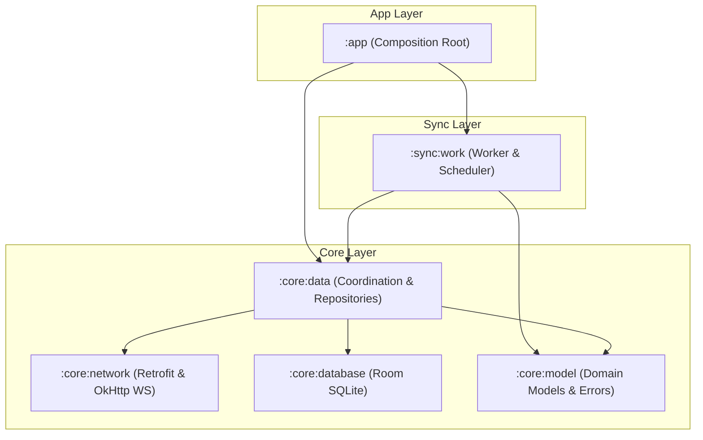
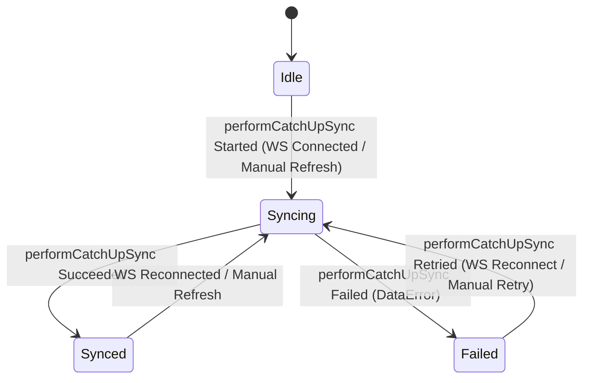

# Offline-First Data Synchronization & Repository Coordination (Core Data Slice)

| Metadata | Value |
|---|---|
| **Author** | Nero Nguyen |
| **Status** | Proposed |
| **Created** | 2026-11-10 |
| **Target Modules** | `:sync:work`, `:core:data`, `:core:model`, `:app` |
| **Living Flow Specs** | `docs/architecture/specifications/flows/offline-catchup-sync.sequence.archify.json` · `docs/architecture/specifications/android-components.archify.json` |

---

## Overview

This technical design establishes an offline-first data synchronization and repository architecture for `Android-ChatApp`. It focuses strictly on the **core data synchronization slice**, isolating Android OS background scheduling into a new `:sync:work` module (per Google's *Now in Android* reference topology), establishing instant network reachability via `NetworkMonitor`, unblocking single-flight sync cancellation hazards, and guaranteeing deterministic, idempotent outbound messaging.

By scoping this slice to `:core:data`, `:sync:work`, and `:core:model`, UI presentation concerns (`:feature:chat`, `:core:ui`) are decoupled: existing Compose screens continue to observe reactive Room SQLite database flows (`getMessages()`), leaving UI banner and viewmodel refactoring to a subsequent dedicated presentation slice.

---

## The Problem

1. **WorkManager Circular Dependency & Heavy Android OS API Leakage in `:core:data`**:
   `ChatRoomRepositoryImpl` currently injects `ChatSyncScheduler` to enqueue WorkManager jobs on network failures. This couples low-level data access to OS background scheduling, introduces circular dependency hazards, and forces heavy Android runtime and annotation processor dependencies (`androidx.work.ktx`, `hilt-work`) into `:core:data`.
2. **Stale Offline State, Silent Half-Open TCP Connections & Exponential Reconnect Lag**:
   The app lacks proactive OS network reachability detection. It relies entirely on WebSocket ping/pong timeouts (taking 30+ seconds to detect dropped cellular/Wi-Fi radios). When network connectivity is restored, exponential backoff delays reconnection by up to 32 seconds, stalling data catch-up.
3. **Single-Flight Coalescing Cancellation Hazard & Stale Deferred Reuse**:
   In `ChatRoomRepositoryImpl`, `inFlightSync` was previously cleared inside a caller-level `finally` block following `deferred.await()`. When Caller A cancels, `finally` clears `inFlightSync = null` prematurely, allowing Caller B to trigger duplicate concurrent executions. Furthermore, omitting an `.takeIf { it.isActive }` check allows completed or failed `Deferred` handles to be reused, returning stale data and dropping required sync cycles.
4. **Silent Outbound Message Drops, Unhandled Disconnects & False Send Failures**:
   `ChatMessageRepository.sendMessage()` returns `Unit` with silent unauthenticated drops. If a network drop occurs while a message is enqueued, the message remains permanently in `SENDING` state without transitioning to `FAILED`, preventing user retry. Furthermore, when retrying after a reconnect, backend `DuplicateMessageId` conflict responses are mistakenly treated as fatal failures rather than reconciling the local state to `SENT`.
5. **Sequential Catch-Up Waterfall Latency Across Changed Rooms**:
   During catch-up sync, `ChatSyncManagerImpl` iterates sequentially over dirty rooms in a `for` loop. For users with multiple active rooms, this sequential HTTP waterfall creates unacceptable latency before recent messages are available locally.
6. **Lack of Reactive Data-Layer Sync Observability**:
   Consumers cannot observe catch-up synchronization lifecycle or distinguish between idle, syncing, and failed states to guide retry policies.

---

## Goals

1. **Modular WorkManager Extraction**: Extract all WorkManager implementations into an edge consumer module `:sync:work`. `:core:data` retains only a pure SPI interface (`ChatSyncScheduler`).
2. **Proactive Network Reachability (`NetworkMonitor`)**: Implement `NetworkMonitor` wrapping Android `ConnectivityManager` callbacks. Synchronously seed initial network state on cold start, debounce offline transitions by 300ms to tolerate radio handovers, and immediately trigger 0ms reconnection on online recovery.
3. **Safe Single-Flight Coalescing**: Repair the in-flight sync mutex in `ChatRoomRepositoryImpl` using `inFlightSync?.takeIf { it.isActive }` and decoupled `invokeOnCompletion` cleanup so cancellation is isolated to the caller and completed jobs are never reused.
4. **Deterministic, Idempotent Outbound Messaging & Disconnect Sweep**: Update `sendMessage()` and `retryMessage()` to return `Either<ChatError.SendMessage, Unit>`. Transition orphan `SENDING` messages to `FAILED` upon socket disconnect, and reconcile `DuplicateMessageId` server responses to `SENT`.
5. **Bounded Parallel Catch-Up Prefetching**: Execute dirty-room prefetching concurrently using `Semaphore(3)` within `supervisorScope` in `ChatSyncManagerImpl.performCatchUpSync()`. Inspect prefetch results and propagate failure if any room fails.
6. **Unified Data-Layer Sync State Machine**: Expose `ChatSyncState` (`Idle`, `Syncing`, `Synced`, `Failed(val error: DataError)`) from `ChatSyncManager.syncState` for reactive observation by consumers.

---

## Non-Goals

1. **UI Presentation & Compose Screen Refactoring**:
   This slice does NOT refactor `ConversationViewModel`, `ChatListViewModel`, or introduce `SyncStatusBar` Compose components in `:core:ui`. Existing UI screens continue to observe Room SQLite `Flow<List<ChatMessage>>` unchanged.
2. **Room Metadata & Membership Lifecycle**:
   Participant kick/leave, room renaming, and room authorization errors (`ParticipantNotInRoom`) belong to the room metadata management slice. In this slice, message synchronization (`syncRecentMessages`, `loadOlderMessages`) strictly retains `Either<DataError, Boolean>`.
3. **Multi-Account Local Sync**:
   Managing multiple local database accounts simultaneously is out of scope.
4. **Automated Background Outbox Across Process Death**:
   Draining failed outbound messages across process termination via WorkManager is out of scope for this slice; user-initiated retry upon foreground reconnection is the intentional architecture.

---

## Critical User Journeys (CUJs)

### CUJ 1: Cold Start & Offline Cache Availability
User opens the app in Airplane Mode. `NetworkMonitor` synchronously detects no active network on subscription and emits `isOnline == false`. The app does not attempt WebSocket connections or REST calls. Cached rooms and messages render instantly from Room SQLite.

### CUJ 2: WebSocket Drop & Automatic Reconnect Reconciliation
While chatting, the user enters an elevator and loses cellular connection. `NetworkMonitor` detects the drop (debounced by 300ms). `RealtimeConnectionManagerImpl` pauses reconnection. Any local messages currently in `SENDING` state are swept and marked `FAILED` by `ChatRealtimeSyncManager`. Upon exiting the elevator, `NetworkMonitor` emits `isOnline == true`. Active backoffs are cancelled immediately (0ms delay), the WebSocket reconnects, and `ChatSyncManagerImpl` runs `performCatchUpSync()`.

### CUJ 3: Optimistic Message Dispatch & Offline Retry
While disconnected, the user sends a message. `ChatMessageRepository.sendMessage()` generates a client `UUIDv7`, inserts the message into SQLite as `SENDING`, attempts immediate socket dispatch, and marks it `FAILED` when the socket is unavailable, returning `Right(Unit)`. When connectivity returns, the user taps retry; the message transmits over the re-established socket. If the message had already reached the server before the drop, the server returns `DuplicateMessageId`, which `ChatRealtimeSyncManager` reconciles to `SENT`.

### CUJ 4: Background Cache Warming via WorkManager
While the app is in the background, Android OS triggers `ChatSyncWorker`. The worker delegates to `chatSyncManager.performCatchUpSync()`. If a transient network failure occurs, the worker natively returns `Result.retry()`, letting Android OS handle exponential backoff without duplicating work requests.

---

## Technical Plan (Architecture)

### 1. High-Level Modular Topology



- **`:sync:work`**: Android library edge consumer. Hosts `ChatSyncWorker` (`@HiltWorker`) and `WorkManagerSyncSchedulerImpl`. Depends on `:core:data` and `:core:model`.
- **`:core:data`**: Defines the `ChatSyncScheduler` SPI interface. Implements `ChatSyncManagerImpl`, `RealtimeConnectionManagerImpl`, and `ChatRealtimeSyncManager`.
- **FK Guard Invariant**: `ChatRealtimeSyncManager` enforces Foreign Key guarding: before inserting incoming message entities into SQLite, it verifies the parent room entity exists in Room SQLite to prevent SQLite foreign key constraint violations during out-of-order frame delivery. If `syncChatRoom(roomId)` fails while buffering incoming frames, `ChatRealtimeSyncManager` schedules a catch-up sync once connectivity stabilizes so dropped room messages are fetched authoritatively from the REST slice.

#### 1.1 Architecture Diagrams & Living Specifications (Archify Integration)
To comply with `AGENTS.md` Section 1 (Level 3 Architecture Governance) and Section 1.1 (Design-First Flow Gate):
1. **Level 3 Android Components Diagram (`docs/architecture/specifications/android-components.archify.json`)**:
   - Add new component node for `:sync:work` (`tag: ":sync:work"`, type: `service`, label: `Sync Work`, sublabel: `ChatSyncWorker · WorkManagerSyncSchedulerImpl`).
   - Wire dependencies: `:app` -> `:sync:work`, `:sync:work` -> `:core:data`, `:sync:work` -> `:core:model`.
   - Update `:core:data` component node by removing WorkManager responsibilities and dependencies, leaving only SPI interface `ChatSyncScheduler`.
2. **Offline Catch-Up Sequence Diagram (`docs/architecture/specifications/flows/offline-catchup-sync.sequence.archify.json`)**:
   - **Transition from Obsolete AS-IS to To-Be Flow**: The existing AS-IS diagram depicts the obsolete pattern where `ChatRoomRepository` directly enqueues WorkManager background jobs on network failure. The To-Be sequence replaces this with the decoupled architecture:
     - **Participants**: `NetworkMonitor`, `RealtimeConnectionManagerImpl`, `ChatSyncWorker` (`:sync:work`), `ChatSyncManager` (`:core:data`), `ChatRoomRepository` (`syncChatsAndGetChangedRooms()`), `ChatMessageRepository` (`syncRecentMessages()`), `ChatDao`, `Backend REST API`.
     - **Segment 1 (Proactive Network Restoration & Instant Reconnect)**: `NetworkMonitor` detects network restoration and emits `isOnline == true`, immediately cancelling backoff delays in `RealtimeConnectionManagerImpl` (0ms delay).
     - **Segment 2 (Background Worker Execution)**: `ChatSyncWorker` delegates to `chatSyncManager.performCatchUpSync()` without `:sync:work` coupling to `:core:datastore`.
     - **Segment 3 (Atomic Single-Flight Room Reconciliation)**: `ChatSyncManager` calls `chatRoomRepository.syncChatsAndGetChangedRooms()`, which coalesces concurrent requests and updates Room SQLite snapshot without self-enqueuing WorkManager.
     - **Segment 4 (Bounded Parallel Message Prefetching)**: `ChatSyncManager` executes concurrent prefetching across dirty rooms using `Semaphore(3)` within `supervisorScope`, returning `Either.Left` if any room fails (`if (errors.isNotEmpty())`).
     - **Segment 5 (Disconnect Sweep & Idempotent Conflict Reconciliation)**: Socket drop triggers `ChatRealtimeSyncManager` to sweep orphan `SENDING` messages to `FAILED`; duplicate server frames reconcile to `SENT`.
   - **Lifecycle State Gate**: Mark `meta.title` and registry row in `docs/architecture/flows/README.md` as `[PLANNED]` prior to code modification. After passing Tier 2 `./scripts/verify.sh clean`, flip to `[AS-IS]` and re-render visual assets.

---

### 2. Proactive Network Reachability (`NetworkMonitor`)

#### Interface Definition (`:core:data`)
```kotlin
package io.github.neronguyen.chat.core.data.util

import kotlinx.coroutines.flow.Flow

interface NetworkMonitor {
    val isOnline: Flow<Boolean>
}
```

#### Implementation Details (`ConnectivityManagerNetworkMonitor`)
- Registers an Android `ConnectivityManager.NetworkCallback` checking both `NetworkCapabilities.NET_CAPABILITY_INTERNET` and `NetworkCapabilities.NET_CAPABILITY_VALIDATED` via `callbackFlow`.
- **Multicast Shared Flow**: Multicasts `isOnline` via `.shareIn(appScope, SharingStarted.WhileSubscribed(stopTimeoutMillis = 5_000), replay = 1)` to avoid exhausting Android OS `NetworkCallback` quotas across multiple collectors.
- **Synchronous Cold-Start Seeding**: Upon flow subscription, immediately queries `connectivityManager.activeNetwork` and emits the current reachability state to avoid startup latency.
- **Hysteresis & Flapping Protection**: Subsequent `false` transitions are debounced by `300ms` via `transformLatest` to tolerate radio handovers between Wi-Fi and cellular, while `true` transitions emit with `0ms` delay.
- **Integration with `RealtimeConnectionManagerImpl`**:
  - `isOnline == false`: Pauses active reconnect loops and transitions state to `RealtimeConnectionState.DISCONNECTED`.
  - `isOnline == true`: Immediately cancels active timer delay to trigger an instant reconnection attempt (0ms delay for pending attempt). To protect against reconnect storms under flapping coverage, `retryAttempt` is **NOT** reset to 0 upon `isOnline == true`; it is reset to 0 **strictly after** the WebSocket reaches `RealtimeConnectionState.CONNECTED` (via network-internal `SocketConnectionState.Connected` from `:core:network`).

---

### 3. Unified Data-Layer State Machine (`ChatSyncState`)

#### Model Definition (`:core:model`)
```kotlin
package io.github.neronguyen.chat.core.model

import io.github.neronguyen.chat.core.model.error.DataError

sealed interface ChatSyncState {
    /** Inactive, unauthenticated, or awaiting sync trigger. */
    data object Idle : ChatSyncState

    /** Catch-up sync is actively reconciling room/message gaps. */
    data object Syncing : ChatSyncState

    /** Catch-up sync completed successfully; local cache is up to date. */
    data object Synced : ChatSyncState

    /** Catch-up sync failed due to network or server error. */
    data class Failed(val error: DataError) : ChatSyncState
}
```

*Note: Socket connection lifecycle is tracked independently by domain enum `RealtimeConnectionState` (`CONNECTING`, `CONNECTED`, `DISCONNECTED`, `FAILED`). Decoupling socket lifecycle from `ChatSyncState` prevents background timeout disconnects from deadlocking the data synchronization state machine.*

#### State Transition Logic (`ChatSyncManagerImpl`)


---

### 4. Bounded Parallel Catch-Up Prefetching

`ChatSyncManagerImpl.performCatchUpSync()` is a pure execution engine returning `Either<DataError, Unit>`. It coordinates with `ChatRoomRepository` interface and eliminates the sequential waterfall by running dirty-room message prefetching concurrently, capped at 3 simultaneous HTTP requests:

```kotlin
override suspend fun performCatchUpSync(): Either<DataError, Unit> {
    return when (val syncResult = chatRoomRepository.syncChatsAndGetChangedRooms()) {
        is Either.Left -> syncResult
        is Either.Right -> {
            val changedRoomIds = syncResult.value
            val semaphore = Semaphore(3)
            val prefetchResults = supervisorScope {
                changedRoomIds.map { roomId ->
                    async {
                        semaphore.withPermit {
                            chatMessageRepository.syncRecentMessages(roomId)
                        }
                    }
                }.awaitAll()
            }
            
            // If ANY room prefetch fails, propagate the error to prompt WorkManager retry and mark state as Failed
            val errors = prefetchResults.filterIsInstance<Either.Left<DataError>>().map { it.value }
            if (errors.isNotEmpty()) {
                Either.Left(errors.first())
            } else {
                Either.Right(Unit)
            }
        }
    }
}
```
*Note: `ChatSyncWorker` observes the return value and maps retryable errors to native WorkManager `Result.retry()`. `ChatSyncManagerImpl` never self-enqueues WorkManager jobs.*

---

### 5. Repository Layer Refactoring & Coordination Defect Resolutions

#### 5.1 `ChatRoomRepository` Clean Interface (`:core:data`)
- Remove UI event bus `syncSuccessEvents: Flow<Unit>` from `ChatRoomRepository`.
- Explicitly remove `chatSyncScheduler` injection and background WorkManager enqueueing from `ChatRoomRepositoryImpl`. Repositories must purely return `Either<DataError, *>` without side-effect background scheduling.
- Rename existing `syncChatsWithChangedRooms()` on the public `ChatRoomRepository` interface to `syncChatsAndGetChangedRooms(): Either<DataError, List<String>>`. Its concrete implementation in `ChatRoomRepositoryImpl` remains `internal`, while `ChatSyncManagerImpl` injects the `ChatRoomRepository` interface abstraction, preserving DIP and decoupled testability in `ChatSyncManagerTest`.

#### 5.2 Single-Flight Coalescing Atomic Cancellation & Reuse Safety
Single-flight coroutine coalescing is attached directly to `syncChatsAndGetChangedRooms()`, ensuring that manual calls via `syncChats()` and automated catch-up sync calls share the exact same deduplicated in-flight job:

In `ChatRoomRepositoryImpl`:
```kotlin
private var inFlightSync: Deferred<Either<DataError, List<String>>>? = null
private val syncMutex = Mutex()

override suspend fun syncChatsAndGetChangedRooms(): Either<DataError, List<String>> {
    val deferred = syncMutex.withLock {
        inFlightSync?.takeIf { it.isActive } ?: appScope.async(defaultDispatcher) {
            executeSyncChatsWithChangedRooms() // Existing private helper in ChatRoomRepositoryImpl
        }.also { newDeferred ->
            inFlightSync = newDeferred
            newDeferred.invokeOnCompletion {
                appScope.launch(defaultDispatcher) {
                    syncMutex.withLock {
                        if (inFlightSync == newDeferred) {
                            inFlightSync = null
                        }
                    }
                }
            }
        }
    }
    return deferred.await()
}

override suspend fun syncChats(): Either<DataError, Unit> =
    syncChatsAndGetChangedRooms().map { }
```
The check `inFlightSync?.takeIf { it.isActive }` guarantees that:
1. Cancellation of Caller A's coroutine does not abort the shared `Deferred` running in `appScope`.
2. Completed or cancelled `Deferred` instances are never reused by subsequent callers.

#### 5.3 Deterministic Outbound Messaging, Disconnect Sweep & Idempotency
In `ChatMessageRepository`:
```kotlin
suspend fun sendMessage(roomId: String, content: String): Either<ChatError.SendMessage, Unit>
suspend fun retryMessage(messageId: String): Either<ChatError.SendMessage, Unit>
```
1. If unauthenticated, returns `Left(ChatError.SendMessage.NotAuthenticated)`.
2. For `retryMessage`, if the message does not exist in SQLite, returns `Left(ChatError.SendMessage.MessageNotFound)`.
3. Inserts into SQLite as `SENDING` with client `UUIDv7`, and enqueues frame over WebSocket.
4. If immediate socket enqueue fails, updates row to `FAILED`. Returns `Right(Unit)` because the message is successfully staged locally in Room SQLite, which is reactively observed by presentation consumers via `Flow<List<ChatMessage>>`.
5. **Disconnect Sweep Invariant**: `ChatRealtimeSyncManager` (which already injects `ChatDao` and observes `realtimeDataSource.connectionState`) calls `chatDao.markSendingMessagesAsFailed()` whenever the connection transitions to `RealtimeConnectionState.DISCONNECTED` or `RealtimeConnectionState.FAILED`, ensuring that messages do not remain stuck in `SENDING` when the socket drops.
6. **Server Idempotency**: In `ChatRealtimeSyncManager`, when handling `WsServerEvent.Error` with `ChatServerError.WebSocket.DuplicateMessageId`, the delivery status is updated to `SENT` instead of `FAILED`.

#### 5.4 Error Hierarchy Alignment
- `ChatError.SendMessage`:
  ```kotlin
  sealed interface SendMessage : ChatError {
      data object NotAuthenticated : SendMessage
      data object RoomNotFound : SendMessage
      data object MessageNotFound : SendMessage, DeleteMessage
      data class Data(val error: DataError) : SendMessage
  }
  ```
- `chatMessageRepository.syncRecentMessages(roomId)` and `loadOlderMessages(roomId)` strictly retain `Either<DataError, Boolean>`, matching `ChatSyncState.Failed(val error: DataError)` directly.

---

## Alternatives Considered

### Alternative 1: Splitting `:core:data-realtime` into a Separate Gradle Module
* **Reason for Rejection**: Breaks Kotlin's `internal` modifier encapsulation (`AGENTS.md` Section 2.2 Rule 2). `ChatRealtimeSyncManager` requires `ChatMapper.kt` entity conversions. Moving it into a separate module forces mappers to become public or duplicated across modules.

### Alternative 2: Keeping WorkManager Inside `:core:data`
* **Reason for Rejection**: Retains the circular dependency cycle between repository sync failures and background schedulers, and bloats `:core:data` with Android OS background worker runtimes.

### Alternative 3: Blind Auto-Resend of `SENDING` Messages on WebSocket Reconnection
* **Reason for Rejection**: Risks duplicate message generation on the server if the original frame was received but the TCP ACK was lost. The adopted fail-fast local state + authoritative catch-up reconciliation model guarantees strict idempotency without message duplication.

### Alternative 4: Sequential Prefetch Waterfall
* **Reason for Rejection**: High latency during reconnection for users with multiple active rooms.

---

## Detailed Implementation Plan (Temporary Scaffolding)

> [!IMPORTANT]
> **EGM Living Document Boundary & Post-Verification Scaffolding Cleanup Invariant**:
> Per the Elephant-Goldfish Model (`egm-draft`), this design document contains two distinct layers:
> 1. **Living Architecture Specification (Permanent, Lines 1–311)**:
>    - `Overview`, `The Problem`, `Goals & Non-Goals`, `Critical User Journeys (CUJs)`, `Technical Plan (Architecture)` (including Section 1.1 Archify specifications and Mermaid models), and `Alternatives Considered`.
>    - This content remains permanently in `docs/designs/offline-first-message-sync-and-cache.md` as the living Single Source of Truth for offline synchronization and message caching.
> 2. **Detailed Implementation Scaffolding (Temporary, Lines 313 to end)**:
>    - The Target Files Inventory (40 files) and sequential execution steps (Workstreams 1–8) serve solely as an actionable checklist for the implementing agent.
>    - **Mandatory Deletion Step**: Immediately following successful execution and Tier 2 verification (`./scripts/verify.sh clean`), a dedicated git commit will delete this entire `## Detailed Implementation Plan (Temporary Scaffolding)` section and update `Status: Implemented` in both metadata and `docs/designs/SITEMAP.md`. No temporary implementation checklists remain in living design documents.

### Target Files Inventory (40 Files Across 8 Workstreams)

```text
Build & Modular Extraction (:sync:work):
 1. settings.gradle.kts (Modify)
 2. sync/work/build.gradle.kts (Create)
 3. core/data/build.gradle.kts (Modify)
 4. app/build.gradle.kts (Modify)
 5. sync/README.md (Create)
 6. sync/work/README.md (Create)

WorkManager Infrastructure Relocation:
 7. sync/work/src/main/kotlin/io/github/neronguyen/chat/sync/work/ChatSyncWorker.kt (Create / Move from core:data)
 8. sync/work/src/main/kotlin/io/github/neronguyen/chat/sync/work/WorkManagerSyncSchedulerImpl.kt (Create / Move from core:data)
 9. sync/work/src/main/kotlin/io/github/neronguyen/chat/sync/work/di/SyncWorkModule.kt (Create)
 10. core/data/src/main/kotlin/io/github/neronguyen/chat/core/data/sync/ChatSyncWorker.kt (Delete)
 11. core/data/src/main/kotlin/io/github/neronguyen/chat/core/data/sync/WorkManagerSyncSchedulerImpl.kt (Delete)

Core Domain Models & Errors (:core:model):
 12. core/model/src/main/kotlin/io/github/neronguyen/chat/core/model/ChatSyncState.kt (Create)
 13. core/model/src/main/kotlin/io/github/neronguyen/chat/core/model/error/ChatError.kt (Modify)
 14. core/model/README.md (Modify)

Proactive Network Reachability (NetworkMonitor):
 15. core/data/src/main/kotlin/io/github/neronguyen/chat/core/data/util/NetworkMonitor.kt (Create)
 16. core/data/src/main/kotlin/io/github/neronguyen/chat/core/data/util/ConnectivityManagerNetworkMonitor.kt (Create)
 17. core/data/src/main/kotlin/io/github/neronguyen/chat/core/data/di/DataModule.kt (Modify)

In-Process Sync & Connection Coordination (:core:data):
 18. core/data/src/main/kotlin/io/github/neronguyen/chat/core/data/sync/ChatSyncScheduler.kt (Modify)
 19. core/data/src/main/kotlin/io/github/neronguyen/chat/core/data/sync/ChatSyncManager.kt (Modify)
 20. core/data/src/main/kotlin/io/github/neronguyen/chat/core/data/sync/ChatSyncManagerImpl.kt (Modify)
 21. core/data/src/main/kotlin/io/github/neronguyen/chat/core/data/realtime/RealtimeConnectionManagerImpl.kt (Modify)
 22. core/data/src/main/kotlin/io/github/neronguyen/chat/core/data/realtime/ChatRealtimeSyncManager.kt (Modify)

Repository Layer Refactoring (:core:data):
 23. core/data/src/main/kotlin/io/github/neronguyen/chat/core/data/repository/ChatRoomRepository.kt (Modify)
 24. core/data/src/main/kotlin/io/github/neronguyen/chat/core/data/repository/ChatRoomRepositoryImpl.kt (Modify)
 25. core/data/src/main/kotlin/io/github/neronguyen/chat/core/data/repository/ChatMessageRepository.kt (Modify)
 26. core/data/src/main/kotlin/io/github/neronguyen/chat/core/data/repository/ChatMessageRepositoryImpl.kt (Modify)
 27. core/data/src/main/kotlin/io/github/neronguyen/chat/core/data/mapper/ChatErrorMapper.kt (Modify)
 28. core/data/README.md (Modify)

Application Composition Root (:app):
 29. app/src/main/kotlin/io/github/neronguyen/chat/ChatApplication.kt (Modify)
 30. app/README.md (Modify)

Automated Verification & Architectural Guardrails:
 31. core/data/src/test/kotlin/io/github/neronguyen/chat/core/data/testing/TestNetworkMonitor.kt (Create)
 32. core/data/src/test/kotlin/io/github/neronguyen/chat/core/data/sync/ChatSyncManagerTest.kt (Modify)
 33. core/data/src/test/kotlin/io/github/neronguyen/chat/core/data/repository/ChatRoomRepositoryImplTest.kt (Modify)
 34. core/data/src/test/kotlin/io/github/neronguyen/chat/core/data/repository/ChatMessageRepositoryImplTest.kt (Modify)
 35. core/data/src/test/kotlin/io/github/neronguyen/chat/core/data/realtime/ChatRealtimeSyncManagerTest.kt (Modify)
 36. core/data/src/test/kotlin/io/github/neronguyen/chat/core/data/architecture/DataArchitectureTest.kt (Create)

Living Documentation & Architecture Specs:
 37. docs/architecture/specifications/android-components.archify.json (Modify)
 38. docs/architecture/specifications/flows/offline-catchup-sync.sequence.archify.json (Modify)
 39. docs/architecture/flows/README.md (Modify)
 40. docs/architecture/assets/offline-catchup-sync.png & .light.png (Modify)
```

---

### Workstream 1: Build Configuration & Modular Extraction (`:sync:work`)
1. **`settings.gradle.kts` (Modify)**: Include `:sync:work`.
2. **`core/data/src/main/kotlin/io/github/neronguyen/chat/core/data/sync/ChatSyncScheduler.kt` (Modify)**: Promote visibility to `public interface ChatSyncScheduler` so `:sync:work` can implement it across module boundaries.
3. **`sync/work/build.gradle.kts` (Create)**: Configure plugins (`android.library`, `hilt`, `ksp`), dependencies on `projects.core.data`, `projects.core.model`, `libs.androidx.work.ktx`, `libs.hilt.android`, `libs.hilt.ext.work`, and processors `ksp(libs.hilt.compiler)`, `ksp(libs.hilt.ext.compiler)`. *(Excludes `projects.core.datastore` per clean edge architecture).*
4. **`core/data/build.gradle.kts` (Modify)**: Remove `androidx.work.ktx` and `hilt-work` dependencies.
5. **`app/build.gradle.kts` (Modify)**: Add `implementation(projects.sync.work)`.
6. **`sync/README.md` & `sync/work/README.md` (Create)**: Document module contracts and invariants.

### Workstream 2: WorkManager Infrastructure Relocation
7. **`ChatSyncWorker.kt` (Create in `:sync:work`, Delete from `:core:data`)**: CoroutineWorker delegating to `chatSyncManager.performCatchUpSync()` and returning native `Result.retry()`. Relocate `internal fun DataError.isRetryable(): Boolean` to this file.
8. **`WorkManagerSyncSchedulerImpl.kt` (Create in `:sync:work`, Delete from `:core:data`)**: Implements `ChatSyncScheduler` SPI.
9. **`SyncWorkModule.kt` (Create in `:sync:work`)**: Binds `WorkManagerSyncSchedulerImpl` to `ChatSyncScheduler`.

### Workstream 3: Core Domain Models & Errors (`:core:model`)
10. **`ChatSyncState.kt` (Create)**: Define `Idle`, `Syncing`, `Synced`, `Failed(val error: DataError)`.
11. **`ChatError.kt` (Modify)**: Define `ChatError.SendMessage` hierarchy (`NotAuthenticated`, `RoomNotFound`, `MessageNotFound`, `Data`).
12. **`core/model/README.md` (Modify)**: Update module contract.

### Workstream 4: Proactive Network Reachability (`NetworkMonitor`)
13. **`NetworkMonitor.kt` (Create)**: Public interface with `val isOnline: Flow<Boolean>`.
14. **`ConnectivityManagerNetworkMonitor.kt` (Create)**: Internal implementation checking `NET_CAPABILITY_INTERNET` and `NET_CAPABILITY_VALIDATED`, synchronous cold-start seeding, 300ms asymmetric debounce, and multicasting via `.shareIn(appScope, SharingStarted.WhileSubscribed(stopTimeoutMillis = 5_000), replay = 1)`.
15. **`DataModule.kt` (Modify)**: Bind `NetworkMonitor`.

### Workstream 5: In-Process Sync & Connection Coordination (`:core:data`)
16. **`ChatSyncManager.kt` & `ChatSyncManagerImpl.kt` (Modify)**: Bounded prefetch with `Semaphore(3)` in `supervisorScope`, evaluating results (returns `Either.Left` if any room fails: `if (errors.isNotEmpty())`), coordinating with `ChatRoomRepository` interface, driving `_syncState`.
17. **`RealtimeConnectionManagerImpl.kt` (Modify)**: Observe `NetworkMonitor`, trigger immediate reconnection attempt (0ms), reset backoff attempt counter strictly on `RealtimeConnectionState.CONNECTED` (via network-internal `SocketConnectionState.Connected`).
18. **`ChatRealtimeSyncManager.kt` (Modify)**: Sweep `SENDING` messages to `FAILED` on disconnect via `chatDao.markSendingMessagesAsFailed()`, reconcile `DuplicateMessageId` server errors to `SENT`.

### Workstream 6: Repository Layer Refactoring (`:core:data`)
19. **`ChatRoomRepository.kt` & `ChatRoomRepositoryImpl.kt` (Modify)**: Remove `syncSuccessEvents` and `chatSyncScheduler` injection. Rename `syncChatsWithChangedRooms()` on public interface to `syncChatsAndGetChangedRooms(): Either<DataError, List<String>>` with atomic single-flight coalescing; `syncChats()` delegates to it.
20. **`ChatMessageRepository.kt` & `ChatMessageRepositoryImpl.kt` (Modify)**: `sendMessage` and `retryMessage` returning `Either<ChatError.SendMessage, Unit>`. Parameter renamed to `content: String`.
21. **`ChatErrorMapper.kt` & `core/data/README.md` (Modify)**: Update mappers and module contract.

### Workstream 7: Application Composition Root (`:app`)
22. **`ChatApplication.kt` (Verify / No-op)**: Verify Hilt worker factory initialization for `:sync:work`. *(Note: `app/src/main/AndroidManifest.xml` already disables default startup initialization via `<provider android:name="androidx.startup.InitializationProvider" tools:node="remove" />`).*
23. **`app/README.md` (Modify)**: Update module dependencies.

### Workstream 8: Automated Verification & Architectural Guardrails
24. **`TestNetworkMonitor.kt` (Create)**: Test fixture for network state emissions.
25. **Unit Tests (Modify)**: Update `ChatSyncManagerTest`, `ChatRoomRepositoryImplTest`, `ChatMessageRepositoryImplTest`, and `ChatRealtimeSyncManagerTest`.
26. **`DataArchitectureTest.kt` (Create)**: Konsist architectural rules enforcing:
    - Zero `androidx.work.*` imports in `:core:data`.
    - Package `repository` never imports `sync` or `realtime`.
    - All mappers and repository implementations are `internal`.
27. **`android-components.archify.json`, `offline-catchup-sync.sequence.archify.json` & `docs/architecture/flows/README.md` (Modify)**:
    - Update Level 3 component spec `docs/architecture/specifications/android-components.archify.json` with `:sync:work` node and rewired dependencies.
    - Update living flow spec `offline-catchup-sync.sequence.archify.json` with To-Be sequence participants/segments, mark registry row `[PLANNED]`, re-render showcase HTML and static assets (`docs/architecture/assets/offline-catchup-sync.png`, `.light.png`), and flip to `[AS-IS]` upon clean gate:
    `node ~/.gemini/config/skills/archify/bin/archify.mjs deliver sequence docs/architecture/specifications/flows/offline-catchup-sync.sequence.archify.json docs/architecture/interactive/flows/offline-catchup-sync.sequence.html --quality showcase --json && node ~/.gemini/config/skills/archify/bin/archify.mjs check docs/architecture/interactive/flows/offline-catchup-sync.sequence.html --json`.
28. **Executable Verification Gate**: Run `./scripts/verify.sh clean` (Tier 2 Gate).
