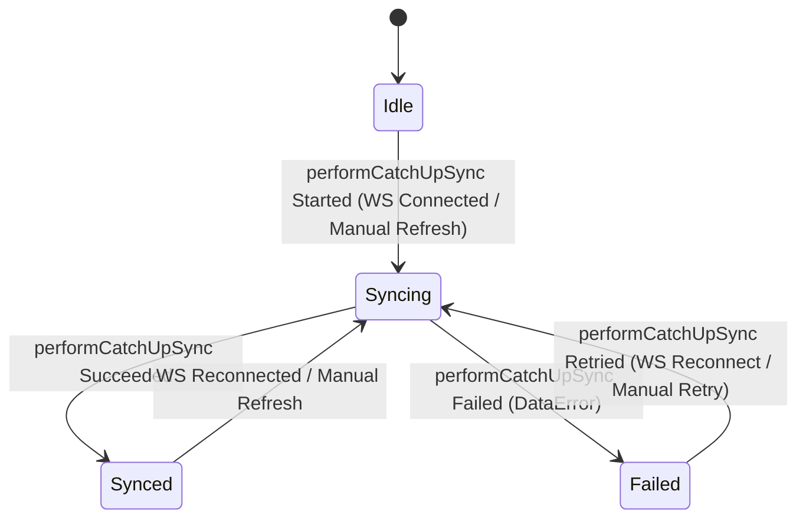

# Offline-First Data Synchronization & Repository Coordination (Core Data Slice)

| Metadata | Value |
|---|---|
| **Author** | Nero Nguyen |
| **Status** | Implemented |
| **Created** | 2026-11-10 |
| **Target Modules** | `:sync:work`, `:core:data`, `:core:model`, `:app` |
| **Living Flow Specs** | `docs/architecture/specifications/flows/offline-catchup-sync.sequence.archify.json` · `docs/architecture/specifications/android-components.archify.json` |

---

## Overview

This technical design establishes an offline-first data synchronization and repository architecture for `Android-ChatApp`. It focuses strictly on the **core data synchronization slice**, isolating Android OS background scheduling into a new `:sync:work` module (per Google's *Now in Android* reference topology), establishing instant network reachability via `NetworkMonitor`, unblocking single-flight sync cancellation hazards, and guaranteeing deterministic, idempotent outbound messaging.

By scoping this slice to `:core:data`, `:sync:work`, and `:core:model`, UI presentation concerns (`:feature:chat`, `:core:ui`) are decoupled: existing Compose screens continue to observe reactive Room SQLite database flows (`getMessages()`), leaving UI banner and viewmodel refactoring to a subsequent dedicated presentation slice.

---

## The Problem

1. **WorkManager Circular Dependency & Heavy Android OS API Leakage in `:core:data`**:
   `ChatRoomRepositoryImpl` currently injects `ChatSyncScheduler` to enqueue WorkManager jobs on network failures. This couples low-level data access to OS background scheduling, introduces circular dependency hazards, and forces heavy Android runtime and annotation processor dependencies (`androidx.work.ktx`, `hilt-work`) into `:core:data`.
2. **Stale Offline State, Silent Half-Open TCP Connections & Exponential Reconnect Lag**:
   The app lacks proactive OS network reachability detection. It relies entirely on WebSocket ping/pong timeouts (taking 30+ seconds to detect dropped cellular/Wi-Fi radios). When network connectivity is restored, exponential backoff delays reconnection by up to 32 seconds, stalling data catch-up.
3. **Single-Flight Coalescing Cancellation Hazard & Stale Deferred Reuse**:
   In `ChatRoomRepositoryImpl`, `inFlightSync` was previously cleared inside a caller-level `finally` block following `deferred.await()`. When Caller A cancels, `finally` clears `inFlightSync = null` prematurely, allowing Caller B to trigger duplicate concurrent executions. Furthermore, omitting an `.takeIf { it.isActive }` check allows completed or failed `Deferred` handles to be reused, returning stale data and dropping required sync cycles.
4. **Silent Outbound Message Drops, Unhandled Disconnects & False Send Failures**:
   `ChatMessageRepository.sendMessage()` returns `Unit` with silent unauthenticated drops. If a network drop occurs while a message is enqueued, the message remains permanently in `SENDING` state without transitioning to `FAILED`, preventing user retry. Furthermore, when retrying after a reconnect, backend `DuplicateMessageId` conflict responses are mistakenly treated as fatal failures rather than reconciling the local state to `SENT`.
5. **Sequential Catch-Up Waterfall Latency Across Changed Rooms**:
   During catch-up sync, `ChatSyncManagerImpl` iterates sequentially over dirty rooms in a `for` loop. For users with multiple active rooms, this sequential HTTP waterfall creates unacceptable latency before recent messages are available locally.
6. **Lack of Reactive Data-Layer Sync Observability**:
   Consumers cannot observe catch-up synchronization lifecycle or distinguish between idle, syncing, and failed states to guide retry policies.

---

## Goals

1. **Modular WorkManager Extraction**: Extract all WorkManager implementations into an edge consumer module `:sync:work`. `:core:data` retains only a pure SPI interface (`ChatSyncScheduler`).
2. **Proactive Network Reachability (`NetworkMonitor`)**: Implement `NetworkMonitor` wrapping Android `ConnectivityManager` callbacks. Synchronously seed initial network state on cold start, debounce offline transitions by 300ms to tolerate radio handovers, and immediately trigger 0ms reconnection on online recovery.
3. **Safe Single-Flight Coalescing**: Repair the in-flight sync mutex in `ChatRoomRepositoryImpl` using `inFlightSync?.takeIf { it.isActive }` and decoupled `invokeOnCompletion` cleanup so cancellation is isolated to the caller and completed jobs are never reused.
4. **Deterministic, Idempotent Outbound Messaging & Disconnect Sweep**: Update `sendMessage()` and
   `retryMessage()` to return `Either<DataError, Unit>`. Transition orphan `SENDING` messages to
   `FAILED` upon socket disconnect, and reconcile `DuplicateMessageId` server responses to `SENT`.
5. **Bounded Parallel Catch-Up Prefetching**: Execute dirty-room prefetching concurrently using `Semaphore(3)` within `supervisorScope` in `ChatSyncManagerImpl.performCatchUpSync()`. Inspect prefetch results and propagate failure if any room fails.
6. **Unified Data-Layer Sync State Machine**: Expose `ChatSyncState` (`Idle`, `Syncing`, `Synced`, `Failed(val error: DataError)`) from `ChatSyncManager.syncState` for reactive observation by consumers.

---

## Non-Goals

1. **UI Presentation & Compose Screen Refactoring**:
   This slice does NOT refactor `ConversationViewModel`, `ChatListViewModel`, or introduce `SyncStatusBar` Compose components in `:core:ui`. Existing UI screens continue to observe Room SQLite `Flow<List<ChatMessage>>` unchanged.
2. **Room Metadata & Membership Lifecycle**:
   Participant kick/leave, room renaming, and room authorization errors (`ParticipantNotInRoom`) belong to the room metadata management slice. In this slice, message synchronization (`syncRecentMessages`, `loadOlderMessages`) strictly retains `Either<DataError, Boolean>`.
3. **Multi-Account Local Sync**:
   Managing multiple local database accounts simultaneously is out of scope.
4. **Automated Background Outbox Across Process Death**:
   Draining failed outbound messages across process termination via WorkManager is out of scope for this slice; user-initiated retry upon foreground reconnection is the intentional architecture.

---

## Critical User Journeys (CUJs)

### CUJ 1: Cold Start & Offline Cache Availability
User opens the app in Airplane Mode. `NetworkMonitor` synchronously detects no active network on subscription and emits `isOnline == false`. The app does not attempt WebSocket connections or REST calls. Cached rooms and messages render instantly from Room SQLite.

### CUJ 2: WebSocket Drop & Automatic Reconnect Reconciliation
While chatting, the user enters an elevator and loses cellular connection. `NetworkMonitor` detects the drop (debounced by 300ms). `RealtimeConnectionManagerImpl` pauses reconnection. Any local messages currently in `SENDING` state are swept and marked `FAILED` by `ChatRealtimeSyncManager`. Upon exiting the elevator, `NetworkMonitor` emits `isOnline == true`. Active backoffs are cancelled immediately (0ms delay), the WebSocket reconnects, and `ChatSyncManagerImpl` runs `performCatchUpSync()`.

### CUJ 3: Optimistic Message Dispatch & Offline Retry
While disconnected, the user sends a message. `ChatMessageRepository.sendMessage()` generates a client `UUIDv7`, inserts the message into SQLite as `SENDING`, attempts immediate socket dispatch, and marks it `FAILED` when the socket is unavailable, returning `Right(Unit)`. When connectivity returns, the user taps retry; the message transmits over the re-established socket. If the message had already reached the server before the drop, the server returns `DuplicateMessageId`, which `ChatRealtimeSyncManager` reconciles to `SENT`.

### CUJ 4: Background Cache Warming via WorkManager
While the app is in the background, Android OS triggers `ChatSyncWorker`. The worker delegates to `chatSyncManager.performCatchUpSync()`. If a transient network failure occurs, the worker natively returns `Result.retry()`, letting Android OS handle exponential backoff without duplicating work requests.

---

## Technical Plan (Architecture)

### 1. High-Level Modular Topology

<picture>
  <source media="(prefers-color-scheme: dark)" srcset="../architecture/assets/AndroidComponents.png">
  <source media="(prefers-color-scheme: light)" srcset="../architecture/assets/AndroidComponents.light.png">
  
</picture>

- **`:sync:work`**: Android library edge consumer (`ChatSyncWorker` `@HiltWorker` and
  `WorkManagerSyncSchedulerImpl`). Depends on `:core:data` and `:core:model`.
- **`:core:data`**: Defines the `ChatSyncScheduler` SPI interface. Implements `ChatSyncManagerImpl`, `RealtimeConnectionManagerImpl`, and `ChatRealtimeSyncManager`.
- **FK Guard Invariant**: `ChatRealtimeSyncManager` enforces Foreign Key guarding: before inserting
  incoming message entities into SQLite, it verifies the parent room entity exists in Room SQLite to
  prevent SQLite foreign key constraint violations during out-of-order frame delivery. If
  `syncChatRoom(roomId)` fails while buffering incoming frames, buffered frames for that room are
  safely dropped without throwing `SQLiteConstraintException`, and authoritative room/message state
  is reconciled on subsequent catch-up syncs.

#### 1.1 Offline Catch-Up & Background Sync Sequence (`offline-catchup-sync`)

> **Interactive Viewer**: [
`docs/architecture/interactive/flows/offline-catchup-sync.html`](../architecture/interactive/flows/offline-catchup-sync.html) ·
> **Spec**: [
`offline-catchup-sync.sequence.archify.json`](../architecture/specifications/flows/offline-catchup-sync.sequence.archify.json)

<picture>
  <source media="(prefers-color-scheme: dark)" srcset="../architecture/assets/offline-catchup-sync.png">
  <source media="(prefers-color-scheme: light)" srcset="../architecture/assets/offline-catchup-sync.light.png">
  
</picture>

- **Segment 1 (Proactive Reachability & 0ms Reconnect Delay Cancel)**: `NetworkMonitor` detects
  network restoration and emits `isOnline == true`, immediately cancelling backoff delays in
  `RealtimeConnectionManagerImpl` (0ms delay) and resetting `retryAttempt = 0` strictly upon
  `101 Switching Protocols`.
- **Segment 2 (Background Worker Delegation & Single-Flight Coalescing)**: `ChatSyncWorker`
  delegates to `chatSyncManager.performCatchUpSync()`, which calls
  `chatRoomRepository.syncChatsAndGetChangedRooms()` guarded by `SingleFlight`.
- **Segment 3 (Authoritative Room Reconcile & Dirty Room Diff)**: `ChatRoomRepository` compares
  pre-sync `getAllRoomsSnapshot()` against `GET /api/chat/rooms`, reconciles via
  `insertFullChats(rooms, participants, lastMessages)`, and returns the diff list of
  `changedRoomIds`.
- **Segment 4 (Bounded Parallel Catch-Up Prefetching)**: `ChatSyncManager` executes concurrent
  prefetching across dirty rooms using `mapConcurrent(concurrency = 3)` (`Semaphore(3)` inside
  `supervisorScope`), propagating `Either.Left` if any room fails. (Disconnect sweep and idempotent
  `DuplicateMessageId` transitions are tracked in [
  `message-delivery-status.lifecycle.archify.json`](../architecture/specifications/flows/message-delivery-status.lifecycle.archify.json)).

---

### 2. Proactive Network Reachability (`NetworkMonitor`)

#### Interface Definition (`:core:data`)
```kotlin
package io.github.neronguyen.chat.core.data.util

import kotlinx.coroutines.flow.Flow

interface NetworkMonitor {
    val isOnline: Flow<Boolean>
}
```

#### Implementation Details (`ConnectivityManagerNetworkMonitor`)
- Registers an Android `ConnectivityManager.NetworkCallback` checking both `NetworkCapabilities.NET_CAPABILITY_INTERNET` and `NetworkCapabilities.NET_CAPABILITY_VALIDATED` via `callbackFlow`.
- **Multicast Shared Flow**: Multicasts `isOnline` via `.shareIn(appScope, SharingStarted.WhileSubscribed(stopTimeoutMillis = 5_000), replay = 1)` to avoid exhausting Android OS `NetworkCallback` quotas across multiple collectors.
- **Synchronous Cold-Start Seeding**: Upon flow subscription, immediately queries `connectivityManager.activeNetwork` and emits the current reachability state to avoid startup latency.
- **Hysteresis & Flapping Protection**: Subsequent `false` transitions are debounced by `300ms` via `transformLatest` to tolerate radio handovers between Wi-Fi and cellular, while `true` transitions emit with `0ms` delay.
- **Integration with `RealtimeConnectionManagerImpl`**:
  - `isOnline == false`: Pauses active reconnect loops and transitions state to `RealtimeConnectionState.DISCONNECTED`.
  - `isOnline == true`: Immediately cancels active timer delay to trigger an instant reconnection attempt (0ms delay for pending attempt). To protect against reconnect storms under flapping coverage, `retryAttempt` is **NOT** reset to 0 upon `isOnline == true`; it is reset to 0 **strictly after** the WebSocket reaches `RealtimeConnectionState.CONNECTED` (via network-internal `SocketConnectionState.Connected` from `:core:network`).

---

### 3. Unified Data-Layer State Machine (`ChatSyncState`)

#### Model Definition (`:core:model`)
```kotlin
package io.github.neronguyen.chat.core.model

import io.github.neronguyen.chat.core.model.error.DataError

sealed interface ChatSyncState {
    /** Inactive, unauthenticated, or awaiting sync trigger. */
    data object Idle : ChatSyncState

    /** Catch-up sync is actively reconciling room/message gaps. */
    data object Syncing : ChatSyncState

    /** Catch-up sync completed successfully; local cache is up to date. */
    data object Synced : ChatSyncState

    /** Catch-up sync failed due to network or server error. */
    data class Failed(val error: DataError) : ChatSyncState
}
```

*Note: Socket connection lifecycle is tracked independently by domain enum `RealtimeConnectionState` (`CONNECTING`, `CONNECTED`, `DISCONNECTED`, `FAILED`). Decoupling socket lifecycle from `ChatSyncState` prevents background timeout disconnects from deadlocking the data synchronization state machine.*

#### State Transition Logic (`ChatSyncManagerImpl`)


---

### 4. Bounded Parallel Catch-Up Prefetching

`ChatSyncManager.performCatchUpSync(): Either<DataError, Unit>` coordinates catch-up reconciliation
across `:core:data` repositories:

- **Single-Flight Execution**: Concurrent invocations coalesce onto the active `appScope` job
  (`inFlightCatchUpSync?.takeIf { it.isActive }`), isolating individual caller cancellations from
  aborting the shared sync cycle.
- **Bounded Concurrency (`Semaphore(3)`)**: Eliminates the sequential room waterfall by prefetching
  dirty rooms (`chatMessageRepository.syncRecentMessages(roomId)`) concurrently inside
  `supervisorScope`, capped at `3` simultaneous requests.
- **Fail-Fast Error Propagation**: If room list reconciliation or **any** dirty-room prefetch
  returns `Either.Left<DataError>`, `performCatchUpSync()` transitions `syncState` to
  `ChatSyncState.Failed(error)` and returns `Either.Left` so `ChatSyncWorker` can map retryable
  errors to `Result.retry()`. `ChatSyncManagerImpl` never self-enqueues WorkManager jobs.

---

### 5. Repository Layer Refactoring & Coordination Defect Resolutions

#### 5.1 `ChatRoomRepository` Clean Interface (`:core:data`)
- Remove UI event bus `syncSuccessEvents: Flow<Unit>` from `ChatRoomRepository`.
- Explicitly remove `chatSyncScheduler` injection and background WorkManager enqueueing from `ChatRoomRepositoryImpl`. Repositories must purely return `Either<DataError, *>` without side-effect background scheduling.
- Rename existing `syncChatsWithChangedRooms()` on the public `ChatRoomRepository` interface to `syncChatsAndGetChangedRooms(): Either<DataError, List<String>>`. Its concrete implementation in `ChatRoomRepositoryImpl` remains `internal`, while `ChatSyncManagerImpl` injects the `ChatRoomRepository` interface abstraction, preserving DIP and decoupled testability in `ChatSyncManagerTest`.

#### 5.2 Single-Flight Coalescing Atomic Cancellation & Reuse Safety

Single-flight coroutine coalescing is attached to `ChatRoomRepository.syncChatsAndGetChangedRooms()`
(which `syncChats()` delegates to via `.void()`), ensuring manual refreshes and automated catch-up
syncs share the same deduplicated in-flight job:

- **Active Job Reuse Only**: Guarded by `syncMutex`, callers reuse
  `inFlightSync?.takeIf { it.isActive }` or launch a new `Deferred` in `appScope`.
- **Caller Cancellation Isolation**: Cancelling Caller A's awaiting coroutine does not cancel the
  shared `Deferred` running in `appScope`, allowing Caller B to complete normally.
- **No Stale Reuse or Reference Clobbering**: Completed or cancelled `Deferred` instances
  (`isActive == false`) are never reused by subsequent callers, and reference cleanup
  (`if (inFlightSync === this@async)`) runs under `NonCancellable` + `syncMutex` so a finishing job
  never overwrites a newer `Deferred`.

#### 5.3 Deterministic Outbound Messaging, Disconnect Sweep & Idempotency
In `ChatMessageRepository`:
```kotlin
suspend fun sendMessage(roomId: String, content: String): Either<DataError, Unit>
suspend fun retryMessage(messageId: String): Either<DataError, Unit>
```

1. If unauthenticated, returns `Left(DataError.Local.NotAuthenticated)`.
2. For `retryMessage`, if the message does not exist in SQLite, returns
   `Left(DataError.Local.NotFound)`.
3. Inserts into SQLite as `SENDING` with client `UUIDv7`, and enqueues frame over WebSocket.
4. If immediate socket enqueue fails, updates row to `FAILED`. Returns `Right(Unit)` because the message is successfully staged locally in Room SQLite, which is reactively observed by presentation consumers via `Flow<List<ChatMessage>>`.
5. **Disconnect Sweep Invariant**: `ChatRealtimeSyncManager` (which already injects `ChatDao` and
   observes `realtimeDataSource.connectionState`) calls `chatDao.markSendingMessagesAsFailed()`
   whenever the connection transitions to `SocketConnectionState.Disconnected` or
   `SocketConnectionState.Failed`, ensuring that messages do not remain stuck in `SENDING` when the
   socket drops.
6. **Server Idempotency**: In `ChatRealtimeSyncManager`, when handling `WsServerEvent.Error` with
   `ChatServerError.DuplicateMessageId.code`, the delivery status is updated to `SENT` instead of
   `FAILED`.

#### 5.4 Error Hierarchy Alignment

- `DataError.Local`:
  ```kotlin
  sealed interface Local : DataError {
      data object NotAuthenticated : Local
      data object NotFound : Local
  }
  ```
- `chatMessageRepository.syncRecentMessages(roomId)` and `loadOlderMessages(roomId)` strictly retain `Either<DataError, Boolean>`, matching `ChatSyncState.Failed(val error: DataError)` directly.

---

## Alternatives Considered

### Alternative 1: Splitting `:core:data-realtime` into a Separate Gradle Module
* **Reason for Rejection**: Breaks Kotlin's `internal` modifier encapsulation (`AGENTS.md` Section 2.2 Rule 2). `ChatRealtimeSyncManager` requires `ChatMapper.kt` entity conversions. Moving it into a separate module forces mappers to become public or duplicated across modules.

### Alternative 2: Keeping WorkManager Inside `:core:data`
* **Reason for Rejection**: Retains the circular dependency cycle between repository sync failures and background schedulers, and bloats `:core:data` with Android OS background worker runtimes.

### Alternative 3: Blind Auto-Resend of `SENDING` Messages on WebSocket Reconnection
* **Reason for Rejection**: Risks duplicate message generation on the server if the original frame was received but the TCP ACK was lost. The adopted fail-fast local state + authoritative catch-up reconciliation model guarantees strict idempotency without message duplication.

### Alternative 4: Sequential Prefetch Waterfall
* **Reason for Rejection**: High latency during reconnection for users with multiple active rooms.

