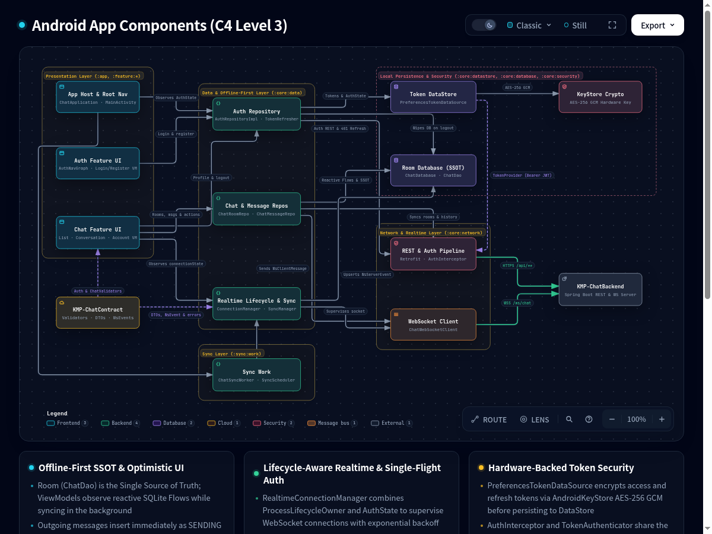
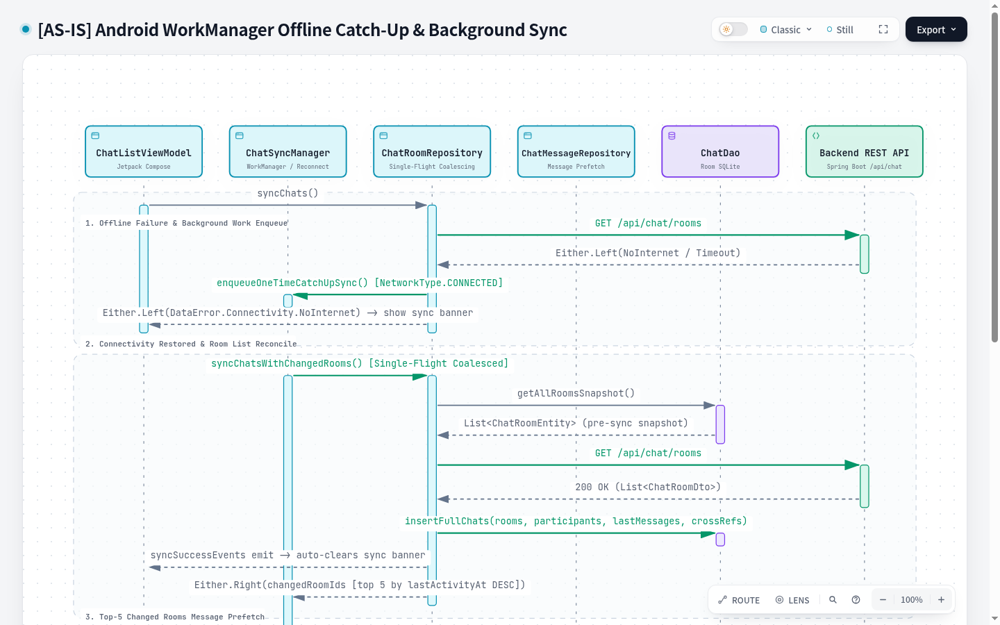

# Offline-First Data Synchronization & Repository Coordination (Unified Sync State & Smoothed Backoff)

| Metadata | Value |
|---|---|
| **Author** | Nero Nguyen |
| **Status** | Implemented |
| **Created** | 2026-11-10 |
| **Updated** | 2026-11-11 |
| **Target Modules** | `:sync:work`, `:core:data`, `:core:database`, `:core:model`, `:app` |
| **Living Flow Specs** | `docs/architecture/specifications/flows/offline-catchup-sync.sequence.archify.json` · `docs/architecture/specifications/flows/unknown-room-fk-guard.sequence.archify.json` · `docs/architecture/specifications/android-components.archify.json` |

---

## Overview

This technical design establishes the offline-first data synchronization and repository coordination architecture for `Android-ChatApp`. It focuses strictly on the **core data synchronization engine**, isolating Android OS background scheduling into `:sync:work`, establishing proactive network reachability via internal `NetworkMonitor`, smoothing WebSocket reconnection supervision to eliminate presentation-layer flicker, providing a unified event-driven `ChatSyncState` (`Idle`, `Offline`, `Connecting`, `Syncing`, `Synced`, `Failed`), and coordinating catch-up sync across repositories.

By resolving these concerns fully within `:core:data` and `:core:model`, presentation layers (`:feature:chat`, `:core:ui`) are shielded from transport and coroutine complexity: Compose screens observe reactive Room SQLite flows (`getMessages()`) and a single unified `StateFlow<ChatSyncState>`.

---

## The Problem

1. **WorkManager Circular Dependency & Heavy Android OS API Leakage in `:core:data`**:
   `ChatRoomRepositoryImpl` previously injected `ChatSyncScheduler` to enqueue WorkManager jobs on network failures. This coupled low-level data access to OS background scheduling, introduced circular dependency hazards, and forced heavy Android runtime and annotation processor dependencies (`androidx.work.ktx`, `hilt-work`) into `:core:data`.
2. **Stale Offline State, Silent Half-Open TCP Connections & Exponential Reconnect Lag**:
   The app lacked proactive OS network reachability detection. It relied entirely on WebSocket ping/pong timeouts (taking 30+ seconds to detect dropped cellular/Wi-Fi radios). When network connectivity was restored, exponential backoff delayed reconnection by up to 32 seconds, stalling data catch-up.
3. **Fragmented & Leaked Connectivity Observables with UI Banner Flicker**:
   Previously, `:core:data` exposed three disjoint state mechanisms: `ChatSyncManager.syncState` (`Idle`, `Syncing`, `Synced`, `Failed`), `RealtimeConnectionManager.connectionState` (`CONNECTING`, `CONNECTED`, `DISCONNECTED`, `FAILED`), and `NetworkMonitor.isOnline` (`Flow<Boolean>`). During exponential backoff delay intervals (2s, 4s, 8s, 16s...), `RealtimeConnectionManagerImpl` emitted `Disconnected` or `Failed` while sleeping, causing UI status banners to flicker between error and connecting on every retry tick.
4. **Single-Flight Coalescing Cancellation Hazard & Stale Deferred Reuse**:
   In `ChatRoomRepositoryImpl`, `inFlightSync` was previously cleared inside a caller-level `finally` block following `deferred.await()`. When Caller A cancelled, `finally` cleared `inFlightSync = null` prematurely, allowing Caller B to trigger duplicate concurrent executions. Furthermore, omitting an `.takeIf { it.isActive }` check allowed completed or failed `Deferred` handles to be reused, returning stale data.
5. **Sequential Catch-Up Waterfall Latency Across Changed Rooms**:
   During catch-up sync, `ChatSyncManagerImpl` iterated sequentially over dirty rooms in a `for` loop. For users with multiple active rooms, this sequential HTTP waterfall created unacceptable latency before recent messages were available locally.

---

## Goals

1. **Modular WorkManager Extraction**: Extract all WorkManager implementations into an edge consumer module `:sync:work`. `:core:data` retains only a pure SPI interface (`ChatSyncScheduler`).
2. **Proactive Network Reachability (`NetworkMonitor`) Internalization**: Encapsulate `NetworkMonitor` wrapping Android `ConnectivityManager` callbacks as `internal` to `:core:data`. Synchronously seed initial network state on cold start, debounce offline transitions by 300ms, and cancel backoff delays with 0ms delay on online recovery.
3. **Smoothed Foreground Reconnection Supervision**: In `RealtimeConnectionManagerImpl`, smooth `connectionState` during active foreground supervision so it continuously emits `RealtimeConnectionState.CONNECTING` across exponential backoff delays until `CONNECTED` is reached, eliminating banner flicker. Include a dead-man switch (timeout after 5 failures) allowing manual retry intervention via `reconnect()`.
4. **Unified Event-Driven State Machine (`ChatSyncState`)**: Expand `ChatSyncState` in `:core:model` to include `Idle`, `Offline`, `Connecting`, `Syncing`, `Synced`, and `Failed(val error: DataError)`. Expose a single `StateFlow<ChatSyncState>` from `ChatSyncManager` coordinating network reachability, socket reconnection, and catch-up sync.
5. **Safe Single-Flight Coalescing**: Repair the in-flight sync mutex in `ChatRoomRepositoryImpl` using `inFlightSync?.takeIf { it.isActive }` and decoupled `invokeOnCompletion` cleanup so cancellation is isolated to the caller and completed jobs are never reused.
6. **Bounded Parallel Catch-Up Prefetching**: Execute dirty-room prefetching concurrently using `Semaphore(3)` within `supervisorScope` in `ChatSyncManagerImpl.performCatchUpSync()`. Propagate failure if any room fails.

---

## Non-Goals

1. **Automatic Offline Outbox Draining & Ack Watchdog (Dedicated E2E Design Slice)**:
   Persisting offline `SENDING` messages without disconnect wipe, FIFO outbox queueing, gap detection ordering vs. concurrent catch-up sync, and ack timeout handling will be designed and implemented in an upcoming End-to-End slice spanning `:contract:chat`, `:core:database`, and `:core:data`. This slice retains the existing fail-fast disconnect sweep (`markSendingMessagesAsFailed()` on socket drop).
2. **UI Presentation & Compose Screen Refactoring**:
   This slice does NOT refactor `ConversationViewModel`, `ChatListViewModel`, or introduce `SyncStatusBar` Compose components in `:core:ui`. ViewModels and Compose screens consume the finalized `ChatSyncManager.syncState` and Room SQLite `Flow<List<ChatMessage>>` in a dedicated presentation slice.
3. **Room Metadata & Membership Lifecycle**:
   Participant kick/leave, room renaming, and room authorization errors (`ParticipantNotInRoom`) belong to the room metadata management slice.
4. **Multi-Account Local Sync**:
   Managing multiple local database accounts simultaneously is out of scope.

---

## Critical User Journeys (CUJs)

### CUJ 1: Cold Start & Offline Cache Availability
User opens the app in Airplane Mode (`isOnline == false`). `NetworkMonitor` detects no active network. `ChatSyncManager.syncState` immediately resolves to `ChatSyncState.Offline`. The app does not attempt WebSocket connections or REST calls. Cached rooms and messages render instantly from Room SQLite.

### CUJ 2: WebSocket Drop & Automatic Reconnect Reconciliation
While chatting, the user enters an elevator and loses cellular connection. `NetworkMonitor` detects the drop (debounced by 300ms). `RealtimeConnectionManagerImpl` pauses reconnection. Inbound pending messages for uncached rooms remain safely guarded. Upon exiting the elevator, `NetworkMonitor` emits `isOnline == true`. Active backoffs are cancelled immediately (0ms delay), `RealtimeConnectionManagerImpl` emits smoothed `CONNECTING`, the WebSocket reconnects, and `ChatSyncManagerImpl` runs `performCatchUpSync()`.

### CUJ 3: Server Outage & Coordinated Error Resolution
The device has Wi-Fi (`isOnline == true`), but the backend API server is down. Reconnection backoff runs under active supervision, emitting `Connecting`. After 5 consecutive failed attempts, `RealtimeConnectionManagerImpl` transitions to `FAILED`, leading `ChatSyncManager` to transition to `ChatSyncState.Failed(DataError.Remote.Unavailable)`. Tapping retry triggers `reconnect()`, instantly transitioning state to `Connecting` and re-invoking connection and catch-up sync.

### CUJ 4: Background Cache Warming via WorkManager
While the app is in the background, Android OS triggers `ChatSyncWorker`. The worker delegates to `chatSyncManager.performCatchUpSync()`. If a transient network failure occurs, the worker natively returns `Result.retry()`, letting Android OS handle exponential backoff without duplicating work requests.

---

## Technical Plan (Architecture)

### 1. High-Level Modular Topology

<picture>
  <source media="(prefers-color-scheme: dark)" srcset="../architecture/assets/AndroidComponents.png">
  <source media="(prefers-color-scheme: light)" srcset="../architecture/assets/AndroidComponents.light.png">
  
</picture>

- **`:sync:work`**: Android library edge consumer (`ChatSyncWorker` `@HiltWorker` and `WorkManagerSyncSchedulerImpl`). Depends on `:core:data` and `:core:model`.
- **`:core:data`**: Defines the `ChatSyncScheduler` SPI interface. Implements `ChatSyncManagerImpl`, `RealtimeConnectionManagerImpl`, `ChatRealtimeSyncManager`, and `ChatMessageRepositoryImpl`.
- **`:core:database`**: Room SQLite entities, DAO (`ChatDao`), transactions, and queries.
- **`:core:model`**: Pure domain models (`ChatSyncState`, `RealtimeConnectionState`, `MessageDeliveryStatus`).

#### 1.1 Offline Catch-Up & Background Sync Sequence (`offline-catchup-sync`)

> **Interactive Viewer**: [`docs/architecture/interactive/flows/offline-catchup-sync.html`](../architecture/interactive/flows/offline-catchup-sync.html) · **Spec**: [`offline-catchup-sync.sequence.archify.json`](../architecture/specifications/flows/offline-catchup-sync.sequence.archify.json)

<picture>
  <source media="(prefers-color-scheme: dark)" srcset="../architecture/assets/offline-catchup-sync.png">
  <source media="(prefers-color-scheme: light)" srcset="../architecture/assets/offline-catchup-sync.light.png">
  
</picture>

- **Segment 1 (Proactive Reachability & 0ms Reconnect Delay Cancel)**: `NetworkMonitor` detects network restoration and emits `isOnline == true`, immediately cancelling backoff delays in `RealtimeConnectionManagerImpl` (0ms delay) and resetting `retryAttempt = 0` strictly upon `101 Switching Protocols`.
- **Segment 2 (Background Worker Delegation & Single-Flight Coalescing)**: `ChatSyncWorker` delegates to `chatSyncManager.performCatchUpSync()`, which calls `chatRoomRepository.syncChatsAndGetChangedRooms()` guarded by `SingleFlight`.
- **Segment 3 (Authoritative Room Reconcile & Dirty Room Diff)**: `ChatRoomRepository` compares pre-sync `getAllRoomsSnapshot()` against `GET /api/chat/rooms`, reconciles via `insertFullChats(rooms, participants, lastMessages)`, and returns the diff list of `changedRoomIds`.
- **Segment 4 (Bounded Parallel Catch-Up Prefetching)**: `ChatSyncManager` executes concurrent prefetching across dirty rooms using `mapConcurrent(concurrency = 3)` (`Semaphore(3)` inside `supervisorScope`).

---

### 2. Domain Model Alignment (`:core:model`)

In `core/model/src/main/kotlin/io/github/neronguyen/chat/core/model/ChatSyncState.kt`:

```kotlin
package io.github.neronguyen.chat.core.model

import io.github.neronguyen.chat.core.model.error.DataError

sealed interface ChatSyncState {
    /** Inactive, unauthenticated, or awaiting sync trigger. */
    data object Idle : ChatSyncState

    /** Device has no validated internet connectivity (NetworkMonitor.isOnline == false). */
    data object Offline : ChatSyncState

    /**
     * Realtime WebSocket is establishing a connection or in backoff
     * retry delay under active foreground supervision.
     */
    data object Connecting : ChatSyncState

    /** Catch-up synchronization is actively reconciling rooms and messages. */
    data object Syncing : ChatSyncState

    /** WebSocket is connected and catch-up synchronization is up to date (quiet state). */
    data object Synced : ChatSyncState

    /** Catch-up synchronization failed due to network or server error. */
    data class Failed(val error: DataError) : ChatSyncState
}
```

---

### 3. Proactive Network Reachability & Smoothed Supervision (`:core:data`)

#### 3.1 Encapsulate `NetworkMonitor`
In `core/data/src/main/kotlin/io/github/neronguyen/chat/core/data/util/NetworkMonitor.kt`:
Change visibility from `interface NetworkMonitor` to `internal interface NetworkMonitor`.

#### 3.2 Smoothed Supervision in `RealtimeConnectionManagerImpl`
In `core/data/src/main/kotlin/io/github/neronguyen/chat/core/data/realtime/RealtimeConnectionManagerImpl.kt`:
- Introduce a private `MutableStateFlow<RealtimeConnectionState>` exposed via `override val connectionState: StateFlow<RealtimeConnectionState>`.
- Under `ConnectionPolicy.ActiveSupervision`:
  - Emit `RealtimeConnectionState.CONNECTING`.
  - Maintain `CONNECTING` throughout backoff sleep intervals (`delay(backoff.calculateDelay(retryAttempt))`).
  - Transition to `CONNECTED` strictly when `SocketConnectionState.Connected` arrives, resetting `retryAttempt = 0`.
  - Implement a dead-man switch: after `MAX_RETRY_ATTEMPTS` (5 attempts) without success, transition to `RealtimeConnectionState.FAILED` so the user is informed and manual retry can reset backoff via `reconnect()`.
- Under `ConnectionPolicy.DisconnectImmediate` or `ConnectionPolicy.DisconnectGracePeriod`: emit `RealtimeConnectionState.DISCONNECTED`.

---

### 4. Event-Driven `ChatSyncManagerImpl` (`:core:data`)

In `core/data/src/main/kotlin/io/github/neronguyen/chat/core/data/sync/ChatSyncManagerImpl.kt`:
- Inject `networkMonitor: NetworkMonitor` and `realtimeConnectionManager: RealtimeConnectionManager`.
- Observe `networkMonitor.isOnline`:
  - When `false`, immediately set `_syncState.value = ChatSyncState.Offline`.
  - When `true`, observe `realtimeConnectionManager.connectionState`:
    - If `CONNECTING`: transition `_syncState.value = ChatSyncState.Connecting` (clearing any previous `Failed` state).
    - If `DISCONNECTED`: if not already `Failed` or `Syncing`, emit `ChatSyncState.Connecting`.
    - If `CONNECTED`: trigger `performCatchUpSync()`.
    - If `FAILED`: if not `Syncing`, transition `_syncState.value = ChatSyncState.Failed(DataError.Remote.Unavailable)`.
- During `performCatchUpSync()`:
  - Transition `_syncState.value = ChatSyncState.Syncing`.
  - On success, set `_syncState.value = ChatSyncState.Synced`.
  - On failure, set `_syncState.value = ChatSyncState.Failed(firstError)`.

---

## Alternatives Considered

### Alternative 1: Bundling Outbox Draining into Data-Only Slice
* **Reason for Rejection**: An outbox requires end-to-end alignment (catch-up gap detection ordering vs. optimistic ack, UI bubble sorting for unsent items, server duplicate semantics, and ack watchdog TTL). Prematurely adding an in-repo outbox drainer introduces critical race conditions with catch-up sync.

### Alternative 2: Exposing Separate Flows (`isOnline`, `connectionState`, `syncState`) to ViewModels
* **Reason for Rejection**: Leaks low-level transport mechanisms to UI, forcing ViewModels to write complex combination logic and leading to state desynchronization.

### Alternative 3: Unlimited Exponential Backoff Without Dead-Man Switch
* **Reason for Rejection**: Masks complete backend or DNS failure indefinitely behind a perpetual "Connecting…" state. A dead-man switch allows graceful degradation to `Failed` after 5 attempts.
