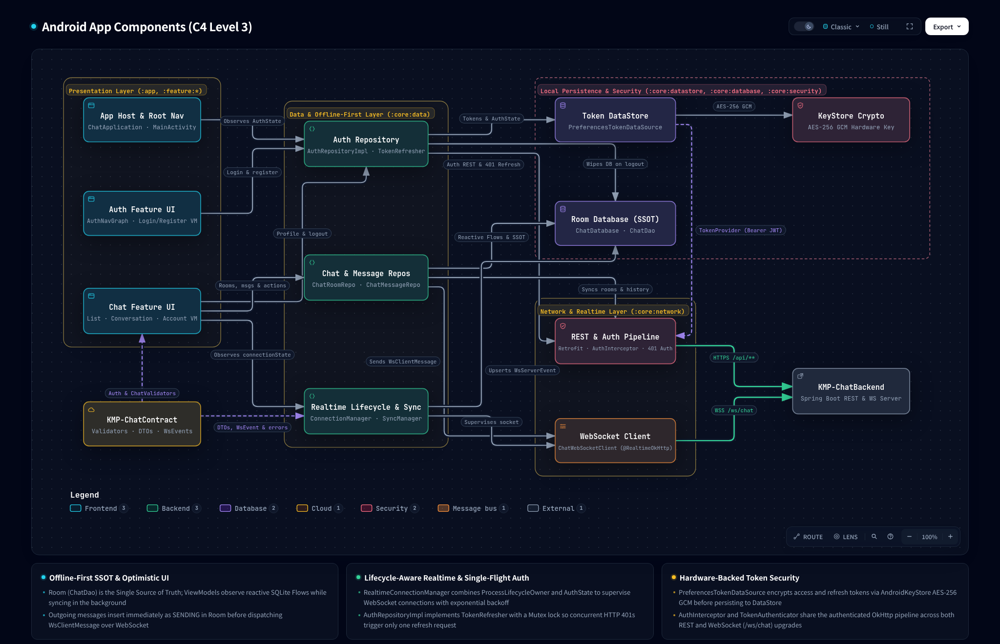

# Presentation & Sync UI Integration (Unified State & Quiet Messaging Architecture)

| Metadata                      | Value                                                                                                                                                                                            |
|-------------------------------|--------------------------------------------------------------------------------------------------------------------------------------------------------------------------------------------------|
| **Author**                    | Nero Nguyen                                                                                                                                                                                      |
| **Status**                    | Implemented                                                                                                                                                                                      |
| **Date**                      | 2026-11-11 (updated 2026-11-12: screenshot testing)                                                                                                                                              |
| **Role**                      | Cross-Module Presentation & Sync Mechanism Specification                                                                                                                                         |
| **Target Modules**            | `:core:data`, `:core:ui`, `:feature:chat` (+ build/verification tooling)                                                                                                                         |
| **Living Architecture Specs** | [`docs/architecture/specifications/android-components.archify.json`](../architecture/specifications/android-components.archify.json) (C4 L3 — edge label update only; no dedicated flow diagram) |

---

## Overview

This technical design document establishes the presentation and synchronization UI integration
architecture for `Android-ChatApp`. It bridges low-level data layer primitives established in [
`docs/designs/offline-first-message-sync-and-cache.md`](./offline-first-message-sync-and-cache.md)
to the user-facing Jetpack Compose presentation layer (`:core:ui`, `:feature:chat`).

Specifically, it unifies fragmented connectivity and sync state streams into a single event-driven
`StateFlow<ChatSyncState>`, eliminates WebSocket backoff UI banner flicker via smoothed reconnection
supervision, encapsulates `NetworkMonitor` as internal to `:core:data`, establishes deterministic
message sending safeguards in the absence of an automatic background outbox, and delivers a reusable
`SyncStatusBar` conforming to the NeroChat *Quiet Messaging* design system specification in [
`docs/designs/design-system.md`](./design-system.md).

---

## The Problem

1. **Fragmented & Leaked Connectivity Observables**:
   Previously, `:core:data` exposed three disjoint state mechanisms: `ChatSyncManager.syncState`
   (`Idle`, `Syncing`, `Synced`, `Failed`), `RealtimeConnectionManager.connectionState`
   (`CONNECTING`, `CONNECTED`, `DISCONNECTED`, `FAILED`), and `NetworkMonitor.isOnline`
   (`Flow<Boolean>`). Exposing raw network interfaces leaked transport details and forced ViewModels
   to implement ad-hoc combinations.
2. **WebSocket Backoff UI Banner Flicker**:
   In `RealtimeConnectionManagerImpl.superviseConnection()`, when the socket drops while
   `networkMonitor.isOnline == true`, `realtimeDataSource.connectionState` emits
   `SocketConnectionState.Failed` or `Disconnected` while sleeping in exponential backoff
   `delay(backoff.calculateDelay(retryAttempt))` (2s, 4s, 8s, 16s...), and only briefly emits
   `Connecting` during the socket handshake. Observing raw socket states in ViewModels caused UI
   banners to flash between error/offline and connecting on every retry tick.
3. **Disjoint Sync Execution & Stale Error Banners**:
   `ChatListViewModel` tracked an isolated local `syncChats()` coroutine, while
   `ConversationViewModel` only triggered `syncRoomAndRecentMessages()`. If a prior background
   catch-up sync failed (`ChatSyncState.Failed(error)`), user-triggered local refreshes did not
   clear the global failure state, leaving stale error banners stuck on the screen even after rooms
   loaded successfully.
4. **Duplicated Status Bar Implementations**:
   `ChatListScreen` and `ConversationScreen` implemented separate inline banners (`SyncStatusBanner`
   and `ConversationConnectionBanner`), duplicating rotation animations, typography, and color
   tokens, while lacking mutual exclusion against full-screen empty-cache skeletons.
5. **False Send Failures in the Absence of an Automated Outbox Drain**:
   Without a persistent background outbox drainer across reconnection, allowing messages to be sent
   while disconnected caused immediate SQLite transition to `FAILED` via the fail-fast socket check.
   This forced users to manually tap inline retry on every staged message once connected, requiring
   manual retry invocations for each staged message once connectivity is restored.

---

## Goals

1. **Unified Event-Driven State Machine (`ChatSyncState`)**:
   Model synchronization lifecycle explicitly in `:core:model` via `ChatSyncState` (`Idle`,
   `Offline`, `Connecting`, `Syncing`, `Synced`, `Failed(val error: DataError)`). Expose a single
   `StateFlow<ChatSyncState>` from `ChatSyncManager` coordinating network reachability, socket
   reconnection, and catch-up sync.
2. **Smoothed Foreground Reconnection Supervision**:
   In `RealtimeConnectionManagerImpl`, smooth `connectionState` during
   `ConnectionPolicy.ActiveSupervision` so it continuously emits
   `RealtimeConnectionState.CONNECTING` across exponential backoff delays until `CONNECTED` is
   reached, eliminating banner flicker.
3. **Encapsulate Infrastructure Primitives**:
   Ensure `NetworkMonitor` remains internal to `:core:data`. Presentation modules interact strictly
   with `ChatSyncManager` and domain models.
4. **Deterministic Composer Send Safeguards**:
   In `ConversationScreen`, disable the Send button when transport is offline or reconnecting
   (`Offline`, `Connecting`), keeping composer text fully editable and preserved in
   `TextFieldState`. Enable sending when realtime transport is ready (`Synced` or `Syncing`),
   avoiding false SQLite `FAILED` transitions while allowing active messaging during background
   history ingestion.
5. **Shared Quiet Messaging `SyncStatusBar` (`:core:ui`)**:
   Implement a reusable `SyncStatusBar` in `:core:ui` conforming to `docs/designs/design-system.md`:
   hidden when quiet (`Synced`, `Idle`), suppressed during initial empty-cache skeleton loading, and
   preserving banner dismissal across `Connecting` → `Syncing` recovery.
6. **Coordinated Retry Execution**:
   Expose a unified `retry()` method on `ChatSyncManager` that coordinates both
   `RealtimeConnectionManager.reconnect()` and `performCatchUpSync()`. Wire UI retry actions in
   `SyncStatusBar` and ViewModels to this unified trigger.
7. **Visual Regression Safety Net for `:core:ui` Components**:
   Introduce host-side Compose Preview Screenshot Testing for `SyncStatusBar` (all visible states).
   Reference images are approved by a human against Stitch, committed to git, and validated
   automatically in `./scripts/verify.sh clean` (and therefore CI), so unintended padding, color,
   typography, or icon changes fail the build.

---

## Non-Goals

1. **Automated Background Outbox Across Process Termination**:
   Background outbox queuing and automatic draining via WorkManager remains out of scope for this
   slice and is deferred to a future dedicated offline outbox design.
2. **Auth Flow Modifications**:
   `:feature:auth` is unaffected by this design.
3. **New Chat Contact Discovery**:
   `NewChatScreen` and user search flows remain unchanged.
4. **Room Metadata Alterations**:
   Participant membership and room creation contracts remain unchanged.
5. **AGP Upgrade / AGP Test Suites**:
   Upgrading AGP from `9.2.1` to `9.5.0-alpha03+` to use
   `testOptions { screenshotTests.create(...) }` is a separate future decision. This slice uses the
   deprecated standalone `com.android.compose.screenshot` plugin.
6. **Automated Pixel Comparison Against Stitch**:
   Stitch exports are not used as test oracles. Design fidelity is a human review step; screenshot
   tests only guard against regressions after approval.
7. **Feature-Screen Screenshot Coverage**:
   Full screens in `:feature:chat` are not screenshot-tested in this slice (higher flakiness and
   image churn); behavior is covered by Robolectric `testTag` tests.

---

## Critical User Journeys (CUJs)

### CUJ 1: Offline Launch & Immediate Cached Render

* **Given**: User launches the app in Airplane Mode (`isOnline == false`).
* **When**: The app opens to the chat list.
* **Then**: `ChatSyncManager.syncState` immediately resolves to `ChatSyncState.Offline`. Room SQLite
  data renders instantly from cache. If the cache is empty on cold start, `ChatListSkeleton` renders
  without displaying duplicate banners. If cached chats exist, a quiet `SyncStatusBar` indicates
  offline reachability with dismiss action.

### CUJ 2: Radio Recovery & Backoff Reconciliation

* **Given**: While offline, the user re-enables Wi-Fi.
* **When**: `NetworkMonitor` detects connectivity.
* **Then**: `RealtimeConnectionManagerImpl` begins active supervision, emitting `CONNECTING`
  continuously without state oscillation. `ChatSyncManager` transitions `Offline` → `Connecting`.
  Once the socket connects, `performCatchUpSync()` triggers automatically, transitioning
  `Connecting` → `Syncing` → `Synced`. The `SyncStatusBar` animates to hidden.

### CUJ 3: Offline Composer Safeguard & Preserved Input

* **Given**: The user opens a conversation while the connection is offline or reconnecting during
  intermittent network coverage.
* **When**: The user types a message in the composer.
* **Then**: The input text is preserved in `TextFieldState`, but the Send button remains disabled
  while `syncState` is `Offline` or `Connecting`. Once socket connection is established (`Synced` or
  `Syncing`), the Send button automatically activates and allows sending without immediate failure.

### CUJ 4: Backend Outage & Coordinated Error Resolution

* **Given**: The device has Wi-Fi (`isOnline == true`), but the backend API server is unreachable.
* **When**: Catch-up sync fails with `DataError.Remote.Unavailable`.
* **Then**: `ChatSyncManager` transitions to `ChatSyncState.Failed(error)`. The `SyncStatusBar`
  displays the error message with a `Retry` action. Tapping `Retry` re-invokes
  `chatSyncManager.retry()`, re-arming socket reconnection and triggering catch-up sync,
  transitioning `Failed` → `Syncing`.

### CUJ 5: Unintended Visual Change Is Caught Before Merge (Developer Journey)

* **Given**: Approved `SyncStatusBar` reference images exist in
  `core/ui/src/screenshotTestDebug/reference/`.
* **When**: A developer changes shared tokens or `SyncStatusBar` layout (e.g. padding `12.dp` →
  `8.dp`) and opens a PR.
* **Then**: `./scripts/verify.sh clean` (CI) runs `:core:ui:validateDebugScreenshotTest`, fails, and
  produces an HTML report showing reference, actual, and diff images. The change merges only after
  the developer compares the new rendering with the Stitch screen, regenerates references with
  `updateDebugScreenshotTest`, and ticks the PR template's visual checklist.

---

## Technical Plan (Architecture)

### 1. Architectural Context (C4 Level 3)

> **Interactive Viewer**: [
`docs/architecture/interactive/c4-android-components.html`](../architecture/interactive/c4-android-components.html) ·
> **Spec**: [
`android-components.archify.json`](../architecture/specifications/android-components.archify.json)

<picture>
  <source media="(prefers-color-scheme: dark)" srcset="../architecture/assets/AndroidComponents.png">
  <source media="(prefers-color-scheme: light)" srcset="../architecture/assets/AndroidComponents.light.png">
  
</picture>

This slice does not change component topology, so it has no dedicated flow diagram. The only C4
change is the label of the `Chat Feature UI → Realtime Lifecycle & Sync` edge
(`Observes connectionState` → `Observes ChatSyncState & retry`), because ViewModels stop observing
`RealtimeConnectionManager` directly. The data path follows the standard layering already visible in
C4:

- **Sources & Data Layer**: Room SQLite emits reactive entity flows; OkHttp WebSocket and
  `NetworkMonitor` feed `RealtimeConnectionManagerImpl` with smoothed backoff.
- **Domain Streams**: Repositories map entities to pure `:core:model` domain types (`ChatRoom`,
  `ChatMessage`). `ChatSyncManager` coordinates network, socket, and catch-up sync, emitting the
  unified `StateFlow<ChatSyncState>`.
- **ViewModels & Compose UI**: ViewModels combine cached data flows with `ChatSyncState`. Chat
  ViewModels drive chat screens and `SyncStatusBar` (`:core:ui`), while `AccountViewModel` drives
  `AccountScreen`'s `RealtimeSyncBanner` card.

---

### 2. Runtime Domain Foundations (`:core:model` — Existing Infrastructure)

In `core/model/src/main/kotlin/io/github/neronguyen/chat/core/model/ChatSyncState.kt` (established
in previous slice):

```kotlin
package io.github.neronguyen.chat.core.model

import io.github.neronguyen.chat.core.model.error.DataError

sealed interface ChatSyncState {
    /** Inactive, unauthenticated, or awaiting sync trigger. */
    data object Idle : ChatSyncState

    /** Device has no validated internet connectivity (NetworkMonitor.isOnline == false). */
    data object Offline : ChatSyncState

    /** Realtime WebSocket is establishing a connection or in backoff retry delay. */
    data object Connecting : ChatSyncState

    /** Catch-up synchronization is actively reconciling rooms and messages. */
    data object Syncing : ChatSyncState

    /** WebSocket is connected and catch-up synchronization is up to date (quiet state). */
    data object Synced : ChatSyncState

    /** Catch-up synchronization failed due to network or server error. */
    data class Failed(val error: DataError) : ChatSyncState
}
```

---

### 3. Core Data Coordination (`:core:data` — Existing Infrastructure & Additions)

#### 3.1 Encapsulate `NetworkMonitor` (Existing Runtime Infrastructure)

In `core/data/src/main/kotlin/io/github/neronguyen/chat/core/data/util/NetworkMonitor.kt`:
Visibility is strictly `internal interface NetworkMonitor`. Presentation modules interact
exclusively through `ChatSyncManager`.

#### 3.2 Smoothed Supervision in `RealtimeConnectionManagerImpl` (Existing Runtime Infrastructure)

In
`core/data/src/main/kotlin/io/github/neronguyen/chat/core/data/realtime/RealtimeConnectionManagerImpl.kt`:

- Maintains `_connectionState = MutableStateFlow(RealtimeConnectionState.DISCONNECTED)` and exposes
  `val connectionState: StateFlow<RealtimeConnectionState>`.
- Under `ConnectionPolicy.ActiveSupervision`, emits `RealtimeConnectionState.CONNECTING` steadily
  across exponential backoff delays (`delay(backoff.calculateDelay(retryAttempt))`). Transitions to
  `CONNECTED` upon `SocketConnectionState.Connected`.
- On reaching `MAX_RETRY_ATTEMPTS` (5 attempts), transitions to `FAILED` and awaits
  `reconnectRequests.first()`.

#### 3.3 Coordinated Retry & Concurrency Guards in `ChatSyncManagerImpl` (Additions)

In `core/data/src/main/kotlin/io/github/neronguyen/chat/core/data/sync/ChatSyncManager.kt` &
`ChatSyncManagerImpl.kt`:

- **Unified Retry Method**: Expose `suspend fun retry(): Either<DataError, Unit>` on
  `ChatSyncManager`:
  ```kotlin
  override suspend fun retry(): Either<DataError, Unit> {
      if (realtimeConnectionManager.connectionState.value == RealtimeConnectionState.FAILED) {
          realtimeConnectionManager.reconnect()
      }
      return performCatchUpSync()
  }
  ```
- **Concurrency & Cancellation Invariants**:
    - In `executeCatchUpSync()`, before updating `_syncState.value = ChatSyncState.Synced` or
      `ChatSyncState.Failed`, check if `networkMonitor.isOnline.value == false`. If offline, leave
      `_syncState.value = ChatSyncState.Offline` to prevent clobbering airplane mode transitions.
    - In the `finally` block of `executeCatchUpSync()`, if the coroutine is cancelled while in
      `Syncing`, transition `_syncState.value` based on current reachability: `Offline` if
      `!networkMonitor.isOnline.value`, or `Connecting` if socket is reconnecting. Never reset to
      `Idle`.

---

### 4. Shared Quiet Messaging Component: `SyncStatusBar` (`:core:ui`)

#### 4.1 Component Contract & Token Alignment

Conforming to the *Quiet Messaging* design system contract in [
`docs/designs/design-system.md`](./design-system.md):

```kotlin
package io.github.neronguyen.chat.core.ui.component

import androidx.compose.runtime.Composable
import androidx.compose.ui.Modifier
import io.github.neronguyen.chat.core.model.ChatSyncState

@Composable
fun SyncStatusBar(
    syncState: ChatSyncState,
    onRetry: () -> Unit,
    onDismiss: () -> Unit,
    modifier: Modifier = Modifier,
    animate: Boolean = true,
)
```

`animate = false` freezes the spinning `Sync` icon at a fixed rotation. Previews and screenshot
tests pass `false` so that rendered images are deterministic.

#### 4.2 Visual Matrix & Semantic States

| State             | Container Fill | Icon              | Label Copy                                        | Primary Action                    | Dismiss Action                   |
|-------------------|----------------|-------------------|---------------------------------------------------|-----------------------------------|----------------------------------|
| `Synced` / `Idle` | N/A            | None              | None (Hidden, returns empty)                      | None                              | None                             |
| `Offline`         | `#F3F4F6`      | `CloudOff`        | `stringResource(R.string.sync_status_offline)`    | None (Autonomous OS reachability) | `Close` (16dp icon, 48dp target) |
| `Connecting`      | `#F3F4F6`      | `Sync` (spinning) | `stringResource(R.string.sync_status_connecting)` | None                              | `Close`                          |
| `Syncing`         | `#F3F4F6`      | `Sync` (spinning) | `stringResource(R.string.sync_status_syncing)`    | None                              | `Close`                          |
| `Failed`          | `#F3F4F6`      | `ErrorOutline`    | `error.asUiText()`                                | `Retry` (`TextButton`)            | `Close`                          |

- **Geometry & Tokens**: Container `MaterialTheme.colorScheme.surfaceVariant` (`#F3F4F6`), flat
  `0.dp` elevation, `1.dp` bottom border in `outlineVariant` (`#D1D5DB`, matching Stitch `border-b border-border`),
  padding `12.dp horizontal, 8.dp vertical`, text `MaterialTheme.typography.bodySmall` (`12sp`).
- **Authoritative Stitch Screens (Project `10647833259558812227`)**:
  - `Chats (Connecting / Syncing)`: `screens/9512792d8a1949a28b9d6960191b5623`
  - `Chats (Offline)`: `screens/dcd52691192642fd877cec56d3688453`
  - `Chats (Sync Error)`: `screens/21000258ec54445c9697ac1771170f81`
- **Animation Ownership**: When `syncState` is `Synced` or `Idle`, `SyncStatusBar` returns
  immediately without composing nodes. Exit animations are driven by screen-level
  `AnimatedVisibility(visible = uiState.showSyncBanner)`.
- **String Resources**: Declared in `core/ui/src/main/res/values/strings.xml`
  (`sync_status_offline`, `sync_status_connecting`, `sync_status_syncing`, `sync_status_retry`,
  `sync_status_dismiss_cd`).
- **Deterministic Test Tags**: `testTag("sync_status_bar")`, `testTag("sync_status_retry_button")`,
  `testTag("sync_status_dismiss_button")`.

#### 4.3 Compose Multi-Preview & Android CLI Verification Loop

1. **Multi-Preview Definitions**:
   `SyncStatusBar.kt` in `:core:ui` implements dedicated `@Preview` composables for all operational
   states:
    - `@Preview(name = "Offline")`
    - `@Preview(name = "Connecting")`
    - `@Preview(name = "Syncing")`
    - `@Preview(name = "Failed")`
2. **Visual Inspection Gate**:
   Execute `android preview render --module :core:ui` (via `android-cli` / `compose-preview`) to
   render preview screenshots to disk and visually verify layout, typography, and hit padding
   against the Stitch visual prototype (`projects/10647833259558812227`) before embedding into
   feature screens.
3. **Relationship to Screenshot Tests**:
   The `@Preview` functions in `main` serve the IDE and `android preview render`. The `@PreviewTest`
   functions in the `screenshotTest` source set (Section 6.3) are separate because the plugin only
   discovers previews in that source set. Both call `SyncStatusBar` with the same fixed inputs.

---

### 5. Feature ViewModels Refactoring (`:feature:chat`)

#### 5.1 `ChatListViewModel` & `ChatListUiState`

- **State Migration**: Replace `isSyncing: Boolean` and `syncError: DataError?` with
  `syncState: ChatSyncState`.
- **Initial Loading Derivation**:
  ```kotlin
  val isInitialLoading: Boolean
      get() = (syncState is ChatSyncState.Syncing || syncState is ChatSyncState.Connecting) &&
              !isInitialLoadComplete &&
              chats.isEmpty()
  ```
- **Banner Visibility Rule**:
  ```kotlin
  val showSyncBanner: Boolean
      get() = !isBannerDismissed && !isInitialLoading && (
          syncState is ChatSyncState.Offline ||
          syncState is ChatSyncState.Connecting ||
          syncState is ChatSyncState.Syncing ||
          syncState is ChatSyncState.Failed
      )
  ```
- **Inverted Dismissal Persistence Invariant**:
  Define shared `SyncCategory` in `feature/chat/.../presentation/util/SyncCategory.kt`:
  ```kotlin
  internal enum class SyncCategory { QUIET, PROGRESS, OFFLINE, ERROR }
  internal fun ChatSyncState.toCategory(): SyncCategory = when (this) {
      is ChatSyncState.Idle, is ChatSyncState.Synced -> SyncCategory.QUIET
      is ChatSyncState.Connecting, is ChatSyncState.Syncing -> SyncCategory.PROGRESS
      is ChatSyncState.Offline -> SyncCategory.OFFLINE
      is ChatSyncState.Failed -> SyncCategory.ERROR
  }
  ```
    - **Positive Recovery**: Dismissal persists across positive recovery progressions (`Offline` →
      `Connecting` → `Syncing` → `Synced`). If the user dismissed an offline banner, transient
      connecting/syncing banners do not reappear.
    - **Negative Regression**: Dismissal resets (`isBannerDismissed = false`) strictly upon negative
      regressions (entering `Failed` or unexpected disconnection back to `Offline`).
- **Refresh Action**: `onEvent(ChatListUiEvent.RefreshChats)` delegates to `chatSyncManager.retry()`
  to re-arm socket connection and reconcile rooms.

#### 5.2 `ConversationViewModel` & `ConversationUiState`

- **State Injection**: Replace `RealtimeConnectionManager` injection with `ChatSyncManager`.
- **Model Migration**: Replace `connectionState: RealtimeConnectionState` with
  `syncState: ChatSyncState`.
- **Send Precondition Gate**:
  ```kotlin
  val canSendMessage: Boolean
      get() = syncState is ChatSyncState.Synced || syncState is ChatSyncState.Syncing
  ```
- **Composer Integration (`ConversationScreen.kt`)**:
  `ConversationComposerBar` accepts
  `isSendEnabled = composerState.text.isNotBlank() && uiState.canSendMessage`. When disconnected
  (`Offline` or `Connecting`), the Send button is disabled while `composerState` remains fully
  editable and preserves input.
- **Banner Visibility & Pagination Errors**:
  ```kotlin
  val showSyncBanner: Boolean
      get() = !isBannerDismissed && (
          syncState is ChatSyncState.Offline ||
          syncState is ChatSyncState.Connecting ||
          syncState is ChatSyncState.Syncing ||
          syncState is ChatSyncState.Failed
      )
  ```
  Pagination errors (`loadOlderError: DataError?`) are decoupled from `SyncStatusBar` and rendered
  via the message list's pagination retry footer.
- **Coordinated Retry**: `onEvent(ConversationUiEvent.RetrySync)` invokes `chatSyncManager.retry()`.

#### 5.3 `AccountViewModel` & `AccountScreen`

- **State Injection**: Replace `RealtimeConnectionManager` with `ChatSyncManager`.
- **Model Migration**: Replace `AccountUiState.connectionState: RealtimeConnectionState` with
  `AccountUiState.syncState: ChatSyncState`.
- **Screen Alignment**: `RealtimeSyncBanner` in `AccountScreen` consumes `ChatSyncState`:
    - `Synced` → Operational badge.
    - `Connecting` / `Syncing` → Connecting/Syncing indicator.
    - `Offline` / `Failed` / `Idle` → Offline / Inactive badge.

---

### 6. Testing Strategy & Headless Robolectric Harness (`testing-setup` Standard)

Adhering to the official Google Android `testing-setup` skill guidelines:

#### 6.1 Headless UI Behavior Testing Architecture

Rather than relying solely on JVM ViewModel unit tests, Compose UI behaviors are tested directly
inside the local `test` sourceset running on Robolectric + `createComposeRule()` without requiring
Android emulators or physical devices:

1. **Module Harness Setup (`:feature:chat`)**:
    - `build.gradle.kts`: Enable `testOptions.unitTests.isIncludeAndroidResources = true` and add
      test dependencies on `libs.robolectric`, `libs.androidx.compose.ui.test`, and
      `debugImplementation(libs.androidx.compose.ui.testManifest)`.
    - `robolectric.properties`: Configure `sdk=35` for deterministic headless rendering.
2. **Screen UI Behavior Tests**:
    - `ConversationScreenTest.kt`: Asserts that the Send button is disabled when
      `uiState.canSendMessage == false` (`Offline`, `Connecting`) even when text is entered into
      `composerState`, and activates when `canSendMessage == true` (`Synced`, `Syncing`). Asserts
      that `SyncStatusBar` displays under the top bar on reachability/sync failures and dispatches
      `onRetry` and `onDismiss`.
    - `ChatListScreenTest.kt`: Asserts that `SyncStatusBar` is visible when
      `uiState.showSyncBanner == true`, hidden when dismissed, and suppressed during initial
      empty-cache skeleton loading.
3. **Component UI Tests (`:core:ui`)**:
    - `SyncStatusBarTest.kt`: Verifies all 5 states (`Offline`, `Connecting`, `Syncing`, `Failed`,
      `Synced`/`Idle`), semantic content descriptions, test tags (`sync_status_bar`,
      `sync_status_retry_button`, `sync_status_dismiss_button`), and click dispatchers.

#### 6.2 Test Doubles & Fakes (`testing-setup` Step 4)

Per Step 4 of `testing-setup`, avoid mock frameworks (Mockito/Mockk) in favor of high-fidelity
in-memory fakes:

- `FakeChatSyncManager`: Implements `ChatSyncManager`, exposes
  `val syncState = MutableStateFlow<ChatSyncState>(ChatSyncState.Idle)`, tracks `retryCallCount`,
  and records invocations of `retry()` and `performCatchUpSync()`. Used consistently across
  `ChatListViewModelTest`, `ConversationViewModelTest`, and `AccountViewModelTest`.

#### 6.3 Visual Regression: Compose Preview Screenshot Testing (`:core:ui`)

**What it tests.** Robolectric behavior tests (6.1) check logic: whether a node exists, is enabled,
and dispatches clicks. They cannot detect that a banner is misaligned, has the wrong color, or clips
its text. Screenshot tests fill that gap. They render each `@PreviewTest` composable on the host JVM
(Layoutlib, no emulator) and compare the image pixel by pixel with an approved reference PNG. Any
difference fails the test and produces an HTML report with reference, actual, and diff images.

**Role of Stitch.** Stitch is the design target, not the test oracle. The workflow is:

1. Implement the component against the Stitch screen.
2. A human compares the rendered preview with Stitch and approves it.
3. `updateDebugScreenshotTest` records the approved rendering as the reference image.
4. From then on, `validateDebugScreenshotTest` catches unintended changes.

Stitch exports are never compared pixel-for-pixel, because font rasterization, antialiasing, and
canvas size differ between Stitch and Layoutlib, which would make the test fail permanently.

**Tooling choice.** The project is on AGP `9.2.1`. The recommended AGP test-suite DSL
(`testOptions { screenshotTests.create(...) }`) requires AGP `9.5.0-alpha03+`. This slice therefore
uses the standalone `com.android.compose.screenshot` plugin (`0.0.1-alpha16`), which is deprecated.
Migrating to test suites is deferred to the AGP upgrade (see Non-Goals and Alternative D).

**Policy decisions.**

| Decision                       | Choice                                                                                  | Reason                                                                                                             |
|--------------------------------|-----------------------------------------------------------------------------------------|--------------------------------------------------------------------------------------------------------------------|
| Scope                          | `:core:ui` components only, starting with `SyncStatusBar` (4 visible states)            | Small, stable surfaces; few images; easy to compare with Stitch                                                    |
| When it runs                   | `./scripts/verify.sh clean` and CI only; Tier 1 skips it                                | Keeps the Tier 1 inner loop at 3–10s                                                                               |
| Where references are generated | Locally; CI only validates                                                              | One authority for references; if Linux CI rendering drifts, tune the tolerance later instead of regenerating in CI |
| Design-fidelity gate           | PR template checklist: reference changes must be compared against linked Stitch screens | Fidelity is a human judgement; the checklist makes it explicit and reviewable                                      |

**Determinism rules.** Fixed `widthDp = 390`, light theme only (the design system defines only
light), `animate = false`, no time-dependent or network data, and `ChatTheme` wrapping every
preview.

**Layout.**

- Test sources:
  `core/ui/src/screenshotTest/kotlin/io/github/neronguyen/chat/core/ui/component/SyncStatusBarScreenshotTest.kt`
- Reference images (committed): `core/ui/src/screenshotTestDebug/reference/*.png`
- Report: `core/ui/build/reports/screenshotTest/preview/debug/index.html`
- Renaming a `@PreviewTest` function breaks its link to its reference image; regenerate references
  after renames.

---

## Alternatives Considered

### Alternative A: Permissive Send Button with Immediate Fail-Fast Error State

* **Pros**: Allows the user to tap Send at any time regardless of connectivity.
* **Cons**: Because socket enqueue immediately returns `false` when disconnected and the repository
  lacks an automated background outbox queue to drain on reconnection, every message sent while
  disconnected transitions immediately to `FAILED` in SQLite, accumulating failed records and
  requiring manual inline retry for each message upon reconnection.
* **Reason for Rejection**: Disabling the Send button during offline/connecting states while
  preserving composer text aligns with underlying infrastructure capabilities, avoids uncommitted
  database failure entries, and eliminates manual per-message retry overhead.

### Alternative B: Exposing Separate Flows (`isOnline`, `connectionState`,
`syncState`) to Feature ViewModels

* **Pros**: Retains raw data layer stream access without building a coordinated state machine in
  `ChatSyncManager`.
* **Cons**: Forces every feature ViewModel (`ChatListViewModel`, `ConversationViewModel`,
  `AccountViewModel`) to duplicate boilerplate combination logic, leading to inconsistent backoff
  flicker handling, race conditions, and divergent state across screens.
* **Reason for Rejection**: Encapsulating infrastructure primitives inside `:core:data` and exposing
  a single, event-driven `StateFlow<ChatSyncState>` eliminates view-layer logic duplication and
  prevents UI banner flicker.

### Alternative C: Static Priority Resolution (Failed Overrides Connecting Indefinitely)

* **Pros**: Simple static priority comparator (e.g., `FAILED > CONNECTING > OFFLINE`).
* **Cons**: Masks the active reconnection attempt underway when a socket drops after a catch-up sync
  failure. If the device reconnects and attempts active supervision, the user is left looking at an
  error banner without knowing recovery is in progress.
* **Reason for Rejection**: An event-driven state machine coordinates transitions deterministically,
  allowing `Connecting` to indicate active recovery while preserving error details when all
  reconnection attempts exhaust.

### Alternative D: Upgrade AGP to 9.5.0-alpha03+ and Use AGP Screenshot Test Suites

* **Pros**: Recommended by Google; native Gradle task lifecycle, multiple suites and variants,
  configuration-cache and project-isolation support; the standalone plugin is deprecated.
* **Cons**: Moves the whole build from a stable AGP to an alpha with experimental flags
  (`android.experimental.testSuiteSupport`), and may force cascading upgrades or incompatibilities
  with Gradle 9.4.1, Kotlin 2.4.0, KSP 2.3.9, and Hilt 2.60. It would couple a root build-system
  migration to a presentation slice.
* **Reason for Rejection (by author)**: Deferred. Do not upgrade AGP as part of setting up
  screenshot tests; revisit test suites as a separate decision once AGP 9.5 is stable. The
  standalone plugin's `screenshotTest` source set and reference layout map directly onto the
  test-suite layout, so migration cost later is low.

### Alternative E: Roborazzi (Robolectric-Based Screenshot Tests)

* **Pros**: Works on stable AGP; reuses the Robolectric setup already in `:core:ui`; no experimental
  flags.
* **Cons**: Adds a third-party dependency and a separate capture API instead of reusing `@Preview`
  functions; tests must be written as Robolectric test classes rather than annotated previews.
* **Reason for Rejection (by author)**: The `testing-setup` skill standardizes on Compose Preview
  Screenshot Testing, which reuses previews that `AGENTS.md` already requires for every `:core:ui`
  visual state, and has a direct migration path to AGP test suites.

### Alternative F: Pixel-Diff Implemented Components Against Stitch Exports

* **Pros**: Would automate design-fidelity checks.
* **Cons**: Stitch and Layoutlib render fonts, antialiasing, and canvas sizes differently; tests
  would fail permanently or need tolerances so loose they catch nothing.
* **Reason for Rejection (by author)**: Fidelity stays a human review step recorded in the PR
  checklist; screenshot tests guard regressions after approval.

### Alternative G: Dedicated `room-to-ui` Dataflow Diagram

* **Pros**: Visualizes the Room → Repository → ViewModel → Compose path explicitly.
* **Cons**: The path is standard layering already shown by the C4 Level 3 diagram; this slice does
  not change topology, so the diagram duplicates C4 and adds rendering and freshness-check overhead.
* **Reason for Rejection (by author)**: Removed before merge. Per the "No Forced 1-to-1 Diagram
  Overhead" rule, only the C4 edge label is updated.

---

## Detailed Implementation Plan

> Execution scaffolding. Per the Phase 3 completion invariant, this section and the Verification
> Plan are deleted when the slice is marked `Implemented`.

### Step 0: Documentation & Diagram Cleanup

| Diagram                                           | Decision               | Reason                                                                                                                                                                 |
|---------------------------------------------------|------------------------|------------------------------------------------------------------------------------------------------------------------------------------------------------------------|
| `android-components` (C4 L3)                      | Keep; relabel one edge | Core topology; `Chat Feature UI → Realtime Lifecycle & Sync`: `Observes connectionState` → `Observes ChatSyncState & retry`                                            |
| `offline-catchup-sync` (sequence)                 | Keep                   | Core flow embedded in `offline-first-message-sync-and-cache.md`                                                                                                        |
| `message-delivery-status` (lifecycle)             | Keep                   | Local state machine (FAILED, late ack, DELETED) not covered by Contract `optimistic-send`                                                                              |
| `room-to-ui` (dataflow, `[PLANNED]`, staged only) | Delete                 | Duplicates C4 (Alternative G)                                                                                                                                          |
| `unknown-room-fk-guard` (sequence)                | Delete                 | Edge case inside one class, not embedded anywhere; its invariants (in-memory buffer capped at 50, single-flight room fetch) move to `core/data/README.md` `Invariants` |

